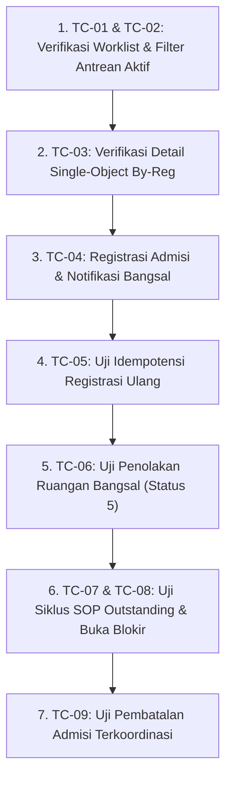

# 1. Overview & Objective

Dokumen ini merupakan **TEST-PACKAGE** resmi untuk memverifikasi fungsionalitas menyeluruh dari implementasi **Penyatuan Fitur Antrean Rawat Inap (Waiting List) ke BedUsageContext dan Migrasi Penggunaan dari Modul Admisi Ranap** pada backend (`b09-bilreg-api`) dan frontend (`c012_myhospital_web`).

Tujuan pengujian adalah memastikan:
1. **Single Source of Truth**: Seluruh manajemen antrean rawat inap terpusat di `BedUsageContext.WaitingListFeature` (`/api/bed-usage/waiting-list`) dan modul lama di `AdmisiRanapContext` telah dibersihkan secara total tanpa merusak sistem.
2. **Kesesuaian Kontrak API & Eliminasi Parsing Error**: Endpoint `GET /api/bed-usage/waiting-list/by-reg/{regId}` mengembalikan rekaman tunggal (*single-object*) atau `null`, dan endpoint `GET /api/bed-usage/waiting-list` mengembalikan daftar antrean terbungkus envelope `{ items: [...] }` yang lolos validasi skema Zod di frontend.
3. **Penyaringan Worklist Antrean Aktif yang Bersih**: Worklist antrean aktif hanya menampilkan pasien yang belum menempati tempat tidur (`0=Waiting`, `1=Reserved`, `4=Rerouted`, `5=Rejected`) dan secara ketat mengecualikan status terminal `2=Placed` (sudah masuk kamar) serta `3=Cancelled` (batal).
4. **Idempotensi Pembuatan Antrean**: Pembuatan antrean ganda (akibat koneksi lambat atau retry registrasi) mengembalikan ID antrean yang sudah ada secara aman tanpa menimbulkan pesan error atau kegagalan sistem.
5. **Notifikasi Real-Time ke Bangsal**: Penerbitan antrean baru pada pendaftaran admisi langsung memicu notifikasi event bus (`PublishWaitingListUpdatedAsync`) ke Cockpit Bangsal tujuan tanpa memerlukan refresh manual.
6. **Penegakan SOP Antrean Terlambat (*Outstanding*)**: Selama terdapat pasien antrean/reservasi yang melampaui batas waktu (*outstanding*), konsol admisi ranap secara otomatis mengunci mode tampilan ke *Outstanding Only* dan memblokir aksi pendaftaran baru hingga kasus terlambat ditindaklanjuti.
7. **Penyampaian Alasan Penolakan Ruangan**: Antrean yang ditolak oleh perawat ruangan menampilkan status `Ditolak Ruangan` beserta alasan penolakan pada drawer antrean admisi agar petugas admisi dapat segera mengalihkan pasien ke bangsal lain.
8. **Integritas Pembatalan Terkoordinasi**: Pembatalan pendaftaran rawat inap membatalkan antrean terkait di BedUsage secara konsisten.

---

# 2. Scope & Testing Principles

## 2.1 Lingkup Pengujian

- **In-Scope**:
  - Tampilan dan filter jalur antrean (*Daftar Tunggu Lane*) pada Konsol Admisi Ranap (`DaftarTungguLane.vue`).
  - Formulir dan drawer detail antrean rawat inap (`WaitingListDrawer.vue` dan `WaitingListFork.vue`).
  - Alur registrasi admisi rawat inap (pendaftaran langsung, reservasi, dan alur terotomasi) yang menerbitkan antrean.
  - Alur penolakan ruangan oleh bangsal dan rendering banner penolakan beserta alasan penolakan.
  - Mekanisme penguncian antrean terlambat (*SOP Outstanding Enforcement*) dan pembukaan blokir melalui dialog tindak lanjut (`DialogTindakLanjutOutstanding.vue`).
  - Pemanggilan REST API publik `/api/bed-usage/waiting-list` dan `/api/bed-usage/waiting-list/by-reg/{regId}`.
  - Alur pembatalan terkoordinasi admisi ranap (`AdmCoordinatedCancelCmd`).

- **Out-of-Scope**:
  - Alur transaksi billing/kasir dan pelayanan farmasi/resep rawat jalan.
  - Perubahan struktur fisik database (tabel `BILRG_BedWaitingList` tetap sama).
  - Alur klinis internal pengkajian medis perawat bangsal di luar penerimaan/penolakan antrean.

## 2.2 Prinsip Pengujian

- **Tester-Agnostic**: Instruksi pengujian disusun dalam bahasa operasional dan deskripsi visual yang dapat dieksekusi oleh siapa pun (QA, Tester, Petugas Admisi, Trainer, atau Developer).
- **Observable Behavior**: Setiap langkah berfokus pada apa yang dilihat di layar (antarmuka, badge, banner peringatan, respons data) tanpa asumsi teknis mendalam.
- **Fail-Fast**: Menemukan regresi atau anomali status seawal mungkin.

---

# 3. Test Environment & Data Setup

## 3.1 Lingkungan Pengujian

- **Aplikasi Web**: Antarmuka Modul Admisi Rawat Inap (`c012_myhospital_web`) berjalan di browser (Chrome / Edge / Firefox) pada alamat lokal atau staging (contoh: `http://localhost:5173`).
- **Layanan Backend**: API Bilreg (`b09-bilreg-api`) aktif pada branch `arf_AdmRanap` (contoh: `http://localhost:5000` atau konfigurasi reverse proxy yang aktif).
- **Basis Data**: SQL Server MyHospital terhubung dengan data master ruangan/bangsal dan registrasi.

## 3.2 Data Uji yang Diperlukan

| ID Data | Karakteristik Pasien / Antrean | Tujuan Pengujian |
| :--- | :--- | :--- |
| **DATA-01** | Pasien Antrean Aktif Baru (`status 0 = Waiting`) | Verifikasi kemunculan antrean pada lane Daftar Tunggu, badge status, dan data bangsal tujuan. |
| **DATA-02** | Pasien Antrean Dipesankan (`status 1 = Reserved`) | Verifikasi penampilan status Dipesankan pada lane antrean aktif. |
| **DATA-03** | Pasien Antrean Sudah Menempati Kamar (`status 2 = Placed`) | Verifikasi eksklusi ketat: pasien TIDAK BOLEH tampil di lane antrean aktif. |
| **DATA-04** | Pasien Antrean Dibatalkan (`status 3 = Cancelled`) | Verifikasi eksklusi ketat: pasien batal TIDAK BOLEH tampil di lane antrean aktif. |
| **DATA-05** | Pasien Antrean Ditolak Bangsal (`status 5 = Rejected`) dengan alasan penolakan terisi | Verifikasi badge `Ditolak Ruangan`, banner penolakan, penayangan alasan penolakan, dan opsi pengalihan bangsal. |
| **DATA-06** | Pasien Rawat Inap yang Belum Memiliki Antrean | Verifikasi respons `null` dari endpoint `by-reg` tanpa memicu error aplikasi. |
| **DATA-07** | Kasus Antrean / Reservasi Terlambat (*Outstanding*, lewat jadwal kedatangan) | Verifikasi aktivasi penguncian SOP Outstanding dan pemblokiran pendaftaran baru. |
| **DATA-08** | Pasien Siap Registrasi Admisi Ranap Baru | Verifikasi penerbitan antrean otomatis dan notifikasi real-time bangsal. |

---

# 4. Acceptance Criteria Traceability Matrix

| Kriteria Penerimaan Arsitektur / Issue | Test Case ID | Cakupan Verifikasi |
| :--- | :---: | :--- |
| **AC-01**: Pemanggilan endpoint antrean terpusat di `/api/bed-usage/waiting-list` | `TC-01`, `TC-03` | Pemanggilan service frontend mengarah ke controller BedUsage, format single-object / null pada `by-reg`, dan envelope `{ items: [...] }` pada list. |
| **AC-02**: Worklist antrean aktif hanya menyaring status non-terminal (0, 1, 4, 5) | `TC-01`, `TC-02` | Status `Placed (2)` dan `Cancelled (3)` tidak muncul di DaftarTungguLane. |
| **AC-03**: Idempotensi pembuatan antrean untuk registrasi yang sama | `TC-05` | Retry registrasi atau double submission tidak menghasilkan error HTTP 500 dan mengembalikan antrean aktif yang ada. |
| **AC-04**: Otomasi antrean admisi dan notifikasi real-time ke bangsal | `TC-04` | Pendaftaran admisi ranap sukses membuat antrean BedUsage dan memicu event `PublishWaitingListUpdatedAsync`. |
| **AC-05**: Penanganan antrean ditolak ruangan (status 5) | `TC-06` | Penayangan badge Ditolak Ruangan, alasan penolakan bangsal, dan opsi alih ruangan. |
| **AC-06**: Penegakan SOP Outstanding di Konsol Admisi Ranap | `TC-07`, `TC-08` | Penguncian filter ke Outstanding Only, pemblokiran pendaftaran baru saat `outstandingCount > 0`, dan pembukaan blokir setelah ditindaklanjuti. |
| **AC-07**: Integritas pembatalan terkoordinasi admisi ranap | `TC-09` | Pembatalan admisi ranap menyinkronkan status antrean ke `Cancelled (3)` tanpa error referensi modul lama. |

---

# 5. Skenario & Kasus Pengujian (Test Cases)

---

### TC-01: Verifikasi Pemuatan Daftar Tunggu Aktif melalui Endpoint Terkonsolidasi (Happy Path)
- **Tujuan**: Memastikan antrean aktif termuat dengan benar melalui endpoint `GET /api/bed-usage/waiting-list` dan ditampilkan secara visual di konsol Admisi Ranap.
- **Prasyarat**: 
  - Pengguna masuk ke aplikasi dan membuka modul **Admisi Rawat Inap**.
  - Terdapat minimal 1 data antrean dengan status *Menunggu* (DATA-01) atau *Dipesankan* (DATA-02).
- **Langkah-Langkah**:
  1. Buka halaman **Konsol Admisi Ranap**.
  2. Buka tab atau jalur tampilan **Daftar Tunggu** (*Waiting List Lane*).
  3. Buka panel *Developer Tools* browser (F12) tab **Network**, lalu amati request yang terjadi saat jalur antrean dimuat atau direfresh.
  4. Periksa kartu-kartu antrean yang tampil di layar.
- **Hasil yang Diharapkan**:
  - Request network mengarah ke URL `/api/bed-usage/waiting-list` (bukan `/api/admisi-ranap/waiting-list`).
  - Respons backend berformat envelope JSON `{ status: "success", data: { items: [ ... ] } }`.
  - Kartu antrean pasien tampil dengan informasi jelas: Nama Pasien, Nomor RM, Bangsal Tujuan, Kelas Perawatan, Prioritas, dan Badge Status (*Menunggu* atau *Dipesankan*).
  - Tidak ada pesan error Zod schema validation pada konsol browser.

---

### TC-02: Eksklusi Ketat Pasien yang Sudah Masuk Kamar (Placed) dan Dibatalkan (Cancelled)
- **Tujuan**: Memastikan pasien yang telah menempati tempat tidur (`status 2 = Placed`) atau dibatalkan (`status 3 = Cancelled`) tidak tampil di daftar antrean aktif.
- **Prasyarat**:
  - Terdapat pasien antrean yang telah dilakukan *Check-In / Rooming-In* oleh bangsal sehingga statusnya menjadi `Placed (2)` (DATA-03).
  - Terdapat pasien antrean yang telah dibatalkan admisi sehingga statusnya menjadi `Cancelled (3)` (DATA-04).
- **Langkah-Langkah**:
  1. Pada halaman **Konsol Admisi Ranap**, buka jalur **Daftar Tunggu**.
  2. Gunakan kolom pencarian antrean dengan mengetikkan Nomor RM atau Nama Pasien dari DATA-03 (pasien yang sudah menempati kamar).
  3. Bersihkan pencarian, kemudian ketikkan Nomor RM atau Nama Pasien dari DATA-04 (pasien batal).
- **Hasil yang Diharapkan**:
  - Pasien DATA-03 (`Placed`) **TIDAK DITEMUKAN** di dalam daftar antrean aktif.
  - Pasien DATA-04 (`Cancelled`) **TIDAK DITEMUKAN** di dalam daftar antrean aktif.
  - Daftar antrean murni hanya menampilkan pasien yang masih menunggu penempatan bed.

---

### TC-03: Pemuatan Detail Antrean Berdasarkan Nomor Registrasi (Single-Object by-reg Query)
- **Tujuan**: Memastikan query `GET /api/bed-usage/waiting-list/by-reg/{regId}` mengembalikan single-object terbungkus JSend, serta menangani kondisi registrasi yang belum memiliki antrean (`null`) secara mulus.
- **Prasyarat**:
  - Pasien A memiliki registrasi dan antrean aktif (DATA-01).
  - Pasien B memiliki registrasi baru tetapi belum memiliki antrean (DATA-06).
- **Langkah-Langkah**:
  1. Pilih pasien A pada konsol admisi dan buka drawer/panel detail antrean pasien.
  2. Amati request network untuk URL `/api/bed-usage/waiting-list/by-reg/{regIdPasienA}`.
  3. Beralih ke pasien B (belum ada antrean), lalu amati request network `/api/bed-usage/waiting-list/by-reg/{regIdPasienB}`.
- **Hasil yang Diharapkan**:
  - Untuk Pasien A: Respons API berupa object tunggal data antrean (bukan array), dan drawer detail antrean menampilkan data bangsal tujuan, kelas, serta catatan pemesanan dengan lengkap.
  - Untuk Pasien B: Respons API mengembalikan data bernilai `null` terbungkus status sukses `{ status: "success", data: null }`. Aplikasi tidak mengalami crash, blank screen, atau Zod schema error.

---

### TC-04: Penerbitan Antrean Otomatis Saat Registrasi Admisi Ranap dan Notifikasi Bangsal
- **Tujuan**: Memastikan proses registrasi admisi rawat inap otomatis menerbitkan antrean di BedUsage dan mengirimkan event pembaruan ke Cockpit Bangsal tujuan.
- **Prasyarat**:
  - Tersedia pasien rawat jalan / IGD yang siap didaftarkan rawat inap (DATA-08).
  - Dua jendela browser terbuka:
    - Jendela 1: Konsol Admisi Ranap.
    - Jendela 2: Konsol Cockpit Bangsal untuk bangsal tujuan (misal: Bangsal ST ANNA).
- **Langkah-Langkah**:
  1. Pada Jendela 1 (Admisi Ranap), pilih pasien DATA-08 dan lakukan **Proses Registrasi Rawat Inap**.
  2. Pilih Bangsal Tujuan (misal: ST ANNA), Kelas Rawat, dan Dokter DPJP, lalu klik tombol **Simpan / Selesaikan Pendaftaran**.
  3. Amati pesan konfirmasi pendaftaran berhasil.
  4. Amati Jendela 2 (Cockpit Bangsal ST ANNA) tanpa melakukan refresh manual halaman.
- **Hasil yang Diharapkan**:
  - Pendaftaran pendaftaran admisi berhasil tanpa kendala.
  - Pada Jendela 1 (Admisi), pasien langsung muncul pada jalur *Daftar Tunggu* dengan status *Menunggu*.
  - Pada Jendela 2 (Cockpit Bangsal), daftar antrean masuk bangsal secara real-time menampilkan pasien baru tersebut (menerima event SignalR `PublishWaitingListUpdatedAsync`).

---

### TC-05: Idempotensi Pendaftaran Antrean Ganda (Network Retry / Double Submission)
- **Tujuan**: Memastikan pengiriman permintaan antrean berulang untuk registrasi yang sama tidak menyebabkan kegagalan sistem atau data antrean terduplikasi.
- **Prasyarat**:
  - Pasien telah memiliki antrean aktif pada suatu registrasi (DATA-01).
- **Langkah-Langkah**:
  1. Melalui antarmuka atau simulasi pengiriman form registrasi ulang dengan Nomor Registrasi (`RegId`) yang sama persis dengan pasien DATA-01.
  2. Amati respons yang diterima dari backend.
  3. Periksa kembali daftar antrean di database atau konsol admisi.
- **Hasil yang Diharapkan**:
  - Sistem tidak melempar pesan error HTTP 500 (*Unique constraint violation*).
  - Sistem mengembalikan status sukses dan ID antrean aktif yang sudah ada secara idempoten.
  - Tidak tercipta baris antrean baru yang duplikat untuk nomor registrasi tersebut.

---

### TC-06: Penanganan Antrean Ditolak Ruangan (Status 5 = Rejected)
- **Tujuan**: Memastikan antrean yang ditolak oleh ruangan bangsal menampilkan badge status yang tepat, menyajikan alasan penolakan, dan memungkinkan admisi mengalihkan pasien.
- **Prasyarat**:
  - Pasien antrean yang telah ditolak oleh perawat ruangan dengan alasan penolakan tertentu (misal: "Kapasitas tempat tidur isolasi penuh") (DATA-05).
- **Langkah-Langkah**:
  1. Buka halaman **Konsol Admisi Ranap** pada jalur **Daftar Tunggu**.
  2. Temukan kartu antrean pasien DATA-05.
  3. Amati label dan warna badge status pada kartu pasien.
  4. Klik kartu pasien untuk membuka drawer detail antrean (*WaitingListDrawer*).
  5. Amati bagian atas drawer detail.
- **Hasil yang Diharapkan**:
  - Kartu antrean menampilkan badge berwarna merah bertuliskan **Ditolak Ruangan** (status 5).
  - Pada drawer detail antrean, muncul banner peringatan penolakan ruangan yang menayangkan teks alasan penolakan perawat: *"Kapasitas tempat tidur isolasi penuh"*.
  - Formulir antrean berada dalam mode yang dapat disunting untuk memungkinkan petugas memilih bangsal alternatif baru (*Reroute / Dialihkan*).

---

### TC-07: Penegakan SOP Antrean Terlambat (Outstanding Enforcement)
- **Tujuan**: Memastikan konsol admisi ranap secara otomatis mengunci tampilan kerja dan memblokir aksi pendaftaran baru selama terdapat kasus *outstanding*.
- **Prasyarat**:
  - Terdapat minimal 1 kasus reservasi / antrean pasien yang telah melampaui batas waktu kedatangan/SLA (`outstandingCount > 0`) (DATA-07).
- **Langkah-Langkah**:
  1. Buka halaman **Konsol Admisi Ranap**.
  2. Amati kategori filter yang aktif secara otomatis pada bilah filter konsol.
  3. Amati area workspace konsol.
  4. Coba lakukan klik pada tombol pendaftaran baru (misal: tombol *Proses Admisi* atau tombol *Reservasi Kamar*).
- **Hasil yang Diharapkan**:
  - Kategori filter konsol otomatis terkunci pada mode **Outstanding Only** (hanya menampilkan kasus terlambat).
  - Pada bagian atas konsol tampil banner peringatan SOP berwarna kuning/merah (*SopOutstandingAlertBanner*) yang menginstruksikan petugas untuk menyelesaikan kasus terlambat terlebih dahulu.
  - Tombol pendaftaran baru dinonaktifkan / diblokir (`isSopBlocked = true`), mencegah pembuatan registrasi baru sebelum antrean terlambat dituntaskan.

---

### TC-08: Pembukaan Blokir SOP Outstanding Setelah Tindak Lanjut Selesai
- **Tujuan**: Memastikan pemblokiran pendaftaran baru dan penguncian filter terlepas secara otomatis setelah seluruh kasus outstanding ditindaklanjuti.
- **Prasyarat**:
  - Konsol admisi berada dalam kondisi terkunci SOP Outstanding dari TC-07 (`outstandingCount > 0`).
- **Langkah-Langkah**:
  1. Klik tombol **Tindak Lanjut** pada kartu pasien outstanding, atau klik tombol tindakan pada banner SOP.
  2. Pada dialog tindak lanjut yang muncul (*DialogTindakLanjutOutstanding*), pilih opsi penyelesaian:
     - Opsi A: Jadwalkan Ulang (*Reschedule*) kedatangan pasien.
     - Opsi B: Batalkan Reservasi dengan memasukkan alasan pembatalan.
  3. Klik tombol **Simpan Tindak Lanjut**.
  4. Lakukan langkah yang sama hingga seluruh pasien pada daftar *Outstanding* terselesaikan (`outstandingCount = 0`).
  5. Amati tampilan konsol admisi ranap.
- **Hasil yang Diharapkan**:
  - Angka penghitung kasus terlambat (*outstandingCount*) berkurang hingga menjadi `0`.
  - Banner peringatan SOP otomatis menghilang dari layar.
  - Pemblokiran pendaftaran baru terbuka kembali (`isSopBlocked = false`).
  - Petugas admisi dapat kembali memilih kategori filter lain (Semua, Menunggu, dll.) dan dapat melakukan pendaftaran admisi baru secara normal.

---

### TC-09: Integritas Pembatalan Admisi Terkoordinasi (Coordinated Cancellation)
- **Tujuan**: Memastikan pembatalan registrasi admisi rawat inap membatalkan antrean di BedUsage secara sinkron tanpa error referensi modul lama.
- **Prasyarat**:
  - Pasien telah terdaftar admisi ranap dan memiliki antrean aktif (DATA-01).
- **Langkah-Langkah**:
  1. Pada konsol admisi ranap, pilih pasien DATA-01 dan buka opsi tindakan admisi.
  2. Pilih menu **Batalkan Admisi**.
  3. Masukkan alasan pembatalan (misal: "Pasien menolak dirawat inap / pulang atas permintaan sendiri").
  4. Konfirmasi pembatalan.
  5. Buka jalur **Daftar Tunggu** dan amati status antrean pasien tersebut.
- **Hasil yang Diharapkan**:
  - Pembatalan registrasi admisi berhasil tanpa pesan error internal server.
  - Antrean terkait otomatis disinkronkan ke status `Cancelled (3)` pada `BedUsageContext`.
  - Pasien langsung terhapus dari tampilan jalur antrean aktif di konsol admisi ranap.

---

# 6. Execution Sequence & Reporting Checklist

Untuk efisiensi pengujian lapangan, penguji disarankan menjalankan pengujian dengan urutan berikut:

### Lembar Ringkasan Hasil Uji (Execution Checklist)

| No. | Kode Test Case | Kategori | Hasil Uji (PASS / FAIL) | Catatan Temuan & Bukti |
| :---: | :--- | :--- | :---: | :--- |
| 1 | **TC-01** | Worklist Antrean Aktif via BedUsage | | |
| 2 | **TC-02** | Eksklusi Status Placed & Cancelled | | |
| 3 | **TC-03** | Single-Object By-Reg Query & Null Handling | | |
| 4 | **TC-04** | Registrasi Admisi & Event Notifikasi Bangsal | | |
| 5 | **TC-05** | Idempotensi Pendaftaran Ganda | | |
| 6 | **TC-06** | Penanganan Antrean Ditolak Ruangan (Status 5) | | |
| 7 | **TC-07** | Penegakan Penguncian SOP Outstanding | | |
| 8 | **TC-08** | Pelepasan Blokir SOP Pasca Tindak Lanjut | | |
| 9 | **TC-09** | Pembatalan Admisi Terkoordinasi | | |

---

# 7. Next Steps

Setelah dokumen paket pengujian ini disetujui:
1. Penguji manusia (*Human Tester*) dapat mengeksekusi test cases di atas pada lingkungan pengujian browser dan merekam hasil pengamatan ke dalam artefak pelaporan **`TEST-EXECUTION.md`**.
2. Jika seluruh pengujian berstatus **PASS**, gerbang **`TEST PASSED`** dapat diberikan secara resmi oleh `ica-tester`.
3. Jika ditemukan cacat (*defect* / **FAIL**), buat rekaman temuan dengan bukti konkret untuk diserahkan ke peran **`ica-issuer`** guna pembukaan tiket perbaikan (*Bug Issue*).
