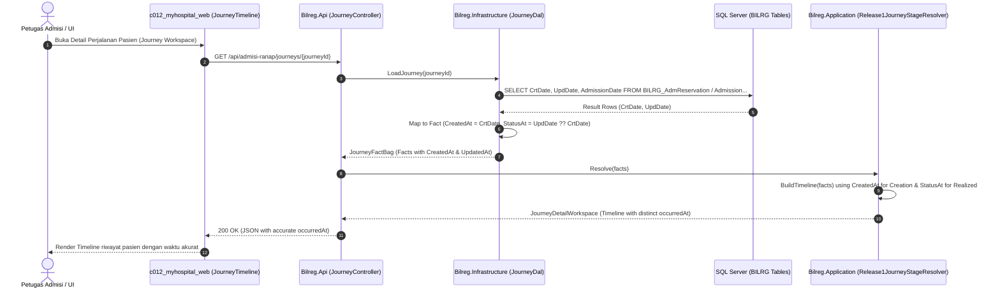

# 1. Overview

Arsitektur ini mendefinisikan realisasi teknis untuk mengoreksi stempel waktu (*timestamp*) pada riwayat kronologis perjalanan pasien rawat inap (*Admisi Ranap Journey*) pada endpoint `GET /api/admisi-ranap/journeys/{journeyId}`.

Koreksi ini mengatasi cacat di mana seluruh peristiwa (*timeline events*) dalam satu siklus perjalanan pasien menghasilkan stempel waktu `occurredAt` yang identik (misal: waktu pembuatan reservasi, realisasi reservasi, dan pendaftaran admisi tercatat pada detik yang sama), padahal pada basis data tercatat perbedaan waktu yang nyata antara pembuatan rekaman (*creation*) dan pembaruan status (*status update/realization*).

Perbaikan mencakup:
1. **Pengayaan Kontrak Fact Agregasi**: Memperluas DTO fakta `JourneyContracts.cs` di backend `b09-bilreg-api` dengan dimensi stempel waktu inisiasi (`CreatedAt`) dan pembaruan (`UpdatedAt`).
2. **Penyempurnaan Ekstraksi Data Access Layer (DAL)**: Memetakan kolom `CrtDate` dan `UpdDate` dari kueri SQL yang telah tersedia di `JourneyDal.cs` dan `JourneyDal.Batch.cs` tanpa menimbulkan round-trip kueri baru ke basis data.
3. **Penataan Ulang Pemetaan Peristiwa di Resolver**: Memperbaiki logika `Release1JourneyStageResolver.cs:BuildTimeline` agar memetakan peristiwa pembentukan ke waktu pembuatan dan peristiwa perubahan status ke waktu mutasi status terkait.
4. **Penguatan Verifikasi Uji**: Menambahkan skenario pengujian unit dan integrasi dengan disparitas waktu eksplisit pada test suite `Bilreg.Test`.

Originating Bug Issue:
- [ADM-RANAP-JOURNEY-TIMELINE-BUG-ISSUE.md](file:///d:/project_aktif/project_MyHospitalWeb/b09-bilreg-api/docs/contexts/admisi/ADM-RANAP-JOURNEY-TIMELINE-BUG-ISSUE.md) (`ISS-ADM-REG-008`)

---

# 2. Architectural Basis

## Business Context

- **Outcome Registrasi**: [OC-ADM-REGISTRASI.md](file:///d:/project_aktif/project_MyHospitalWeb/b21-myhosweb-system/outcomes/OC-ADM-REGISTRASI.md)  
  Prinsip transparansi operasional dan keandalan rekam jejak: Riwayat perjalanan pasien rawat inap harus mencerminkan titik-titik kronologis pelayanan secara akurat sebagai instrumen monitoring mutu loket dan pemantauan waktu tunggu (*waiting time*).
- **Domain Context**:
  - `03-ADMISSION-DOMAIN.md`: Mengelola siklus hidup permintaan opname, reservasi kamar, registrasi admisi ranap, dan antrean bangsal rawat inap (*waiting list*).

## Analysis Input

- **BUG-INVESTIGATION**: [ADM-RANAP-JOURNEY-TIMELINE-BUG-INVESTIGATION.md](file:///d:/project_aktif/project_MyHospitalWeb/b09-bilreg-api/docs/contexts/admisi/ADM-RANAP-JOURNEY-TIMELINE-BUG-INVESTIGATION.md)  
  Realisasi keputusan investigasi dan resolusi dialog (*Approved Decisions & Closed Gaps*):
  - **OQ-01 (Anomali Data Legacy `UpdDate < CrtDate`)**: *Tampilkan apa adanya*. Sistem tidak melakukan swap atau clamping artifisial, melainkan menyajikan data sesuai rekaman audit trail riil database.
  - **OQ-02 (Prioritas Tanggal `AdmissionRegistered`)**: Menggunakan `AdmissionDate` (tanggal medis admisi) sebagai prioritas utama dengan fallback ke `CrtDate`.
  - **OQ-03 (Urutan Array `timeline[]`)**: Mempertahankan urutan kategori siklus hidup saat ini (Opname -> Reservasi -> Admisi -> Waiting List) demi menjaga stabilitas urutan bagi frontend `c012_myhospital_web`.
  - **OQ-04 (Cakupan Penambahan `CreatedAt` pada DTO Fact)**: Dibatasi pada 3 entitas dual-event (`OpnameRequest`, `Reservation`, `Admission`). Entitas `WaitingList` tetap menggunakan `StatusAt` tunggal.
  - **OQ-05 (Versi Endpoint API)**: Tetap v1 tanpa *version bumping* karena kompatibilitas kontrak JSON wire format dipertahankan penuh.

```text
ISSUE (ISS-ADM-REG-008)
        +
BUG-INVESTIGATION (ADM-RANAP-JOURNEY-TIMELINE-BUG-INVESTIGATION)
        ↓
    ARCHITECTURE (ADM-RANAP-JOURNEY-TIMELINE-ARCHITECTURE)
```

---

# 3. Scope

## Included

1. **Backend - Kontrak Fakta Agregasi (`b09-bilreg-api`)**:
   - Pemutakhiran record `OpnameRequestJourneyFact` di `JourneyContracts.cs`: penambahan parameter opsional `DateTime? CreatedAt = null`.
   - Pemutakhiran record `ReservationJourneyFact` di `JourneyContracts.cs`: penambahan parameter opsional `DateTime? CreatedAt = null`.
   - Pemutakhiran record `AdmissionJourneyFact` di `JourneyContracts.cs`: penambahan parameter opsional `DateTime? CreatedAt = null` dan `DateTime? UpdatedAt = null`.
2. **Backend - Lapisan Akses Data (`b09-bilreg-api`)**:
   - Pemutakhiran `JourneyDal.cs`:
     - `LoadOpnameJourney`: memetakan `CreatedAt = opn.CrtDate`, `StatusAt = opn.UpdDate == VoidSentinel ? opn.CrtDate : opn.UpdDate`.
     - `LoadReservationJourney`: memetakan `CreatedAt = rsv.CrtDate`, `StatusAt = rsv.UpdDate == VoidSentinel ? rsv.CrtDate : rsv.UpdDate`.
     - `AssembleAdmissionBag`: memetakan `CreatedAt = adm.CrtDate`, `AdmissionAt = adm.AdmissionDate`, `UpdatedAt = adm.UpdDate == VoidSentinel ? null : adm.UpdDate`. Fallback saat rekaman admisi hilang tetap mempertahankan `CreatedAt = AdmissionDate`.
   - Pemutakhiran `JourneyDal.Batch.cs`:
     - `FoldOpnameJourney`: memetakan `CreatedAt = opn.CrtDate`.
     - `FoldReservationJourney`: memetakan `CreatedAt = rsv.CrtDate`.
3. **Backend - Timeline Event Resolver (`b09-bilreg-api`)**:
   - Pemutakhiran `Release1JourneyStageResolver.cs:BuildTimeline`:
     - `OpnameRequested` -> `opn.CreatedAt ?? opn.StatusAt`
     - `ReservationCreated` -> `rsv.CreatedAt ?? rsv.StatusAt`
     - Status mutasi Opname/Reservasi -> tetap `StatusAt`
     - `AdmissionRegistered` -> `admission.AdmissionAt ?? admission.CreatedAt`
     - `AdmissionUpdated` / `AdmissionCancelled` -> `admission.UpdatedAt ?? admission.AdmissionAt`
4. **Backend - Test Suite (`b09-bilreg-api`)**:
   - `Release1JourneyStageResolverTest.cs`: penambahan kasus uji disparitas waktu pembuatan vs mutasi status pada reservasi, opname, dan admisi.
   - `JourneyDalIntegrationTest.cs`: perbaikan helper seed data uji agar memberikan jeda waktu nyata antara `CrtDate` dan `UpdDate`, serta menambahkan assert verifikasi elemen timeline.

## Excluded

1. **Perubahan Skema Basis Data (DDL)**: Tidak ada pembuatan tabel baru, penambahan kolom, maupun pengubahan indeks database.
2. **Perubahan Kontrak Wire Format JSON**: Struktur skema wire response `JourneyDetailWorkspace.timeline` tetap berformat `{ kind: number, occurredAt: string | null, relatedRecordId: string | null, summary: string }`.
3. **Komponen Frontend (`c012_myhospital_web`)**: Komponen `JourneyTimeline.vue` dan skema Zod `ranapJourney.ts` sudah siap mengonsumsi nilai `occurredAt` yang benar tanpa perubahan kode.
4. **Logika Tahapan & Aksi Admisi**: Tidak mengubah penentuan tahap operasional (`Stage`), evaluasi hak aksi (`AllowedActions`), perhitungan sorting list (`SortAt`), maupun kueri CTE listing.

---

# 4. Technical Decisions

### TD-01: Perluasan Kontrak Fact DTO yang Kompatibel Mundur (*Backward-Compatible Record Expansion*)
- **Keputusan**: Penambahan properti waktu inisiasi (`CreatedAt`) dan pembaruan (`UpdatedAt`) dideklarasikan dengan nilai default `= null` pada record C#.
- **Alasan**: Menghindari kerusakan kompilasi pada titik konstruksi lama, pengujian unit lama, maupun instansiasi fallback (`JourneyIdFactory.cs:93`).

### TD-02: Zero-Overhead Data Extraction di Lapisan DAL
- **Keputusan**: Nilai `CrtDate` dan `UpdDate` diekstrak langsung dari kueri Dapper SQL yang sudah aktif saat ini.
- **Alasan**: Kolom `CrtDate` dan `UpdDate` telah dimasukkan dalam klausa `SELECT` tabel `BILRG_AdmReservation`, `BILRG_AdmOpnameRequest`, dan `BILRG_AdmAdmission`. Dengan demikian, tidak diperlukan kueri tambahan, join baru, maupun modifikasi round-trip database.
- **Aturan Nilai Sentinel**: Kolom `UpdDate` yang bernilai `3000-01-01` (`VoidSentinel`) dipetakan menjadi `null` untuk properti `UpdatedAt`.

### TD-03: Resolusi Waktu Peristiwa Deterministik & Resilient
- **Keputusan**: Menggunakan pemetaan deterministik dengan *fallback chaining*:
  - Pembuatan Opname: `opn.CreatedAt ?? opn.StatusAt`
  - Perubahan Status Opname: `opn.StatusAt`
  - Pembuatan Reservasi: `rsv.CreatedAt ?? rsv.StatusAt`
  - Perubahan Status Reservasi: `rsv.StatusAt`
  - Pendaftaran Admisi: `admission.AdmissionAt ?? admission.CreatedAt`
  - Pembaruan/Pembatalan Admisi: `admission.UpdatedAt ?? admission.AdmissionAt`
- **Alasan**: Menjamin sistem tidak pernah melempar *NullReferenceException* atau menghasilkan tanggal kosong mendadak jika ada rekaman historis yang kehilangan salah satu stempel waktu.

### TD-04: Kebijakan Integritas Audit Trail (Non-Swapping Policy)
- **Keputusan**: Sistem tidak melakukan penukaran tanggal atau pembatasan artifisial (*no artificial clamping or swapping*) jika ditemukan data legacy di mana `UpdDate < CrtDate`.
- **Alasan**: Menjaga prinsip kepatuhan audit medis bahwa sistem menyajikan representasi faktual dari basis data apa adanya tanpa rekayasa data di lapisan logika bisnis.

### TD-05: Preservasi Urutan Kategori Timeline
- **Keputusan**: Susunan elemen timeline tetap dikelompokkan berdasarkan blok siklus admisi:
  1. Peristiwa Opname Request (jika ada)
  2. Peristiwa Reservasi (jika ada)
  3. Peristiwa Admisi (jika ada)
  4. Peristiwa Antrean Bangsal (*Waiting List*, terurut internal `OrderBy(w => w.StatusAt)`)
- **Alasan**: Mencegah pergeseran urutan tak terduga pada antarmuka pengguna `JourneyTimeline.vue` yang mengandalkan kebiasaan alur tahapan registrasi.

---

# 5. Component Responsibilities

| Komponen | Tanggung Jawab Teknis |
| :--- | :--- |
| **`JourneyContracts.cs`** | Menyediakan definisi kontrak DTO fakta agregasi (`OpnameRequestJourneyFact`, `ReservationJourneyFact`, `AdmissionJourneyFact`) yang menampung multi-dimensi waktu (`CreatedAt`, `StatusAt`, `AdmissionAt`, `UpdatedAt`). |
| **`JourneyDal.cs` & `JourneyDal.Batch.cs`** | Mengekstrak data rekaman admisi dari basis data SQL Server dan mengisi atribut waktu `CreatedAt` dan `UpdatedAt` secara akurat pada DTO fakta. |
| **`Release1JourneyStageResolver.cs`** | Mentransformasikan agregasi fakta menjadi model presentasi workspace, khususnya menyusun array kronologis `BuildTimeline` dengan stempel waktu yang bersesuaian. |
| **`JourneyController.cs`** | Mengekspos endpoint HTTP REST `GET /api/admisi-ranap/journeys/{journeyId}` yang mengembalikan representasi JSON `JourneyDetailWorkspace`. |
| **`JourneyTimeline.vue` (`c012_myhospital_web`)** | Mengonsumsi array `timeline[]` dan merender riwayat perjalanan pasien rawat inap beserta stempel waktu terformat. |

---

# 6. Integration Design



---

# 7. Data Ownership

| Entitas Data | Pemilik Otoritatif (*Authoritative Owner*) | Keterangan Penggunaan pada Journey |
| :--- | :--- | :--- |
| **Opname Request (`BILRG_AdmOpnameRequest`)** | Konteks Opname Request (`OpnameRequestFeature`) | `CrtDate` sebagai waktu requested; `UpdDate` sebagai waktu fulfilled/cancelled. |
| **Reservasi (`BILRG_AdmReservation`)** | Konteks Reservasi (`ReservationFeature`) | `CrtDate` sebagai waktu reservasi dibuat; `UpdDate` sebagai waktu realisasi/pembatalan/pemeliharaan. |
| **Admisi (`BILRG_AdmAdmission`)** | Konteks Admisi (`AdmissionFeature`) | `AdmissionDate` (atau `CrtDate`) sebagai waktu didaftarkan; `UpdDate` sebagai waktu update/pembatalan. |
| **Waiting List (`BILRG_BedWaitingList`)** | Konteks Antrean Bangsal (`WaitingListFeature`) | `UpdDate == Void ? CrtDate : UpdDate` sebagai waktu status antrean kamar. |
| **Journey Aggregation (`JourneyFeature`)** | Konteks Admisi Ranap (`JourneyFeature`) | Agregator read-only (tidak memiliki tabel tersendiri). |

---

# 8. Database Design

## New Tables
*Tidak ada tabel baru.*

## Modified Tables
*Tidak ada modifikasi tabel atau perubahan skema DDL.*

## Column Utilization (Read-Only)
| Tabel Basis Data | Kolom yang Dimanfaatkan | Penggunaan pada Journey Timeline |
| :--- | :--- | :--- |
| `BILRG_AdmOpnameRequest` | `CrtDate`, `UpdDate` | `CreatedAt` (OpnameRequested), `StatusAt` (OpnameFulfilled/Cancelled) |
| `BILRG_AdmReservation` | `CrtDate`, `UpdDate` | `CreatedAt` (ReservationCreated), `StatusAt` (ReservationRealized/Cancelled/Maintained) |
| `BILRG_AdmAdmission` | `AdmissionDate`, `CrtDate`, `UpdDate` | `AdmissionAt` & `CreatedAt` (AdmissionRegistered), `UpdatedAt` (AdmissionUpdated/Cancelled) |
| `BILRG_BedWaitingList` | `CrtDate`, `UpdDate` | `StatusAt` (WaitingListCreated/Accepted/Closed/Cancelled) |

## Migration Considerations
*Nol migrasi data. Tidak diperlukan script backfill atau pembaruan rekaman basis data eksisting.*

---

# 9. Cross-Cutting Concerns

- **Performa & Latensi**: Nol penambahan overhead CPU atau database I/O, karena kolom yang dibaca sudah tercakup dalam kueri SQL DAL saat ini.
- **Keandalan & Ketahanan (*Resilience*)**: Penggunaan operator *null-coalescing* (`??`) menjamin data rekaman lama atau data tidak lengkap tetap dapat di-render tanpa crash.
- **Audit & Kepatuhan Medis**: Visualisasi kronologi yang akurat mendukung proses akreditasi dan audit rekam medis pasien rawat inap.

---

# 10. Implementation Constraints

1. **Framework & Bahasa**: .NET 8 dengan C# 12, memanfaatkan fitur positional record DTO.
2. **Kesesuaian Nilai Sentinel**: Penanganan sentinel void `3000-01-01` (`VoidSentinel`) harus konsisten di seluruh lapisan DAL agar tidak lolos ke representasi waktu JSON.
3. **Kompatibilitas Wire Format**: Respons JSON API v1 `GET /api/admisi-ranap/journeys/{journeyId}` tidak boleh mengalami perubahan tipe atau nama properti.
4. **Disiplin Pengujian**: Setiap perubahan pada logika resolver wajib disertai dengan pengujian unit di `Release1JourneyStageResolverTest.cs` yang menguji disparitas waktu nyata.

---

# 11. Acceptance Conditions

Implementation dianggap selesai secara arsitektur apabila memenuhi kriteria berikut:

- **AC-01**: Unit test `Release1JourneyStageResolverTest` membuktikan bahwa untuk data reservasi dengan `CrtDate = 09:16:57` dan `UpdDate = 09:18:51`, timeline menghasilkan `kind 3 (ReservationCreated)` dengan `occurredAt = 09:16:57` dan `kind 6 (ReservationRealized)` dengan `occurredAt = 09:18:51`.
- **AC-02**: Unit test `Release1JourneyStageResolverTest` membuktikan bahwa untuk data opname request dengan `CrtDate != UpdDate`, `kind 0 (OpnameRequested)` menggunakan `CreatedAt` dan `kind 2 (OpnameFulfilled)` menggunakan `StatusAt`.
- **AC-03**: Unit test `Release1JourneyStageResolverTest` membuktikan bahwa untuk admisi yang diperbarui (`Status = Updated`), `kind 7 (AdmissionRegistered)` menggunakan `AdmissionAt` dan `kind 8 (AdmissionUpdated)` menggunakan `UpdatedAt`.
- **AC-04**: Integration test `JourneyDalIntegrationTest` dengan seed `CrtDate != UpdDate` memuat `CreatedAt` pada DTO fact dan memvalidasi kronologi riwayat end-to-end.
- **AC-05**: Seluruh rangkaian tes pada proyek `Bilreg.Test` berhasil dijalankan dan lulus 100% (`dotnet test`).
