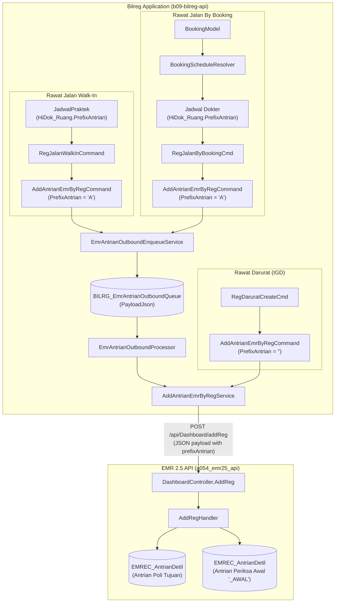

# 1. Overview

Arsitektur ini mendefinisikan realisasi teknis pengiriman atribut kode prefix antrian (`PrefixAntrian`) dari subsistem pendaftaran Bilreg (`b09-bilreg-api`) menuju dasbor EMR25 (`a054_emr25_api`) melalui endpoint `POST api/Dashboard/addReg` pada alur pendaftaran Rawat Jalan (Walk-In dan By Booking).

Nilai `PrefixAntrian` bersumber dari tabel master ruangan lokal `HiDok_Ruang` melalui entitas jadwal praktek dokter yang bertugas. Pelayanan Rawat Darurat (IGD) dikecualikan secara fungsional sehingga tetap mengirimkan nilai default string kosong (`""`). Seluruh alur tetap memanfaatkan mekanisme penyimpanan antrian lokal *Transactional Outbox* (`BILRG_EmrAntrianOutboundQueue`) tanpa memerlukan penambahan tabel atau kolom fisik baru pada database lokal.

Referenced Artifacts:
- ISSUE: [ADMISI-EMR-PREFIX-ANTRIAN-ISSUE.md](file:///d:/project_aktif/project_MyHospitalWeb/b09-bilreg-api/docs/contexts/admisi/ADMISI-EMR-PREFIX-ANTRIAN-ISSUE.md) (`ISSUE-BILREG-EMR-PREFIX-ANTRIAN-001`)
- FEASIBILITY-ASSESSMENT: [ADMISI-EMR-PREFIX-ANTRIAN-FEASIBILITY-ASSESSMENT.md](file:///d:/project_aktif/project_MyHospitalWeb/b09-bilreg-api/docs/contexts/admisi/ADMISI-EMR-PREFIX-ANTRIAN-FEASIBILITY-ASSESSMENT.md)

---

# 2. Architectural Basis

## Business Context

- DOMAIN: [admisi-rajal-domain.md](file:///d:/project_aktif/project_MyHospitalWeb/b09-bilreg-api/docs/contexts/admisi-rajal/admisi-rajal-domain.md)

Dalam domain pendaftaran Rawat Jalan, registrasi pasien menghubungkan pasien dengan jadwal praktek dokter di poliklinik tertentu. Setiap ruangan poliklinik memiliki identitas antrian fisik yang dapat diawali dengan kode prefix (misal: "A" untuk Poliklinik Penyakit Dalam, "B" untuk Poliklinik Anak). Pengiriman kode prefix antrian ke sistem EMR diperlukan agar nomor antrian yang tampil pada dasbor pemeriksaan dokter dan unit periksa awal selaras dengan tiket antrian fisik pasien.

## Analysis Input

Keputusan analisis kelayakan yang direalisasikan dalam arsitektur ini:
- **GAP-001:** Penambahan parameter ke-10 `string PrefixAntrian = ""` pada record DTO `AddAntrianEmrByRegCommand` dengan nilai default guna memastikan *zero breaking change*.
- **GAP-002:** Ekstraksi nilai prefix ruang dari objek jadwal (`schedule.LegacyJadwal.Ruang` / `schedule.Effective.Ruang`) pada use case `RegJalanWalkInCommand`.
- **GAP-003 & OQ-001:** Resolusi jadwal dokter booking pada `RegJalanByBookingCmd` memanfaatkan `BookingScheduleResolver.Resolve` guna mendapatkan `Ruang.PrefixAntrian`.
- **GAP-004:** Penambahan suite unit test untuk memverifikasi serialisasi outbox queue dan pemetaan handler.
- **OQ-002:** Penerapan sanitasi defensif (`Trim` dan pembatasan maksimal 2 karakter) pada nilai prefix sebelum dibungkus ke dalam DTO.
- **IGD Exclusion:** Alur IGD (`RegDaruratCreateCmd`) tidak menggunakan prefix antrian dan tetap mengirimkan nilai string kosong (`""`).

```text
DOMAIN (admisi-rajal-domain)
        +
FEASIBILITY-ASSESSMENT (ADMISI-EMR-PREFIX-ANTRIAN-FEASIBILITY-ASSESSMENT)
        ↓
    ARCHITECTURE (ADMISI-EMR-PREFIX-ANTRIAN-ARCHITECTURE)
```

---

# 3. Scope

## Included

1. Penambahan parameter opsional `string PrefixAntrian = ""` pada kontrak record DTO `AddAntrianEmrByRegCommand`.
2. Pengambilan dan sanitasi nilai `PrefixAntrian` pada handler registrasi Rawat Jalan Walk-In (`RegJalanWalkInCommand`).
3. Resolusi jadwal praktek dan pengambilan nilai `PrefixAntrian` pada handler registrasi Rawat Jalan By Booking (`RegJalanByBookingCmd`).
4. Penyimpanan data `PrefixAntrian` ke dalam kolom `PayloadJson` pada tabel lokal `BILRG_EmrAntrianOutboundQueue`.
5. Verifikasi pengiriman payload JSON yang memuat `"prefixAntrian"` ke endpoint EMR25 `POST api/Dashboard/addReg`.
6. Pengujian unit (unit tests) mencakup serialisasi payload outbox dan pemetaan handler registrasi.

## Excluded

1. Penambahan kolom fisik atau tabel baru di database SQL Server (memanfaatkan kolom `PayloadJson` yang sudah ada).
2. Perubahan kode atau endpoint di sisi servis EMR25 (`a054_emr25_api`), karena EMR25 telah siap menerima `PrefixAntrian`.
3. Pengiriman prefix antrian untuk alur pendaftaran Rawat Darurat / IGD (IGD tetap mengirimkan string kosong `""`).
4. Modifikasi jadwal atau mekanisme pemrosesan background worker `EmrAntrianOutboundProcessor`.

---

# 4. Technical Decisions

### TD-01: Positional Record Backward Compatibility
Kontrak DTO `AddAntrianEmrByRegCommand` di [IDashboardEmrAddRegService.cs](file:///d:/project_aktif/project_MyHospitalWeb/b09-bilreg-api/src/bilreg/Bilreg.Application/AdmisiContext/RegFeature/IDashboardEmrAddRegService.cs) diperbarui dengan menambahkan parameter di posisi paling akhir dengan nilai default string kosong:
```csharp
public record AddAntrianEmrByRegCommand
(
    string RegId,
    string BookingId,
    string PasienId,
    string PasienName,
    string LayananId,
    string DokterId,
    string TglBerobat,
    string JamJadwal,
    int NoAntrian,
    string PrefixAntrian = ""
);
```
Pendekatan ini menjamin kompatibilitas biner dan kode sumber (*backward compatibility*); pemanggil yang belum menyertakan parameter ke-10 (seperti IGD) tetap terkompilasi dan berjalan normal.

### TD-02: Defensive Normalization & Length Boundary
Sebelum nilai prefix dimasukkan ke dalam DTO `AddAntrianEmrByRegCommand`, dilakukan sanitasi defensif:
```csharp
var prefix = (rawPrefix ?? string.Empty).Trim();
if (prefix.Length > 2)
    prefix = prefix.Substring(0, 2);
```
Hal ini memastikan nilai yang dikirim tidak pernah `null` dan tidak melebihi alokasi panjang kolom `PrefixAntrian` (2 karakter) pada tabel database downstream EMR (`EMREC_AntrianDetil`).

### TD-03: Zero-Query Prefix Extraction on Walk-In
Pada use case `RegJalanWalkInCommand`, pemanggilan `BookingScheduleResolver.ResolveWalkIn(...)` telah memuat entitas `RuangType` yang di-hydrate dari tabel `HiDok_Ruang`. Nilai prefix diambil langsung dari:
```csharp
var prefixAntrian = NormalizePrefix(schedule.LegacyJadwal.Ruang?.PrefixAntrian 
    ?? schedule.Effective.Ruang?.PrefixAntrian);
```
Tidak ada query database tambahan yang dieksekusi saat registrasi walk-in.

### TD-04: Practice Schedule Resolution on By Booking
Pada use case `RegJalanByBookingCmd`, handler telah memiliki dependensi `_featureResolver` atau dapat me-resolve jadwal booking dokter menggunakan tanggal berobat, jam praktek, dan dokter dari `BookingModel`:
```csharp
var schedule = BookingScheduleResolver.Resolve(
    _featureResolver, _jadwalRepo, booking.Dokter, booking.TglBerobat, booking.JamPraktek, allowSynthetic: true);
var prefixAntrian = NormalizePrefix(schedule.LegacyJadwal.Ruang?.PrefixAntrian 
    ?? schedule.Effective.Ruang?.PrefixAntrian);
```
Hal ini memastikan kode ruangan dan prefix yang diperoleh akurat sesuai jadwal praktek yang sedang berlaku pada hari tersebut.

### TD-05: Outbox Serialization via Existing NVARCHAR(MAX) Payload
Alur pengiriman Rawat Jalan tetap mempertahankan *Transactional Outbox Pattern*:
1. DTO `AddAntrianEmrByRegCommand` di-serialize menjadi string JSON oleh `EmrAntrianOutboundPayloadBuilder.SerializeReg(emrPayload)`.
2. Serializer `System.Text.Json` (dengan camelCase policy) otomatis menghasilkan properti `"prefixAntrian": "A"`.
3. String JSON disimpan ke kolom `PayloadJson` pada tabel `BILRG_EmrAntrianOutboundQueue` di dalam transaksi database yang sama dengan data registrasi (`TransHelper.NewScope()`).
4. Worker `EmrAntrianOutboundProcessor` mengambil record antrian dan memanggil `AddAntrianEmrByRegService.Send(...)` untuk melakukan HTTP POST ke EMR25.

---

# 5. Component Responsibilities

| Component | Layer | Responsibility |
|---|---|---|
| `AddAntrianEmrByRegCommand` | `Bilreg.Application` | Kontrak data (DTO) antrian pendaftaran ke EMR, memuat properti `PrefixAntrian`. |
| `RegJalanWalkInCommand` | `Bilreg.Application` | Mengekstraksi prefix ruang dari schedule walk-in, menormalisasi, dan membentuk `AddAntrianEmrByRegCommand`. |
| `RegJalanByBookingCmd` | `Bilreg.Application` | Me-resolve jadwal dokter booking untuk mendapatkan prefix ruang, menormalisasi, dan membentuk `AddAntrianEmrByRegCommand`. |
| `RegDaruratCreateCmd` | `Bilreg.Application` | Membentuk `AddAntrianEmrByRegCommand` untuk IGD dengan `PrefixAntrian = ""` (default). |
| `EmrAntrianOutboundPayloadBuilder` | `Bilreg.Application` | Melakukan serialisasi dan deserialisasi DTO ke/dari string JSON outbox queue. |
| `EmrAntrianOutboundEnqueueService` | `Bilreg.Application` | Menyimpan record queue outbox ke tabel `BILRG_EmrAntrianOutboundQueue`. |
| `AddAntrianEmrByRegService` | `Bilreg.Infrastructure` | Melakukan pemanggilan HTTP POST ke endpoint EMR25 `{BaseApiUrl}/api/Dashboard/addReg`. |
| `RuangRepo` / `RuangDal` | `Bilreg.Infrastructure` | Mengelola data master `HiDok_Ruang` yang dibaca saat query jadwal dokter. |

---

# 6. Integration Design

| Source | Target | Purpose | Protocol / Payload |
|---|---|---|---|
| `RegJalanWalkInCommand` | `EmrAntrianOutboundEnqueueService` | Pendaftaran antrian pendaftaran Walk-In ke outbox lokal | In-process call, `AddAntrianEmrByRegCommand` (PrefixAntrian terisi) |
| `RegJalanByBookingCmd` | `EmrAntrianOutboundEnqueueService` | Pendaftaran antrian pendaftaran By Booking ke outbox lokal | In-process call, `AddAntrianEmrByRegCommand` (PrefixAntrian terisi) |
| `RegDaruratCreateCmd` | `IAddAntrianEmrByRegService` | Pengiriman antrian pendaftaran IGD langsung ke EMR | In-process call, `AddAntrianEmrByRegCommand` (PrefixAntrian = `""`) |
| `EmrAntrianOutboundProcessor` | `IEmrAntrianOutboundIntegration` | Pengambilan antrian lokal dan pengiriman ke gateway EMR | In-process call via outbox loop |
| `AddAntrianEmrByRegService` | EMR25 `DashboardController.AddReg` | Mendaftarkan antrian registrasi ke dasbor EMR25 | HTTP POST JSON ke `/api/Dashboard/addReg` |

### Diagram Alur Data



---

# 7. Data Ownership

| Data | Owner | Storage / Location |
|---|---|---|
| Master Ruangan & Prefix Antrian | Master Data Jadwal (Bilreg) | SQL Server: `HiDok_Ruang` (`RuangId`, `RuangName`, `PrefixAntrian`) |
| Outbound Queue Message Payload | Admisi Context (Bilreg) | SQL Server: `BILRG_EmrAntrianOutboundQueue` (kolom `PayloadJson`) |
| Antrian Pasien Poliklinik & Awal | Dashboard Context (EMR25) | SQL Server: `EMREC_Antrian` & `EMREC_AntrianDetil` (`PrefixAntrian`) |

---

# 8. Database Design

## New Tables
Tidak ada (*None required*).

## Modified Tables
Tidak ada modifikasi skema DDL (*None required*). Nilai properti baru secara otomatis ditampung di dalam kolom `PayloadJson` (`NVARCHAR(MAX)`) pada tabel `BILRG_EmrAntrianOutboundQueue`.

## Relationships
Hubungan antar-tabel yang sudah ada tetap dipertahankan:
- `BILRG_JadwalPraktek.RuangId` -> `HiDok_Ruang.RuangId`
- `BILRG_JadwalPraktekHarian.RuangId` -> `HiDok_Ruang.RuangId`
- `ta_jadwal_dokter.fs_kd_fruang` -> `HiDok_Ruang.RuangID`

## Migration Considerations
Tidak ada migrasi skema database yang diperlukan. Pendaftaran yang telah terjadi sebelum implementasi tetap berada di tabel outbox tanpa gangguan, dan saat diproses tetap valid karena `PrefixAntrian` bersifat opsional di EMR25.

---

# 9. Cross-Cutting Concerns

### Resilience & Reliability
- Mekanisme *Transactional Outbox* menjamin bahwa antrian Rawat Jalan hanya akan di-enqueue jika transaksi pendaftaran pasien berhasil di-commit secara lokal.
- Kegagalan konektivitas HTTP ke EMR25 tidak membatalkan registrasi pasien di loket. Background worker outbox akan melakukan percobaan ulang (*retry*) secara berkala.

### Data Defensive Sanitization
- Fungsi normalisasi prefix menjamin bahwa nilai `null` diubah menjadi string kosong `""`.
- Nilai prefix yang melebihi batas 2 karakter otomatis dipotong agar tidak memicu error pemotongan string di downstream database EMR.

---

# 10. Implementation Constraints

1. **Clean Architecture Isolation:** Modifikasi kontrak DTO `AddAntrianEmrByRegCommand` berada di layer `Bilreg.Application` tanpa menambah dependensi ke layer luar.
2. **Backward Compatibility:** Parameter `PrefixAntrian` pada `AddAntrianEmrByRegCommand` wajib memiliki default value `""` dan diletakkan pada posisi parameter terakhir.
3. **No Database Schema Changes:** Dilarang menambahkan kolom fisik baru pada tabel lokal `BILRG_EmrAntrianOutboundQueue` maupun tabel transaksi pendaftaran lainnya.
4. **IGD Isolation:** Handler `RegDaruratCreateCmd` tidak boleh dihubungkan dengan lookup ruang; parameter `PrefixAntrian` pada registrasi IGD harus tetap kosong `""`.

---

# 11. Acceptance Conditions

1. Kontrak `AddAntrianEmrByRegCommand` memiliki 10 parameter dengan parameter ke-10: `string PrefixAntrian = ""`.
2. Saat pendaftaran Rawat Jalan Walk-In (`RegJalanWalkInCommand`), antrian yang tersimpan pada tabel `BILRG_EmrAntrianOutboundQueue` memiliki field `"prefixAntrian"` dalam JSON-nya yang nilainya sesuai dengan `PrefixAntrian` pada master ruang terkait.
3. Saat pendaftaran Rawat Jalan By Booking (`RegJalanByBookingCmd`), antrian yang tersimpan pada tabel `BILRG_EmrAntrianOutboundQueue` memiliki field `"prefixAntrian"` dalam JSON-nya yang nilainya sesuai dengan `PrefixAntrian` pada master ruang dokter terkait.
4. Saat pendaftaran Rawat Darurat IGD (`RegDaruratCreateCmd`), payload yang dikirimkan memiliki `PrefixAntrian` berupa string kosong `""`.
5. Serialisasi dan deserialisasi JSON outbox (`EmrAntrianOutboundPayloadBuilder`) berhasil membaca dan menulis properti `PrefixAntrian`.
6. Seluruh unit test pada `Bilreg.Test` berhasil dijalankan (*passed* 100%) dan pengujian baru untuk skenario prefix antrian berhasil diverifikasi.
