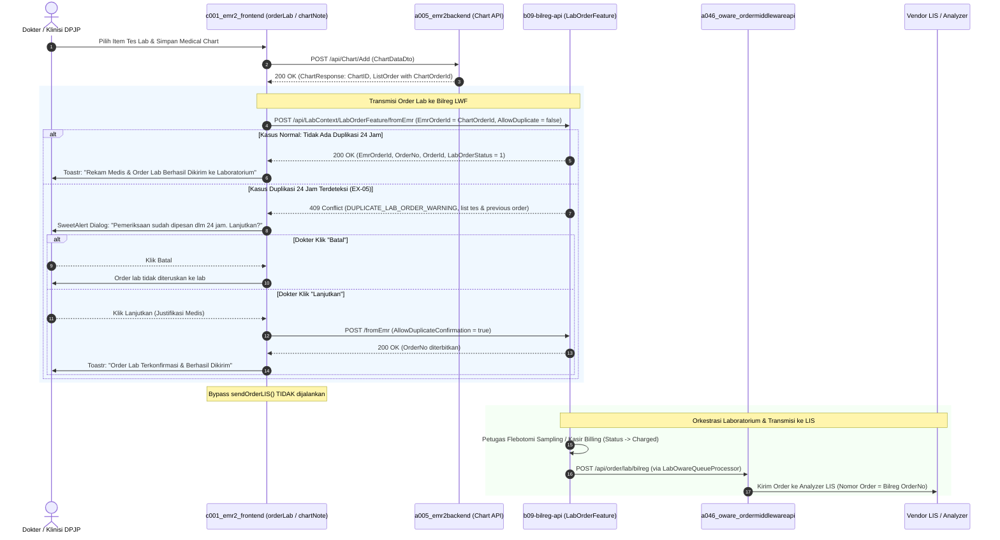
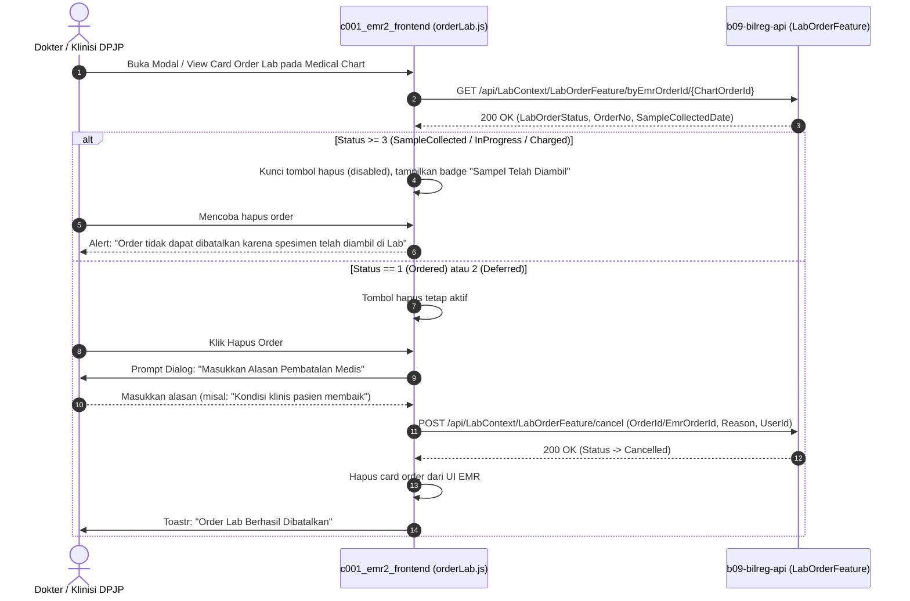

# 1. Overview

Arsitektur ini mendefinisikan realisasi teknis target untuk integrasi dan penyelarasan alur pembuatan permintaan pemeriksaan laboratorium (*laboratory examination order*) dari modul Electronic Medical Record (EMR) Medical Chart ([orderLab.js](file:///D:/Project.Aktif/_emr/c001_emr2_frontend/assets/js/MedicalChart/orderLab.js) dan [chartNote.js](file:///D:/Project.Aktif/_emr/c001_emr2_frontend/assets/js/MedicalChart/chartNote.js) pada repositori `c001_emr2_frontend`) ke sistem Laboratory Workflow Feature (LWF) pada backend Bilreg ([LabOrderFeature](file:///D:/Project.Aktif/_hospital_web/b09-bilreg-api/src/bilreg/Bilreg.Application/LabContext/LabOrderFeature/UseCases/LabOrderCreateFromEmrCmd.cs) pada repositori `b09-bilreg-api`).

Integrasi ini menyelesaikan masalah bypass langsung yang selama ini menghubungkan EMR ke OWARE middleware (`sendOrderLIS`), serta menegakkan Bilreg LWF sebagai sumber kebenaran operasional (*operational source of truth*) yang mengorkestrasikan seluruh alur laboratorium: pencatatan order kanonikal, persiapan spesimen/flebotomi (`LAB-COLLECT`), pembebanan billing tindakan (`TRK-BILLING`), dan penerusan order ke analyzer/LIS via OWARE (`LabOwareFeature`).

Referenced FEATURE:
- [OC-LAB-ORDER-LAB-FEATURE.md](file:///D:/Project.Aktif/_hospital_web/b09-bilreg-api/docs/contexts/lab/OC-LAB-ORDER-LAB-FEATURE.md)

Originating ISSUE:
- [LAB-EMR-ORDER-INTEGRATION-ISSUE.md](file:///D:/Project.Aktif/_hospital_web/b09-bilreg-api/docs/contexts/lab/LAB-EMR-ORDER-INTEGRATION-ISSUE.md)

---

# 2. Architectural Basis

## Business Context

Sesuai spesifikasi bisnis pada [OC-LAB-ORDER-LAB.md](file:///D:/Project.Aktif/_hospital_web/b21-myhosweb-system/outcomes/OC-LAB-ORDER-LAB.md) dan dokumen domain [lab-domain.md](file:///D:/Project.Aktif/_hospital_web/b09-bilreg-api/docs/contexts/lab/lab-domain.md):
- **Otoritas Operasional LWF**: Bilreg LWF bertanggung jawab mutlak atas penerimaan, validasi katalog tes laboratorium, penetapan kebutuhan vacutainer/spesimen, pemeliharaan status order, dan penerbitan nomor referensi resmi (`OrderNo`). EMR bertindak sebagai inisiator permintaan klinis (*clinical order initiator*).
- **Integritas Penagihan dan Sampling**: Tidak ada tes diagnostik yang dikerjakan oleh instalasi laboratorium atau dikirimkan ke instrumen analyzer LIS tanpa tercatat resmi dalam sistem Bilreg, agar proses flebotomi terstandar dan biaya tindakan otomatis tercatat pada akun billing pasien (`TRK-BILLING`).
- **Keselamatan Pasien (Patient Safety - EX-05)**: Sistem harus mencegah duplikasi pemeriksaan diagnostik yang tidak perlu dalam jendela 24 jam, namun tetap memberikan keleluasaan justifikasi medis bagi dokter penanggung jawab (DPJP).

## Analysis Input

Mengonsumsi keputusan gap-closure yang telah disetujui pada [LAB-EMR-ORDER-INTEGRATION-FEASIBILITY-ASSESSMENT.md](file:///D:/Project.Aktif/_hospital_web/b09-bilreg-api/docs/contexts/lab/LAB-EMR-ORDER-INTEGRATION-FEASIBILITY-ASSESSMENT.md) (Status: `READY-FOR-PLANNING`):
1. **Frontend EMR Direct Orchestration (GAP-001 & OQ-001)**: Transmisi dieksekusi langsung dari frontend EMR via AJAX ke endpoint Bilreg `POST /api/LabContext/LabOrderFeature/fromEmr` segera setelah penyimpanan chart note selesai.
2. **Korelasi Identitas Persisten Berbasis `ChartOrderId` (GAP-003 & OQ-002)**: Menggunakan kunci primer `ChartOrderId` (tabel `dbo.EMREC_ChartOrder`) sebagai `EmrOrderId` kanonikal di Bilreg.
3. **Penyelarasan Kontrak DTO Lengkap (GAP-002 & GAP-008)**: Memetakan atribut lengkap `LabOrderCreateFromEmrCmd`.
4. **Penanganan Interaktif Duplikasi 24 Jam (GAP-005 & OQ-004)**: Dialog SweetAlert rincian duplikasi (HTTP 409) dengan opsi konfirmasi dokter untuk retry `AllowDuplicateConfirmation = true`.
5. **Eliminasi Direct Bypass OWARE (GAP-006 & OQ-005)**: Pemanggilan `sendOrderLIS` dinonaktifkan; transmisi ke OWARE didelegasikan sepenuhnya ke Bilreg LWF (`LabOwareFeature`).
6. **Sinkronisasi Siklus Pembatalan (GAP-007)**: Pengecekan status real-time via `GET byEmrOrderId/{emrOrderId}`; kunci tombol hapus jika spesimen telah diambil (`SampleCollected`), dan panggil API pembatalan Bilreg jika belum diambil.

---

# 3. Scope

## Included

1. **EMR Frontend (`c001_emr2_frontend`)**:
   - Pemutakhiran fungsi pengiriman pada [chartNote.js](file:///D:/Project.Aktif/_emr/c001_emr2_frontend/assets/js/MedicalChart/chartNote.js) untuk mengirimkan order lab ke Bilreg API segera setelah respons `Chart/Add` sukses.
   - Pemetaan payload `LabOrderCreateFromEmrCmd` dari state rekam medis (`ChartOrderId`, data sosial pasien, DPJP pengorder, unit perujuk, catatan klinis, dan rincian tarif).
   - Penanganan respons error HTTP 409 (`DUPLICATE_LAB_ORDER_WARNING`): menampilkan modal dialog SweetAlert dan mengirim ulang dengan `AllowDuplicateConfirmation = true` jika disetujui dokter.
   - Penanganan error respons `LAB_TEST_DEFINITION_NOT_FOUND` dengan alert informatif yang menampilkan nama pemeriksaan terkait.
   - Penonaktifan pemanggilan fungsi legacy `sendOrderLIS` ketika order berhasil dikirimkan ke Bilreg.
   - Pemutakhiran modul [orderLab.js](file:///D:/Project.Aktif/_emr/c001_emr2_frontend/assets/js/MedicalChart/orderLab.js) untuk memeriksa status order real-time ke Bilreg (`GET /api/LabContext/LabOrderFeature/byEmrOrderId/{emrOrderId}`) saat membuka modal/card order, men-disable tombol hapus jika status sudah `Collected` / `Charged`, serta memanggil endpoint pembatalan Bilreg `POST /api/LabContext/LabOrderFeature/cancel` saat dokter membatalkan order yang belum disampling.

2. **Bilreg Backend (`b09-bilreg-api`)**:
   - Verifikasi dan penegasan endpoint [LabOrderController.cs](file:///D:/Project.Aktif/_hospital_web/b09-bilreg-api/src/bilreg/Bilreg.Api/Controllers/LabContext/LabOrderFeature/LabOrderController.cs) (`POST /api/LabContext/LabOrderFeature/fromEmr` dan `GET /api/LabContext/LabOrderFeature/byEmrOrderId/{emrOrderId}`).
   - Penegasan validasi domain pada [LabOrderCreateFromEmrCmd.cs](file:///D:/Project.Aktif/_hospital_web/b09-bilreg-api/src/bilreg/Bilreg.Application/LabContext/LabOrderFeature/UseCases/LabOrderCreateFromEmrCmd.cs) (`ADM-REG` active check, `ORG-PPA` verification, 24h duplication detection, dan resolusi definisi uji).
   - Orkestrasi otomatis pengiriman order ke OWARE melalui antrean `LabOwareOutboundQueueModel` (`LabOwareFeature`) setelah order lab mencapai status `Charged`.

## Excluded

1. Perubahan skema fisik tabel rekam medis pada database EMR (`dbo.EMREC_ChartOrder` dan `dbo.EMREC_ChartOrderItem` dipertahankan tanpa perubahan skema).
2. Modifikasi internal protokol komunikasi LIS vendor pihak ketiga di luar gateway OWARE.
3. Modifikasi alur kerja order Patologi Anatomi dan Mikrobiologi (dikelola secara terpisah melalui arsitektur `LAB-ORDER-PA-MICRO-ACCOMMODATION`).

---

# 4. Technical Decisions

## TD-01: Frontend Direct Orchestration via AJAX
- **Keputusan**: Transmisi order laboratorium ke Bilreg dieksekusi secara sinkron dari client browser ([chartNote.js](file:///D:/Project.Aktif/_emr/c001_emr2_frontend/assets/js/MedicalChart/chartNote.js)) segera setelah pemanggilan `POST Chart/Add` ke backend EMR mengembalikan status sukses.
- **Implementasi**: Menggunakan fungsi AJAX jQuery standar EMR dengan basis URL yang merujuk pada `config.base_api_bilreg` (`http://.../BilregApi/api/LabContext/LabOrderFeature/fromEmr`).
- **Alasan**: Mempertahankan arsitektur decoupled antarmuka EMR eksisting, menghindari perombakan backend EMR legacy, dan memungkinkan feedback interaktif langsung (SweetAlert) kepada dokter jika terjadi warning duplikasi 24 jam.

## TD-02: Identitas Persisten Berbasis `ChartOrderId`
- **Keputusan**: Field `EmrOrderId` pada kontrak Bilreg diisi menggunakan `ChartOrderId` resmi dari database EMR (kunci primer `dbo.EMREC_ChartOrder`), bukan `ChartID`.
- **Implementasi**: Backend EMR saat merespons `Chart/Add` mengembalikan objek `ChartResponse` yang memuat array `ListOrder` lengkap dengan properti `ChartOrderId`. Frontend EMR mencocokkan card order dengan item pada `ListOrder` untuk memperoleh `ChartOrderId` sebelum memanggil Bilreg.
- **Alasan**: Sebuah rekam medis (*medical chart*) dapat memiliki lebih dari satu card order lab (misal: order rutin dan order puasa). Penggunaan `ChartOrderId` menjamin keunikan 1:1 antara entitas order di EMR dengan entitas `OrderLab` di Bilreg.

## TD-03: Penanganan Interaktif Peringatan Duplikasi 24 Jam (HTTP 409 / EX-05)
- **Keputusan**: Exception `DuplicateLabOrderWarningException` dari Bilreg yang menghasilkan HTTP 409 ditangani secara ramah di UI EMR melalui dialog konfirmasi SweetAlert.
- **Implementasi**:
  1. Frontend menangkap HTTP 409 pada blok `error` AJAX.
  2. Membaca properti `data.duplicateTestNames` dan `data.previousOrderIds` dari body respons.
  3. Menampilkan modal dialog: *"Pemeriksaan [Nama Tes] telah dipesan dalam 24 jam terakhir pada Order [No Order]. Apakah Anda yakin ingin melanjutkan pemesanan ulang?"*.
  4. Jika dokter memilih *"Lanjutkan"*, fungsi melakukan *retry* AJAX dengan payload yang sama namun menambahkan field `AllowDuplicateConfirmation: true`.
  5. Jika dokter memilih *"Batal"*, proses order dihentikan dan dokter diberi notifikasi.

## TD-04: Eliminasi Direct Bypass OWARE dan Sentralisasi di Bilreg LWF
- **Keputusan**: Pemanggilan fungsi legacy `sendOrderLIS(result.ChartID)` pada [chartNote.js](file:///D:/Project.Aktif/_emr/c001_emr2_frontend/assets/js/MedicalChart/chartNote.js) tidak dieksekusi jika transmisi ke Bilreg berhasil.
- **Implementasi**: Logika pemanggilan diubah:
  ```javascript
  if (config.base_api_bilreg && isOrderLab) {
      await sendOrderToBilreg(result);
  } else if (config.medicalChart.oware_order_lis_without_tu && isOrderLab) {
      sendOrderLIS(result.ChartID); // Fallback legacy hanya jika Bilreg tidak terpasang
  }
  ```
- **Alasan**: Mencegah duplikasi pengiriman order ke analyzer LIS dan memastikan nomor order yang tertera pada tabung barcode LIS adalah `OrderNo` resmi Bilreg.

## TD-05: Penyelarasan Status Siklus Hidup & Non-Destructive Cancellation
- **Keputusan**: Pembatalan order lab dari EMR diselaraskan dengan aturan siklus hidup LWF:
  - Sebelum menghapus order pada modal EMR, sistem melakukan verifikasi status via `GET /api/LabContext/LabOrderFeature/byEmrOrderId/{emrOrderId}`.
  - Jika status order di Bilreg `>= 3` (`SampleCollected`, `Charged`, `Done`), tombol hapus dinonaktifkan (*disabled*) dengan tooltip peringatan bahwa sampel telah diambil/diproses.
  - Jika status masih `1` (`Ordered`) atau `2` (`Deferred`), dokter dapat menekan tombol hapus, yang akan memicu prompt alasan pembatalan dan memanggil `POST /api/LabContext/LabOrderFeature/cancel` di Bilreg secara *non-destructive*.

## TD-06: Toleransi Kredensial Dokter Perujuk (`ORG-PPA`)
- **Keputusan**: `DokterPerujukId` diisi dengan kode dokter login EMR (`chart.DokterID` / `user.UserrID`).
- **Implementasi**: Jika dokter perujuk tidak memiliki ID atau belum terdaftar di master `ORG-PPA` Bilreg, string ID dapat dikosongkan dan `DokterPerujukName` tetap dikirimkan. Sesuai logika [LabOrderCreateFromEmrCmd.cs](file:///D:/Project.Aktif/_hospital_web/b09-bilreg-api/src/bilreg/Bilreg.Application/LabContext/LabOrderFeature/UseCases/LabOrderCreateFromEmrCmd.cs#L92-L105), validasi `_ppaRepo` hanya dieksekusi jika `DokterPerujukId` tidak kosong.

---

# 5. Component Responsibilities

| Component | Repository / Layer | Responsibility |
|---|---|---|
| **`orderLab.js`** | `c001_emr2_frontend`<br>*(Assets/JS)* | - Mengelola UI seleksi tarif laboratorium dan penandaan prioritas (Rutin / Cito).<br>- Menyimpan draft order pada variabel `listOrderLaborat`.<br>- Menampilkan status implementasi / sampling real-time dari Bilreg.<br>- Mengunci tombol hapus jika spesimen telah diambil. |
| **`chartNote.js`** | `c001_emr2_frontend`<br>*(Assets/JS)* | - Menyimpan rekam medis ke backend EMR (`POST Chart/Add`).<br>- Mengorkestrasikan pengiriman payload `LabOrderCreateFromEmrCmd` ke Bilreg API pasca-simpan chart.<br>- Menangani dialog konfirmasi duplikasi 24 jam (HTTP 409) dan retry flow.<br>- Menonaktifkan pemanggilan bypass `sendOrderLIS`. |
| **`ChartController`** | `a005_emr2backend`<br>*(ASP.NET Web API)* | - Mempersistensi entitas `ChartModel`, `ChartOrderModel`, dan `ChartOrderItemModel`.<br>- Menghasilkan kunci primer unik `ChartOrderID` untuk setiap order.<br>- Mengembalikan `ChartResponse` lengkap dengan rincian `ListOrder`. |
| **`LabOrderController`** | `b09-bilreg-api`<br>*(API Layer)* | - Mengekspos endpoint REST: `POST /api/LabContext/LabOrderFeature/fromEmr`, `GET /byEmrOrderId/{emrOrderId}`, dan `POST /cancel`.<br>- Melindungi endpoint dengan autentikasi terstandar. |
| **`LabOrderCreateFromEmrHandler`** | `b09-bilreg-api`<br>*(Application Layer)* | - Memvalidasi keaktifan kunjungan (`ADM-REG` check).<br>- Memvalidasi dokter pengorder (`ORG-PPA` check).<br>- Menjalankan deteksi tes duplikat 24 jam (`_labOrderDal`).<br>- Menerbitkan nomor order kanonikal (`OrderNo`).<br>- Mempersistensi snapshot order ke `BILRG_LabOrder` dan `BILRG_LabOrderItem`. |
| **`LabTestResolutionService`** | `b09-bilreg-api`<br>*(Infrastructure Layer)* | - Menyelesaikan pemetaan setiap `TarifId` ke `LabTestDefinitionModel` aktif.<br>- Menentukan jenis tabung vacutainer, jenis spesimen, dan daftar komponen hasil laboratorium. |
| **`LabOwareQueueProcessor`** | `b09-bilreg-api`<br>*(Application / Background)* | - Memproses antrean outbound `BILRG_LabOwareOutboundQueue`.<br>- Mentransmisikan payload order laboratorium resmi ke OWARE middleware setelah status order mencapai `Charged`. |
| **`OrderController`** | `a046_oware_ordermiddlewareapi`<br>*(API Layer)* | - Menerima order kanonikal dari Bilreg (`POST /api/order/lab/bilreg`).<br>- Mengorkestrasikan pengiriman ke vendor LIS/analyzer yang sesuai melalui `OrderLabHubService`. |

---

# 6. Integration Design

## Collaboration Overview

| Source | Target | Protocol / Endpoint | Payload / Contract | Purpose |
|---|---|---|---|---|
| `c001_emr2_frontend` | `a005_emr2backend` | HTTP POST<br>`/api/Chart/Add` | `ChartDataDto` | Menyimpan rekam medis dan menerbitkan `ChartOrderID`. |
| `c001_emr2_frontend` | `b09-bilreg-api` | HTTP POST<br>`/api/LabContext/LabOrderFeature/fromEmr` | `LabOrderCreateFromEmrCmd` (JSON) | Mengirimkan permintaan order laboratorium dari EMR ke Bilreg LWF. |
| `c001_emr2_frontend` | `b09-bilreg-api` | HTTP GET<br>`/api/LabContext/LabOrderFeature/byEmrOrderId/{emrOrderId}` | URL Parameter | Mengecek status operasional order di Bilreg untuk proteksi UI hapus/edit. |
| `c001_emr2_frontend` | `b09-bilreg-api` | HTTP POST<br>`/api/LabContext/LabOrderFeature/cancel` | `LabOrderCancelCmd` (JSON) | Meneruskan pembatalan order dari EMR ke Bilreg LWF sebelum pengambilan sampel. |
| `b09-bilreg-api` | `a046_oware_ordermiddlewareapi` | HTTP POST<br>`/api/order/lab/bilreg` | `CreateOrderLabFromBilregCommand` (JSON) | Meneruskan order yang telah terverifikasi/charged ke middleware LIS. |

---

## Sequence Diagram: Alur Pembuatan Order Lab (Create & Duplication Handling)



---

## Sequence Diagram: Alur Pengecekan Status & Pembatalan Order (Cancellation Flow)



---

## Spesifikasi Kontrak Payload: `LabOrderCreateFromEmrCmd`

Format JSON yang dikirimkan oleh `chartNote.js` ke `POST /api/LabContext/LabOrderFeature/fromEmr`:

```json
{
  "userId": "DOK001",
  "emrOrderId": "10000000000001234",
  "regId": "RG00676158",
  "patientId": "00123456",
  "patientName": "Ny. Siti Aminah",
  "birthDateYmd": "1985-06-15",
  "gender": "P",
  "items": [
    {
      "tarifId": "TF000123",
      "tarifName": "Darah Lengkap Otomatis"
    },
    {
      "tarifId": "TF000456",
      "tarifName": "Glukosa Darah Sewaktu"
    }
  ],
  "dokterPerujukId": "DOK001",
  "dokterPerujukName": "dr. Ahmad Sp.PD",
  "layananPerujukId": "2RJ01",
  "layananPerujukName": "Poli Penyakit Dalam",
  "clinicalNote": "Suspek DHF grade 1, lemas 3 hari",
  "urgency": 0,
  "allowDuplicateConfirmation": false
}
```

Format respons sukses dari Bilreg (`LabOrderCreateFromEmrResponse`):

```json
{
  "status": "ok",
  "data": {
    "emrOrderId": "10000000000001234",
    "labOrderStatus": 1,
    "orderNo": "LO-20261102-0042",
    "orderId": "6f9b1c2d-3e4a-4b5c-8d1e-2f3a4b5c6d7e"
  }
}
```

Format respons peringatan duplikasi 24 jam (HTTP 409 Conflict):

```json
{
  "status": "fail",
  "code": "DUPLICATE_LAB_ORDER_WARNING",
  "message": "EX-05: Peringatan duplikasi tes laboratorium dalam 24 jam terakhir untuk pasien ini. Pemeriksaan 'Darah Lengkap Otomatis' telah dipesan pada order sebelumnya: LO-20261101-0089. Konfirmasikan atau berikan justifikasi medis.",
  "data": {
    "duplicateTestNames": [
      "Darah Lengkap Otomatis"
    ],
    "previousOrderIds": [
      "LO-20261101-0089"
    ]
  }
}
```

---

# 7. Data Ownership

| Entity / Data Area | Authoritative Owner | Read Access | Primary Storage Table |
|---|---|---|---|
| **Rekam Medis & Chart Order** | Backend EMR (`a005_emr2backend`) | EMR Frontend | `dbo.EMREC_ChartOrder`<br>`dbo.EMREC_ChartOrderItem` |
| **Order Pemeriksaan Lab Kanonikal** | Backend Bilreg (`b09-bilreg-api`) | Bilreg Web, EMR Frontend, OWARE | `dbo.BILRG_LabOrder`<br>`dbo.BILRG_LabOrderItem`<br>`dbo.BILRG_LabOrderItemComponent` |
| **Definisi Uji & Pemetaan Tarif Lab** | Backend Bilreg (`b09-bilreg-api`) | Bilreg Web, EMR Frontend | `dbo.BILRG_LabTestDefinition`<br>`dbo.BILRG_LabComponentMaster` |
| **Antrean Outbound OWARE** | Backend Bilreg (`b09-bilreg-api`) | Background Worker Bilreg | `dbo.BILRG_LabOwareOutboundQueue` |
| **Pemetaan Vendor Analyzer LIS** | Middleware OWARE (`a046_oware_ordermiddlewareapi`) | OWARE Services | `dbo.OWARE_MapTarifLab` |

---

# 8. Database Design

## New Tables
*Tidak ada tabel baru yang ditambahkan.* Seluruh entitas persistensi yang dibutuhkan telah tersedia pada basis data EMR dan Bilreg.

## Modified Tables
*Tidak ada modifikasi skema fisik tabel.* Struktur tabel eksisting digunakan secara optimal:
- `dbo.EMREC_ChartOrder`: Kolom `ChartOrderID` (`VARCHAR(17)`) digunakan sebagai nilai `EmrOrderId`.
- `dbo.BILRG_LabOrder`: Kolom `EmrOrderId` (`VARCHAR(50)`) menampung nilai `ChartOrderID` sebagai kunci korelasi lintas-sistem.

## Relationships
- **Korelasi Logis Lintas Bounded Context**:
  - Relasi 1:1 logis antara `dbo.EMREC_ChartOrder.ChartOrderID` (EMR) dengan `dbo.BILRG_LabOrder.EmrOrderId` (Bilreg).
  - Hubungan dipelihara melalui kontrak API eksplisit tanpa foreign key fisik lintas-database.

## Migration & Data Readiness Considerations
1. **Audit Master LabTestDefinition**: Sebelum integrasi diaktifkan pada lingkungan produksi, tim implementer wajib menjalankan audit verifikasi pada tabel `BILRG_LabTestDefinition` untuk memastikan seluruh item tarif laboratorium yang aktif pada master tarif rumah sakit (`TRK-TARIF`) telah terpetakan ke definisi uji teknis yang sah.
2. **Ketersediaan Konfigurasi API**: Memastikan entri `config.base_api_bilreg` pada `c001_emr2_frontend/config/config.js` mengarah ke URL Bilreg API yang aktif dan dapat diakses dari browser pengguna.

---

# 9. Cross-Cutting Concerns

## Security & Authentication
- Komunikasi frontend EMR ke Bilreg API dilindungi header otorisasi standar (Bearer Token atau sesi terintegrasi).
- Endpoint `byEmrOrderId` dan `fromEmr` memvalidasi hak akses petugas medis penanggung jawab.

## Audit Trail & Traceability
- Setiap pencatatan order di Bilreg merekam `AuditInfoType` (waktu pencatatan dan ID pengguna yang login di EMR).
- Setiap pembatalan order wajib merekam alasan pembatalan medis (`CancellationReason`), waktu pembatalan, dan ID klinisi yang membatalkan.

## Idempotency & Fault Tolerance
- **Idempotensi Pembuatan**: Jika terjadi transmisi ulang untuk `EmrOrderId` yang sama (misal akibat koneksi timeout), Bilreg mengenali `EmrOrderId` eksisting dan mengembalikan data order yang sudah terbentuk tanpa membuat order ganda.
- **Resiliensi Client**: Jika transmisi ke Bilreg mengalami gangguan jaringan sementara, EMR menampilkan notifikasi peringatan yang jelas dan status order lab pada rekam medis ditandai belum tersinkronisasi.

---

# 10. Implementation Constraints

1. **Prinsip Decoupled Client**: Perubahan integrasi dilakukan murni pada sisi frontend EMR ([chartNote.js](file:///D:/Project.Aktif/_emr/c001_emr2_frontend/assets/js/MedicalChart/chartNote.js) dan [orderLab.js](file:///D:/Project.Aktif/_emr/c001_emr2_frontend/assets/js/MedicalChart/orderLab.js)) dan pemanfaatan endpoint Bilreg yang sudah ada, tanpa mengubah logika bisnis pada backend EMR legacy (`a005_emr2backend`).
2. **Kepatuhan Format DTO**: Payload yang dikirimkan oleh frontend EMR wajib memenuhi seluruh validasi `Guard` pada [LabOrderCreateFromEmrCmd.cs](file:///D:/Project.Aktif/_hospital_web/b09-bilreg-api/src/bilreg/Bilreg.Application/LabContext/LabOrderFeature/UseCases/LabOrderCreateFromEmrCmd.cs) (terutama string tidak boleh null/whitespace untuk `UserId`, `EmrOrderId`, `RegId`, `PatientId`, `PatientName`, dan `Items`).
3. **Standar Respons UI**: Seluruh dialog interaktif konfirmasi dan peringatan kesalahan wajib menggunakan pustaka SweetAlert dan Toastr yang sudah standar digunakan pada `c001_emr2_frontend`.

---

# 11. Acceptance Conditions

1. **Terbentuknya Order Kanonikal di Bilreg**:
   - Saat dokter menyimpan Medical Chart yang memuat order laboratorium di EMR, record baru berhasil terbentuk pada tabel `BILRG_LabOrder` dan `BILRG_LabOrderItem` dengan `EmrOrderId` yang sesuai dengan `ChartOrderID` EMR.
   - Order memiliki nomor referensi resmi berformat `LO-YYYYMMDD-XXXX`.
2. **Peringatan Duplikasi 24 Jam Berfungsi Interaktif**:
   - Jika pasien dipesankan tes yang sama dalam 24 jam terakhir, UI EMR menampilkan dialog konfirmasi SweetAlert.
   - Jika dokter menekan "Lanjutkan", order berhasil dibuat di Bilreg dengan `AllowDuplicateConfirmation: true`.
   - Jika dokter menekan "Batal", order tidak dibuat di Bilreg.
3. **Bypass OWARE Tereliminasi Bersih**:
   - Fungsi `sendOrderLIS` di EMR tidak dieksekusi saat order lab berhasil dikirim ke Bilreg.
   - Order ke vendor LIS hanya diteruskan oleh Bilreg LWF (`LabOwareFeature`) setelah order diproses di laboratorium.
4. **Proteksi & Sinkronisasi Pembatalan Berjalan Aman**:
   - Jika order telah diambil spesimennya di laboratorium (`LabOrderStatus >= 3`), tombol hapus order di EMR terkunci (*disabled*).
   - Jika order belum diambil spesimennya (`LabOrderStatus == 1` atau `2`), dokter dapat membatalkan order dan status order di Bilreg berubah menjadi `Cancelled` (`6`) dengan catatan alasan medis yang valid.
