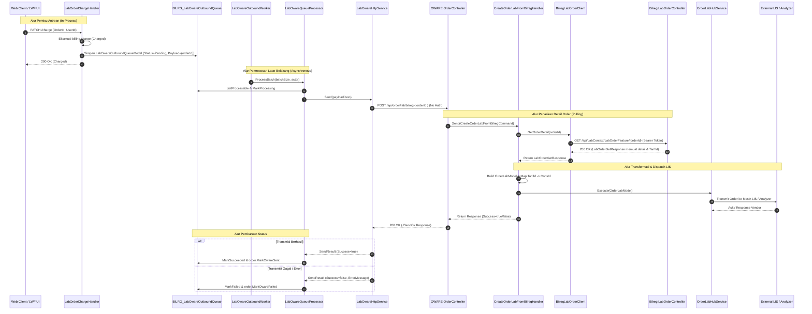
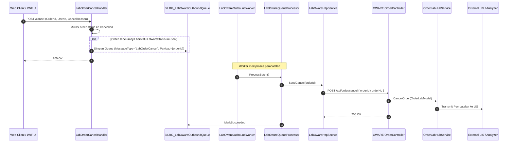

# 1. Overview

Dokumen spesifikasi teknis arsitektur ini mendefinisikan realisasi teknis integrasi pengiriman data order pemeriksaan laboratorium dari Laboratory Workflow Feature (LWF) pada backend `b09-bilreg-api` ke middleware OWARE (`a046_oware_ordermiddlewareapi`) untuk diteruskan ke Laboratory Information System (LIS) dan analyzer laboratorium rumah sakit.

Realisasi arsitektur ini menerapkan pola **Notification & Pull**:
- LWF mengirimkan notifikasi ringan berisi `OrderId` ke OWARE saat order berhasil dibebankan biaya (*Charged*).
- OWARE melakukan penarikan (*pulling*) data detail order secara lengkap dari API resmi LWF menggunakan Token Bearer JWT.
- OWARE memetakan item pemeriksaan ke vendor LIS tujuan (`ConsId`) melalui tabel pemetaan `OWARE_MapTarifLab` berbasis `TarifId`, menyimpan order ke database OWARE, dan mendispatch ke vendor LIS via `OrderLabHubService`.
- Status pengiriman integrasi diperbarui secara asinkron di LWF (`OwareStatus`: `Sent` atau `Failed`).

---

# 2. Architectural Basis

## Business Context

- **DOMAIN**:
  - [07-LABORATORY-DOMAIN.md](file:///D:/Project.Aktif/_hospital_web/b21-myhosweb-system/domain/07-LABORATORY-DOMAIN.md): Definisi kapabilitas domain laboratorium (`LAB-ORDER`, `LAB-COLLECT`, `LAB-RESULT`).
  - [lab-domain.md](file:///D:/Project.Aktif/_hospital_web/b09-bilreg-api/docs/contexts/lab/lab-domain.md): §21 OWARE Integration, §22 OWARE Communication, §23 OWARE Status.
- **OPERATIONAL WORKFLOW & INTEGRATION**:
  - [lab-integration.md](file:///D:/Project.Aktif/_hospital_web/b09-bilreg-api/docs/contexts/lab/lab-integration.md): Pola integrasi asynchronous OWR, antrean pengiriman, isolasi kegagalan, dan retry strategy.
  - [lab-workflow.md](file:///D:/Project.Aktif/_hospital_web/b09-bilreg-api/docs/contexts/lab/lab-workflow.md): Siklus hidup order laboratorium (`Ordered` → `Charged` → `Collected` → `Recorded` → `Verified` → `Released`).
- **OUTCOME**:
  - [OC-LAB-ORDER-LAB.md](file:///D:/Project.Aktif/_hospital_web/b21-myhosweb-system/outcomes/OC-LAB-ORDER-LAB.md): Eksistensi entitas order laboratorium yang sah.

## Analysis Input

- **FEASIBILITY ASSESSMENT**:
  - [LAB-OWARE-ORDER-INTEGRATION-FEASIBILITY-ASSESSMENT.md](file:///D:/Project.Aktif/_hospital_web/b09-bilreg-api/docs/contexts/lab/LAB-OWARE-ORDER-INTEGRATION-FEASIBILITY-ASSESSMENT.md) (Version 1.1, Status: `READY-FOR-PLANNING`).
- **ISSUE**:
  - [LAB-OWARE-ORDER-INTEGRATION-ISSUE.md](file:///D:/Project.Aktif/_hospital_web/b09-bilreg-api/docs/contexts/lab/LAB-OWARE-ORDER-INTEGRATION-ISSUE.md) (ID: `ISSUE-LAB-OWARE-ORDER-001`).

Arsitektur diturunkan langsung dari keputusan-keputusan penutupan celah (*gap closure decisions*) yang telah disepakati:
- **GAP-001**: Implementasi klien HTTP riil di `Bilreg.Infrastructure` menggantikan mock in-memory.
- **GAP-002 & OQ-002**: Penyediaan endpoint baru `POST /api/order/lab/bilreg` di OWARE.
- **GAP-003**: Konfigurasi `OwareOptions` di `appsettings.json` `b09-bilreg-api`.
- **GAP-004 & OQ-001**: Pemicu otomatis antrean pada status `Charged` (termasuk Cito) serta tombol manual "Kirim ke LIS/OWARE" di antarmuka kerja laboratorium.
- **GAP-005 & OQ-004**: Background worker hybrid: .NET `BackgroundService` internal di `Bilreg.Api` dan endpoint HTTP trigger manual.
- **GAP-006 & OQ-003**: Penarikan data detail order dari Bilreg dan mapping `TarifId` ke `ConsId` via `OWARE_MapTarifLab`.
- **OQ-005**: Autentikasi: Bilreg → OWARE bebas autentikasi; OWARE → Bilreg menggunakan Token Bearer JWT.
- **GAP-007 & OQ-006**: Otomatisasi pembatalan order ke OWARE saat order yang sudah `Sent` dibatalkan di LWF.

---

# 3. Scope

## Included

1. **Komponen Pengirim (`b09-bilreg-api`)**:
   - Pemicu otomatis enqueue ke `BILRG_LabOwareOutboundQueue` di dalam `LabOrderChargeHandler` saat order sukses menjadi `Charged`.
   - Pemicu otomatis enqueue pembatalan (`MessageType = "LabOrderCancel"`) di dalam `LabOrderCancelHandler` saat order berstatus `Sent` dibatalkan.
   - Implementasi adapter HTTP Client riil [`LabOwareHttpService`](file:///D:/Project.Aktif/_hospital_web/b09-bilreg-api/src/bilreg/Bilreg.Infrastructure/LabContext/Integration) yang mengimplementasikan `ILabOwareIntegration` dengan timeout dan error handling yang aman.
   - Pendaftaran `IHttpClientFactory` dengan named client `"OwareClient"` dan binding `OwareOptions` dari `appsettings.json`.
   - Background worker hosted service `LabOwareOutboundWorker` (.NET `BackgroundService`) di `Bilreg.Api` yang memproses antrean pending/failed secara periodik.
   - Penyediaan tombol/command manual retry pengiriman antrean melalui `LabOwareRetryCmd`.
2. **Komponen Penerima (`a046_oware_ordermiddlewareapi`)**:
   - Endpoint HTTP baru `POST /api/order/lab/bilreg` pada `OrderController` yang menerima `{ "orderId": "..." }` tanpa autentikasi.
   - Command & Handler baru: `CreateOrderLabFromBilregCommand` dan `CreateOrderLabFromBilregHandler`.
   - Client penarikan data `IBilregLabOrderClient` yang memanggil `GET /api/LabContext/LabOrderFeature/{orderId}` di `b09-bilreg-api`.
   - Service manajemen token `IBilregAuthTokenService` untuk login ke `POST /api/User/login` di Bilreg, me-refresh token jika expired, dan menyimpan Bearer token di in-memory cache.
   - Builder baru `IOrderLabBilregBuilder` yang mengonversi `LabOrderGetResponse` menjadi `OrderLabModel`, memetakan `TarifId` ke `ConsId` dan kode LIS via `OWARE_MapTarifLab`.
   - Penyimpanan order ke tabel OWARE (`OWARE_Order`, dsb.) dan penerusan ke `OrderLabHubService` untuk dikirim ke vendor LIS (Sysmex, Prolims, Premier, dsb.).
   - Endpoint pembatalan order eksisting `POST /api/order/cancel` menerima request pembatalan dari LWF.
3. **Komponen Antarmuka Web (`c012_myhospital_web`)**:
   - Penyesuaian aturan visibilitas tombol aksi di [`lab-workflow-actions.config.ts`](file:///D:/Project.Aktif/_hospital_web/c012_myhospital_web/src/modules/Laboratory/configs/lab-workflow-actions.config.ts): merapikan `canEnqueueOware` agar hanya tampil jika order belum terantre dan berstatus minimal `Charged`, serta memastikan `canRetryOware` hanya aktif saat `owareStatus === Failed`.
   - Penambahan indikator / tooltip pesan kesalahan (`LastError`) pada badge status integrasi [`LabOwareStatusBadge.vue`](file:///D:/Project.Aktif/_hospital_web/c012_myhospital_web/src/modules/Laboratory/components/integration/LabOwareStatusBadge.vue) dan panel detail [`LabOrderDetailPanel.vue`](file:///D:/Project.Aktif/_hospital_web/c012_myhospital_web/src/modules/Laboratory/components/workspace/LabOrderDetailPanel.vue).

## Excluded

- Ingestion/retrieval hasil tes laboratorium (*lab results*) dari LIS/OWARE kembali ke LWF (merupakan tanggung jawab tersendiri pada modul `LabResultFeature`).
- Pembuatan atau modifikasi adapter spesifik mesin analyzer baru di OWARE (adapter LIS yang ada sudah berjalan via `OrderLabHubService`).
- Perubahan pada skema transaksi keuangan/billing di `PaymentContext` / `TataRekening`.

---

# 4. Technical Decisions

## TD-001: Pola Integrasi Notification & Pull
- **Keputusan**: LWF hanya mengirimkan notifikasi `{ "orderId": "..." }` ke OWARE. OWARE bertugas menarik seluruh rincian order dari `GET /api/LabContext/LabOrderFeature/{orderId}` di Bilreg.
- **Rasional**:
  - Mengurangi beban payload JSON yang disimpan dalam antrean database `BILRG_LabOwareOutboundQueue`.
  - Menghilangkan redundansi serialisasi model data besar di LWF.
  - Memastikan OWARE selalu mendapatkan data transaksi yang valid dan mutakhir langsung dari endpoint otoritatif LWF.
  - Endpoint `GET /api/LabContext/LabOrderFeature/{orderId}` sudah lengkap menyediakan seluruh atribut yang dibutuhkan (`PatientId`, `RegId`, `DokterPerujuk`, item tes dengan `TarifId`, tube type, dsb.).

## TD-002: Skema Autentikasi Dua Arah
- **Keputusan**:
  1. **LWF → OWARE (`POST /api/order/lab/bilreg`)**: Tidak memerlukan autentikasi khusus (`AllowAnonymous` / internal intranet network boundary).
  2. **OWARE → LWF (`GET /api/LabContext/LabOrderFeature/{orderId}`)**: Menggunakan header HTTP `Authorization: Bearer <JWT_TOKEN>`. OWARE mengotentikasi diri ke endpoint `/api/User/login` di Bilreg menggunakan kredensial service account yang dikonfigurasi di `appsettings.json` OWARE (`BilregClient:Username` dan `BilregClient:Password`). Token di-cache di memory dengan masa berlaku sesuai expiry token, dan di-refresh otomatis jika menerima HTTP 401.
- **Rasional**:
  - Mengikuti standar keamanan ketat di `b09-bilreg-api` di mana seluruh controller LWF dilindungi oleh filter `[Authorize]`.
  - Tidak memerlukan modifikasi atau bypass keamanan pada controller LWF.

## TD-003: Titik Pemicu Otomatis Enqueue & Perlakuan Cito
- **Keputusan**:
  - Enqueue pengiriman order ke OWARE dipicu secara otomatis **hanya saat status order menjadi `Charged` (penagihan sukses)** di dalam `LabOrderChargeHandler`.
  - Pemeriksaan Cito (Emergency) tetap wajib berstatus `Charged` sebelum dikirim ke OWARE.
  - Tidak ada pengiriman update susulan saat sampling fisik (`Collected`).
  - Disediakan tombol manual "Kirim ke LIS/OWARE" di antarmuka kerja LWF yang memanggil `LabOwareRetryCmd` untuk mengirim ulang order yang sebelumnya berstatus `Failed`.
- **Rasional**:
  - Penagihan di LWF bersifat in-process dan langsung selesai saat order diproses laboratorium.
  - Menjamin kelengkapan tagihan sebelum sampel masuk meja analisis diagnostik.
  - Menyediakan fallback manual yang aman bagi analis laboratorium jika koneksi LIS sempat terputus.

## TD-004: Arsitektur Background Worker Antrean LWF
- **Keputusan**: Menggunakan arsitektur **Hybrid**:
  - Menambahkan .NET `BackgroundService` (`LabOwareOutboundWorker`) di host `Bilreg.Api` yang berjalan otomatis di background dengan interval polling yang dapat dikonfigurasi (default 5–10 detik). Worker mengeksekusi `LabOwareQueueProcessor.ProcessBatch`.
  - Endpoint HTTP `POST /api/LabContext/LabOwareFeature/process` dan `PATCH /api/LabContext/LabOwareFeature/retry` tetap dipertahankan untuk pemanggilan manual atau pengujian.
- **Rasional**:
  - Pengiriman order berlangsung secara otomatis tanpa campur tangan pengguna dan tanpa ketergantungan pada cron runner eksternal.
  - Isolasi error: kegagalan pengiriman ke OWARE ditangkap secara aman, dicatat pada kolom `LastError`, dan status order dimutasi ke `OwareStatus = Failed` tanpa menghentikan worker service.

## TD-005: Pemetaan Vendor LIS Berbasis `TarifId`
- **Keputusan**:
  - OWARE memetakan item pemeriksaan ke vendor LIS tujuan (`ConsId`) dengan memanfaatkan `TarifId` dari respon `LabOrderGetResponse` dan mencocokkannya ke tabel master `OWARE_MapTarifLab` (`IMapTarifLabDal`).
- **Rasional**:
  - Infrastruktur pemetaan `OWARE_MapTarifLab` di OWARE sudah matang dan digunakan oleh integrasi LIS lainnya (Sysmex, Prolims, Premier, Wynacom).
  - Menghindari pembuatan tabel master pemetaan baru berbasis kode tes di OWARE.

## TD-006: Sinkronisasi Pembatalan Order (Cancellation)
- **Keputusan**:
  - Di dalam `LabOrderCancelHandler`, jika order yang dibatalkan memiliki status `OwareStatus == OwareStatusEnum.Sent`, sistem secara otomatis membuat antrean outbound baru di `BILRG_LabOwareOutboundQueue` dengan `MessageType = "LabOrderCancel"` dan `PayloadJson = { "orderId": "..." }`.
  - Saat worker memproses antrean pembatalan, adapter HTTP memanggil endpoint pembatalan OWARE: `POST /api/order/cancel`.
- **Rasional**:
  - Mencegah instrumen analitik atau petugas LIS mengerjakan tabung spesimen yang secara medis/administratif telah dibatalkan di SIMRS.

## TD-007: Penyelarasan UX & Visibilitas Tombol Aksi di Frontend
- **Keputusan**:
  - Karena proses enqueue pengiriman kini berjalan 100% otomatis saat order di-charge di backend, fungsi guard `canEnqueueOware` di `lab-workflow-actions.config.ts` dirapikan agar tombol manual "Antre integrasi OWARE" hanya muncul jika order berstatus minimal `Charged` dan status OWARE belum pernah terantre (`owareStatus == 0` / belum pending/sent).
  - Tombol manual "Ulangi integrasi OWARE" (`canRetryOware`) hanya muncul saat order berstatus `owareStatus === OwareStatus.Failed`.
  - Komponen `LabOwareStatusBadge.vue` dan strip status di `LabOrderDetailPanel.vue` diselaraskan agar menampilkan indikator/tooltip pesan kesalahan (`lastError`) saat status gagal.
- **Rasional**:
  - Mencegah kebingungan pengguna (mengurangi tombol redundant pada alur normal otomatis) sekaligus mempertegas aksi penanganan kegagalan (*recovery action*).

---

# 5. Component Responsibilities

| Repository | Komponen | Tanggung Jawab |
|---|---|---|
| **`b09-bilreg-api`** | `LabOrderChargeHandler` | Memicu pembentukan antrean `LabOwareOutboundQueueModel` (status `Pending`) secara in-process saat order berhasil di-charge. |
| **`b09-bilreg-api`** | `LabOrderCancelHandler` | Memicu pembentukan antrean pembatalan (`MessageType = "LabOrderCancel"`) jika order yang dibatalkan sebelumnya berstatus `Sent`. |
| **`b09-bilreg-api`** | `LabOwareQueueProcessor` | Mengambil batch antrean, menandai `Processing`, mengeksekusi adapter `ILabOwareIntegration`, dan memperbarui status antrean (`Succeeded`/`Failed`) serta order (`OwareStatus`). |
| **`b09-bilreg-api`** | `LabOwareHttpService` | Adapter HTTP riil (`Bilreg.Infrastructure`) yang memanggil `POST /api/order/lab/bilreg` atau `POST /api/order/cancel` di OWARE. |
| **`b09-bilreg-api`** | `LabOwareOutboundWorker` | Hosted background service (`Bilreg.Api`) yang secara berkala memanggil `LabOwareQueueProcessor.ProcessBatch`. |
| **`b09-bilreg-api`** | `OwareOptions` | Strongly-typed configuration options yang membaca URL dan parameter koneksi OWARE dari `appsettings.json`. |
| **`a046_oware_ordermiddlewareapi`** | `OrderController.CreateFromBilreg` | Menerima request HTTP `POST /api/order/lab/bilreg` berisi `OrderId` (tanpa autentikasi) dan mendelegasikan ke MediatR. |
| **`a046_oware_ordermiddlewareapi`** | `CreateOrderLabFromBilregHandler` | Mengorkestrasi penarikan detail order dari Bilreg, transformasi data, penyimpanan order, dan dispatch ke LIS. |
| **`a046_oware_ordermiddlewareapi`** | `BilregAuthTokenService` | Mengelola login service account ke `POST /api/User/login` di Bilreg, token caching, dan peremajaan token saat expired. |
| **`a046_oware_ordermiddlewareapi`** | `BilregLabOrderClient` | Mengeksekusi HTTP GET ke `GET /api/LabContext/LabOrderFeature/{orderId}` di Bilreg menggunakan Token Bearer. |
| **`a046_oware_ordermiddlewareapi`** | `OrderLabBilregBuilder` | Mengonversi `LabOrderGetResponse` menjadi `OrderLabModel` dan memetakan `TarifId` ke `ConsId` via `OWARE_MapTarifLab`. |
| **`a046_oware_ordermiddlewareapi`** | `OrderLabHubService` | Komponen eksisting yang mendispatch `OrderLabModel` ke adapter vendor LIS (Sysmex, Prolims, dsb.) berdasarkan `ConsId`. |
| **`c012_myhospital_web`** | `lab-workflow-actions.config.ts` | Mengatur aturan keterlihatan tombol `canEnqueueOware` dan `canRetryOware` sesuai status order dan status OWARE. |
| **`c012_myhospital_web`** | `LabOwareStatusBadge.vue` | Menampilkan visual badge status (`Pending`, `Sent`, `Failed`) dengan tooltip error info saat gagal. |
| **`c012_myhospital_web`** | `LabOrderDetailPanel.vue` | Menampilkan integrasi strip status OWARE dan tombol aksi retry pada panel detail workbench lab. |

---

# 6. Integration Design

## Collaboration Diagram: Notification & Pull



## Collaboration Diagram: Pembatalan Order (Cancellation)



## Kontrak Data Inter-Service

### 1. Payload Notifikasi Outbound (Bilreg → OWARE)
- **Endpoint**: `POST /api/order/lab/bilreg`
- **Request Body**:
  ```json
  {
    "orderId": "ORD-20261029-0001"
  }
  ```
- **Response Body**:
  ```json
  {
    "status": "success",
    "data": {
      "success": true,
      "orderId": "ORD-20261029-0001",
      "owareOrderId": "OWR-00123",
      "vendorReffId": "LIS-9988",
      "message": "Order successfully routed to Sysmex"
    }
  }
  ```

### 2. Request Penarikan Detail Order (OWARE → Bilreg)
- **Endpoint**: `GET /api/LabContext/LabOrderFeature/{orderId}`
- **Header**: `Authorization: Bearer <JWT_TOKEN>`
- **Response**: Menggunakan DTO `LabOrderGetResponse` eksisting di Bilreg yang memuat:
  - Header: `OrderId`, `OrderNo`, `RegId`, `PatientId`, `PatientName`, `BirthDate`, `Gender`, `DokterPerujukId`, `DokterPerujukName`, `LayananPerujukId`, `LayananPerujukName`, `ClinicalNote`, `IsCito`.
  - Collection `Items`: `ItemNo`, `TarifId`, `TarifCode`, `TarifName`, `LabTestCode`, `LabTestName`, `TubeType`, `SpecimenType`, `RequiredTubeCount`.

---

# 7. Data Ownership

| Data Domain | Single Owner | Deskripsi Kepemilikan |
|---|---|---|
| **Status Siklus Hidup Order Lab** | `b09-bilreg-api` (`LabOrderModel`) | Otoritas mutlak status klinis & operasional (`Ordered`, `Charged`, `Collected`, `Verified`, `Released`, `Cancelled`). |
| **Status Integrasi OWARE** | `b09-bilreg-api` (`LabOrderModel.OwareStatus`) | Mencatat status konektivitas integrasi (`Pending`, `Sent`, `Failed`) pada header order LWF. |
| **Antrean Outbound LWF** | `b09-bilreg-api` (`LabOwareOutboundQueueModel`) | Mengelola lifecycle antrean, retry count, pesan kesalahan teknis (`LastError`), dan waktu pemrosesan. |
| **Mapping Tarif ke Vendor LIS** | `a046_oware_ordermiddlewareapi` (`OWARE_MapTarifLab`) | Otoritas pemetaan `TarifId` rumah sakit ke `ConsId` (vendor) dan kode pemeriksaan mesin LIS. |
| **Log Komunikasi Vendor LIS** | `a046_oware_ordermiddlewareapi` (`OWARE_OrderLog`) | Mencatat raw request dan response payload pertukaran data antara OWARE dan mesin LIS eksternal. |

---

# 8. Database Design

## New Tables
*Tidak ada tabel baru yang dibuat.*

## Modified Tables
*Tidak ada kolom tabel yang dimodifikasi.*

## Tabel yang Digunakan Eksisting

### 1. `BILRG_LabOwareOutboundQueue` (`b09-bilreg-api`)
Tabel antrean persisten yang sudah tersedia di SQL Server:
- `QueueId VARCHAR(12)` (PK)
- `OrderId VARCHAR(12)`
- `MessageType VARCHAR(30)` (`LabOrderOutbound` atau `LabOrderCancel`)
- `PayloadJson NVARCHAR(MAX)` (berisi `{ "orderId": "..." }`)
- `QueueStatus INT` (`0=Pending`, `1=Processing`, `2=Succeeded`, `3=Failed`)
- `RetryCount INT`
- `LastRetryDate DATETIME`
- `ProcessedDate DATETIME`
- `LastError VARCHAR(200)`
- `CrtDate DATETIME`
- Indeks: `IX_BILRG_LabOwareOutboundQueue_Status` pada `(QueueStatus, CrtDate)`.

### 2. Tabel Operasional OWARE (`a046_oware_ordermiddlewareapi`)
- `OWARE_Order`: Header order middleware.
- `OWARE_OrderTarif`: Rincian tarif dan relasi ke `ConsId`.
- `OWARE_OrderPemeriksaan`: Rincian tes dan kode LIS.
- `OWARE_MapTarifLab`: Tabel master pemetaan `TarifId` ke `ConsId`.
- `OWARE_OrderLog`: Tabel audit log pengiriman vendor.

## Migration Considerations
- Tidak memerlukan script migrasi DDL database.
- Data antrean bersifat non-destruktif dan transien (antrean selesai ditandai `Succeeded = 2`).

---

# 9. Cross-Cutting Concerns

## 1. Security & Authentication
- **Service Account Bilreg**:
  - Di `appsettings.json` OWARE ditambahkan konfigurasi:
    ```json
    "BilregClient": {
      "BaseUrl": "http://localhost:5189",
      "Username": "OWARE_SERVICE_USER",
      "Password": "EncryptedOrSecurePassword"
    }
    ```
  - `BilregAuthTokenService` di OWARE melakukan autentikasi ke `/api/User/login` saat inisialisasi atau ketika token kedaluwarsa.
  - Token JWT di-cache di memory (menggunakan `IMemoryCache`) dengan masa berlaku expiry token dikurangi 5 menit sebagai safety buffer.
  - Jika request GET ke Bilreg menghasilkan status `401 Unauthorized`, client secara otomatis membersihkan cache, melakukan re-login ulang, dan mengulang request sebanyak 1 kali.

## 2. Resilience, Timeout & Retry Policy
- **HTTP Client di Bilreg**:
  - Konfigurasi `OwareOptions`:
    ```json
    "Oware": {
      "BaseUrl": "http://localhost:5255",
      "OrderLabEndpoint": "/api/order/lab/bilreg",
      "TimeoutSeconds": 10,
      "MaxRetryCount": 3
    }
    ```
  - Timeout per request dibatasi 10 detik agar tidak menahan worker thread.
  - Jika pemanggilan gagal (timeout atau status error HTTP), `LabOwareQueueProcessor` memutasi status antrean menjadi `Failed`, menaikkan `RetryCount`, mencatat pesan error pada `LastError`, dan menandai `LabOrderModel.OwareStatus = Failed`.
- **Auto-Retry & Manual Retry**:
  - `LabOwareOutboundWorker` akan mencoba memproses kembali antrean `Failed` yang memiliki `RetryCount < MaxRetryCount` setelah selang waktu tertentu (*exponential backoff* atau interval berkala).
  - Jika batas retry tercapai, antrean tetap berstatus `Failed` dan dapat di-retry manual oleh staf laboratorium via tombol di UI.

## 3. Idempotency & Deduplication
- OWARE memeriksa apakah `OrderId` yang masuk sudah pernah dicatat di tabel `OWARE_Order`. Jika sudah ada dan berstatus aktif/terkirim, OWARE mengembalikan respon sukses idempotent tanpa mengirimkan ulang order ganda ke mesin LIS.

## 4. Logging & Observability
- Di Bilreg: Setiap percobaan pengiriman dan kegagalannya dicatat melalui `ILogger<LabOwareQueueProcessor>`.
- Di OWARE: Setiap pengiriman dan respons dari vendor LIS disimpan pada tabel `OWARE_OrderLog`.

---

# 10. Implementation Constraints

1. **Repository Isolation**:
   - Perubahan di `b09-bilreg-api` harus mematuhi kaidah Pragmatic Tactical DDD, arsitektur Clean/CQRS MediatR, dan pola persistensi eksplisit yang berlaku di Bilreg.
   - Perubahan di `a046_oware_ordermiddlewareapi` harus mematuhi arsitektur MediatR dan struktur Clean Architecture yang berlaku di OWARE.
2. **Zero Regression pada Legacy Clients**:
   - Dilarang mengubah kontrak atau perilaku endpoint `POST /api/order/lab` eksisting di OWARE. Endpoint baru `POST /api/order/lab/bilreg` harus berdiri sendiri secara independen.
3. **No Direct Database Querying Cross-Service**:
   - Dilarang membuat koneksi database lintas service (OWARE tidak boleh membaca tabel `BILRG_*` langsung via SQL; Bilreg tidak boleh membaca tabel `OWARE_*` langsung via SQL). Seluruh pertukaran data wajib via REST API.
4. **Non-Blocking Clinical Workflow**:
   - Transaksi klinis lab (seperti `Charge` atau `Cancel`) tidak boleh diblokir oleh kegagalan koneksi ke OWARE. Enqueue dilakukan secara aman dalam unit of work yang sama, dan transmisi fisik HTTP dilakukan asinkron oleh worker terpisah.

---

# 11. Acceptance Conditions

1. **Pemicu Antrean Otomatis**:
   - Saat use case `LabOrderChargeCmd` sukses dieksekusi, satu record antrean baru di `BILRG_LabOwareOutboundQueue` berhasil tersimpan dengan `QueueStatus = 0 (Pending)`, `PayloadJson` memuat `OrderId`, dan `LabOrder.OwareStatus` berubah menjadi `0 (Pending)`.
2. **Background Worker Otomatis**:
   - Hosted service `LabOwareOutboundWorker` di `Bilreg.Api` berjalan otomatis di background, mengambil record pending, memanggil adapter HTTP, dan memutasi status antrean serta order.
3. **Penerimaan Notifikasi di OWARE**:
   - Endpoint `POST /api/order/lab/bilreg` di OWARE dapat menerima payload `{ "orderId": "..." }` tanpa autentikasi, mengembalikan HTTP 200 dengan struktur `JSendOk`.
4. **Penarikan Detail Order & Autentikasi JWT**:
   - OWARE berhasil melakukan login ke `/api/User/login` di Bilreg, memperoleh Token Bearer, dan sukses mengeksekusi `GET /api/LabContext/LabOrderFeature/{orderId}`.
5. **Pemetaan Vendor LIS**:
   - OWARE berhasil membaca `TarifId` dari detail order, mencocokkan ke tabel master `OWARE_MapTarifLab`, membentuk `OrderLabModel`, dan mendispatch ke `OrderLabHubService`.
6. **Pembaruan Status & Error Handling**:
   - Jika pengiriman sukses: antrean di Bilreg berubah menjadi `Succeeded (2)` dan order `OwareStatus` menjadi `Sent (1)`.
   - Jika OWARE tidak dapat dihubungi: antrean di Bilreg berubah menjadi `Failed (3)`, order `OwareStatus` menjadi `Failed (2)`, dan `LastError` terisi deskripsi kegagalan.
7. **Manual Retry**:
   - Panggilan `PATCH /api/LabContext/LabOwareFeature/retry` untuk antrean yang berstatus `Failed` berhasil mengulang pengiriman ke OWARE.
8. **Sinkronisasi Pembatalan**:
   - Saat order yang berstatus `Sent` dibatalkan via `LabOrderCancelCmd`, antrean pembatalan dengan `MessageType = "LabOrderCancel"` terbentuk otomatis dan diproses ke endpoint pembatalan OWARE.
9. **Visibilitas Aksi & Status di Frontend (`c012_myhospital_web`)**:
   - Tombol manual "Antre integrasi OWARE" tidak muncul lagi pada alur normal order yang sudah otomatis terantre; tombol "Ulangi integrasi OWARE" aktif dan terlihat jelas hanya saat status order `owareStatus === Failed`.
   - Tooltip atau deskripsi pesan kesalahan teknis (`lastError`) tertampil jelas pada badge status OWARE saat hover/fokus di panel detail order.
