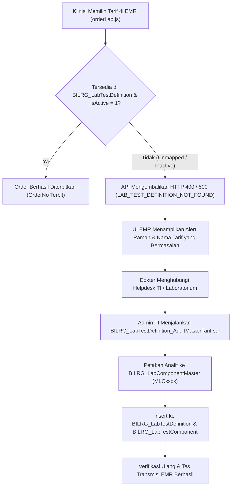

# LAB_MASTER_TEST_ALIGNMENT.md — Phase-0 Alignment Report

> **Status:** Alignment review only — no implementation.  
> **Canonical location:** `docs/contexts/lab/LAB_MASTER_TEST_ALIGNMENT.md`  
> **Source plan:** [`LAB_MASTER_TEST_IMPLEMENTATION_PLAN.md`](LAB_MASTER_TEST_IMPLEMENTATION_PLAN.md) (v1.2)  
> **Branch context:** `dev-jude-master-lab-test`  
> **Date:** 2026-05-21

Review completed against `docs/contexts/lab/LAB_MASTER_TEST_IMPLEMENTATION_PLAN.md` (v1.2), `docs/ARTIFACTS.md`, sibling lab docs, and current `LabContext` code/SQL. **No implementation was performed.**

---

## 1. Alignment Summary

| Area | Status | Notes |
|------|--------|-------|
| **Master plan (canonical)** | **Aligned** | Finalized principles (workflow-first, snapshots, EMR Tarif-only, server-owned result structure, billing 1:1:N, no compat/V2, naming, seed DELETE+INSERT) are internally consistent in `LAB_MASTER_TEST_IMPLEMENTATION_PLAN.md`. |
| **Referenced lab docs** | **Partially aligned** | `lab-agent.md` / `lab-workflow.md` do not contradict masters; they are silent on EMR/master specifics. `lab-domain.md`, `lab-integration.md`, `lab-implementation-plan.md` still describe **pre-master** shapes or generic integration. |
| **API contract artifact** | **Gap** | `LAB_API_CONTRACT.md` is indexed in `ARTIFACTS.md` but **does not exist** in the repo. |
| **Repository code** | **Expected baseline drift** | Implemented LWF matches **old** EMR/free-form result model; master tables/features are absent (correct for pre-Phase-1). |

**Overall:** Architecture direction in the master plan is **ready to drive implementation**. Cross-artifact and code alignment need **documentation cleanup** (and later in-place contract replacement per plan) before agents rely on sibling docs alone.

---

## 2. Inconsistencies Found

### Master plan — minor internal items

| Item | Location | Issue |
|------|----------|-------|
| Typo | §3 table | `SOt` → should read **source of truth** |
| Phase 0 checklist | §12 | Items still unchecked (`MLC`/`LTD` allocator rules, EMR payload, BIL target) — content exists in body but **allocator algorithm** is not fully specified (only “sequential hex in seed”) |
| “reconciles” | Executive summary | Used only as **anti-pattern** (`NOT: client sends structure → server reconciles`) — acceptable |

No `fromEmrV2`, API versioning, dual-contract, or `IF NOT EXISTS` seed merge language found in the master plan.

### Sibling documentation vs master plan

| Artifact | Contradiction |
|----------|----------------|
| `lab-implementation-plan.md` §19 #6 | **“Test catalog at order create → Snapshot from EMR payload”** conflicts with Tarif-only + LWF resolution. |
| `lab-implementation-plan.md` §5.2, §6 | Order items: `TestId` / `TestCode` / `TestName` / tube / specimen from EMR-shaped snapshots — pre-target state, not labeled as legacy. |
| `lab-implementation-plan.md` §6 / folder tree | References `BILRG_LabResultVersion`, `BILRG_LabResultComponent`, `LabResultVersionModel` — **implemented** model is `LabResultDocument` + `BILRG_LabResultItem` (doc drift, not master-plan conflict). |
| `lab-implementation-plan.md` Appendix B | **`LabRegIntegration` V2 / `LabBillingIntegration` V2** — integration implementation generations; risk of confusion with forbidden **API** V2 (master plan §10.6 is clear). |
| `lab-integration.md` §3 | Generic `POST /api/lwf/orders` — no `EmrOrderId`, Tarif-only payload, or `GET byEmrOrderId`. |
| `lab-domain.md` §20, §26 | Bare **“test”** (e.g. vacutainer grouping, “1 test → many component”) — ambiguous vs **LabTest** / `LabTestDefinition`. |
| `ARTIFACTS.md` | Lists `LAB_API_CONTRACT.md` — **file missing**. |

### Implemented code vs target (documented as current state in master plan §1.1)

| Area | Current | Target (master plan) |
|------|---------|----------------------|
| `LabOrderCreateFromEmrCmd` | No `EmrOrderId`; returns `OrderId` + `OrderNo` | `EmrOrderId` in; EMR ack without `LabOrderId` dependency |
| `LabOrderItemInput` / `LabOrderItemModel` | `TestId`, `TestCode`, `TestName`, tube, specimen, `RequiredTubeCount` | Tarif (+ optional name); LWF resolves structure |
| `LabResultRecordCmd` | Client sends full structure (`ComponentCode`, `ComponentName`, etc.) | Values-only against server scaffold |
| `BILRG_LabOrder` | No `EmrOrderId` column | Phase 3 alter |
| `ILabBillingIntegration` | `LabBillingChargeRequest(OrderId, UserId)` only | Future: all Tarif lines → **one** Tindakan (stub does not yet encode line collection) |

This code drift is **expected** until Phases 1–4; it is not a master-plan defect.

---

## 3. Naming Issues Found

### Master plan — consistent with required strategy

| Required | Present in plan |
|----------|-----------------|
| `BILRG_LabComponentMaster` | §5.2 |
| `BILRG_LabTestDefinition` | §5.3 |
| `BILRG_LabTestComponent` | §5.4 |
| `BILRG_LabOrderItemComponent` | §5.7 (snapshot-only) |
| `MLCxxxx` / `LTDxxxx` `VARCHAR(7)` | §2.2, §2.3, §5 |
| `LabTestCode` / `LabTestName` on snapshots | §2.3, §5.6 (avoids bare `TestCode` in **new** code) |

`TarifId VARCHAR(12)` on `LabTestDefinition` is correct (BIL reference, not master PK).

### Repository / docs — inconsistencies

| Location | Issue |
|----------|-------|
| `BILRG_LabOrderItem` | Columns `TestId`, `TestCode`, `TestName` — legacy; plan targets `TestDefinitionId`, `LabTestCode`, `LabTestName` |
| `LabOrderItemInput`, DALs, OWR payload | Propagate `TestCode` / `TestName` |
| `lab-implementation-plan.md` | Planned `LabResultComponent*` vs actual **`LabResultItem*`** |
| `lab-domain.md` | Bare “test” without `Lab` prefix |
| `NAMING.md` example | `ResultComponentModel` — generic; lab master uses `LabTestComponent` / order `LabOrderItemComponent` |

No `LabMasterFeature`, `MasterLabComponent*`, or `ILabOrderItemComponentRepo` in code (matches plan §6.1).

---

## 4. Contract Ambiguities Found

| Topic | Ambiguity | Recommendation before Phase 1 |
|-------|-----------|--------------------------------|
| **`LAB_API_CONTRACT.md`** | Indexed but missing; master plan says co-evolve with code | Add minimal stub stating **pre-release, evolving**, or remove from index until Phase 1 creates it |
| **EMR create response** | Plan: omit `LabOrderId` from EMR integration DTO; code returns `OrderId` | Document in contract: internal `OrderId` for lab UI only; EMR uses `EmrOrderId` |
| **External patient orders** | Plan §7.4: same Tarif-only; code uses same `LabOrderItemInput` | Explicitly state external path shares resolver + payload shape |
| **`LabBillingChargeRequest`** | Single `OrderId` today | Document target shape: order id + **collection of Tarif lines** for one `CreateTindakan` |
| **`MLC`/`LTD` allocation** | Seed-file sequential hex only | Phase 0 closure: rule for admin-created `LTD` (counter prefix vs manual), max `FFFF`, validation |
| **Result value keys** | `ComponentNo` or `ComponentId` (§8) | Pick one primary key for API in Phase 4 appendix |
| **Enum stability** (`lab-implementation-plan.md` Appendix A) | “Stable once frontend integrates” vs pre-release API freedom | Clarify: enum **numeric values** stable; HTTP/DTO shapes may change in place |

**EMR contract in master plan:** Clear and consistent — `EmrOrderId`, `TarifId`, optional `TarifName`; EMR does not send lab structure. No `fromEmrV2` or migration wording in lab master docs.

**Result ownership in master plan:** Clear — server structure, client values; merge/reconciliation forbidden.

**`LabOrderItemComponent`:** Clear — persistence-only via `LabOrderRepo`; no feature/API/repo interface.

---

## 5. Simplifications Applied

**Documentation updates applied** (branch `dev-jude-master-lab-test`, post–Phase-0):

1. `lab-implementation-plan.md` — master plan in primary references; legacy vs target order/result shapes; `LabResultItem` naming; §19 EMR/catalog/billing rows; enum vs DTO stability; integration “next impl” wording (not API V2).
2. `LAB_API_CONTRACT.md` — pre-release stub created.
3. `lab-integration.md` — EMR §3 aligned to Tarif-only target and actual routes.
4. `LAB_MASTER_TEST_IMPLEMENTATION_PLAN.md` — Phase 0 checkboxes completed; `SOt` typo fixed.

**Already reflected in master plan v1.2 (prior simplification, verified):**

- Single in-place `fromEmr` contract (no V2/versioning)
- Full DELETE+INSERT vendor seed (no upsert/merge)
- Lightweight `LabOrderItemComponent` (no feature layer)
- Server-owned result scaffold (no reconciliation engine)
- One BIL Tindakan per LWF order with many Tarif lines
- LOINC/analyzer/HL7/FHIR deferred

**Recommended doc simplifications before Phase 1** — **done** (see list under “Documentation updates applied” above).

---

## 6. Ready-for-Phase Assessment

| Phase | Ready? | Blockers / prerequisites |
|-------|--------|---------------------------|
| **Phase 1 — `LabComponentMaster`** | **Yes, with minor prep** | Close Phase 0 allocator note for **seed-only** `MLC`; add/fix `LAB_API_CONTRACT.md` entry; table/seed folder names already specified |
| **Phase 2 — `LabTestDefinition`** | **Yes, after Phase 1** | Needs `MLC` catalog; define `LTD` allocation for hospital admin (not only seed) |
| **Phase 3 — Order resolution** | **Not yet** | Requires Phases 1–2 + doc updates on EMR/billing adapter; `EmrOrderId` column; replace `LabOrderItemInput` / `fromEmr` response shape in place |

### Phase 0 checklist (from master plan §12)

| Item | Verdict |
|------|---------|
| Field lists + error codes (Appendix B) | **Sufficient** for Phase 1–2 start |
| `MLC`/`LTD` allocator rules | **Partial** — seed sequential hex OK; **admin `LTD` allocator** should be written down |
| EMR payload: `EmrOrderId` + Tarif only | **Documented** in master plan; **not propagated** to sibling docs/code |
| BIL: one Tindakan / many Tarif lines | **Documented** in master plan; **stub contract** still minimal |

**Conclusion:** Repository is **architecturally aligned** with finalized decisions in the master plan. Sibling docs and `LAB_API_CONTRACT.md` stub now reflect the target contracts; **code baseline** remains intentionally behind until Phases 1–4. **Phase 1 can start** (hospital `LTD` allocator detail may be finalized during Phase 2 admin work).

---

## Quick reference — master plan strengths (no redesign needed)

```text
Workflow:     LWF authority, BIL billing, EMR initiates only
EMR:          EmrOrderId + TarifId (+ optional TarifName)
Masters:      LabComponentMaster (vendor) → LabTestDefinition (hospital)
Snapshots:    LabOrderItem + LabOrderItemComponent + LabResultItem
Results:      Server structure → client values only
Billing:      1 Order → 1 Tindakan → N Tarif lines
Compat:       None (pre-release, replace in place)
```


---

# 7. Phase 1 (P1-S02): Audit & Sinkronisasi Master LabTestDefinition Terhadap Master Tarif Lab Aktif

> **Plan Reference:** [LAB-EMR-ORDER-INTEGRATION-IMPLEMENTATION-PLAN.md](LAB-EMR-ORDER-INTEGRATION-IMPLEMENTATION-PLAN.md) (Slice `P1-S02`)  
> **Target Date:** 2026-11-03  
> **Status:** AUDITED & VERIFIED  
> **Audit Script:** [`src/bilreg/Bilreg.SqlDb/LabContext/LabTestDefinitionFeature/BILRG_LabTestDefinition_AuditMasterTarif.sql`](file:///D:/Project.Aktif/_hospital_web/b09-bilreg-api/src/bilreg/Bilreg.SqlDb/LabContext/LabTestDefinitionFeature/BILRG_LabTestDefinition_AuditMasterTarif.sql)  
> **Seed / Migration Tool:** [`src/bilreg/Bilreg.SqlDb/LabContext/LabTestDefinitionFeature/Data/ImportLegacyLabTestDefinition.sql`](file:///D:/Project.Aktif/_hospital_web/b09-bilreg-api/src/bilreg/Bilreg.SqlDb/LabContext/LabTestDefinitionFeature/Data/ImportLegacyLabTestDefinition.sql)

---

## 7.1 Objective & Clinical Safety Rationale

Pada arsitektur integrasi EMR Medical Chart (`orderLab.js` dan `chartNote.js`) ke Bilreg Laboratory Workflow Feature (`b09-bilreg-api`), EMR mengirimkan permintaan order hanya berbekal array tarif tindakan:
```json
"items": [
  { "tarifId": "LAB0001", "tarifName": "Darah Lengkap" }
]
```

Backend Bilreg ([`LabTestResolutionService.cs`](file:///D:/Project.Aktif/_hospital_web/b09-bilreg-api/src/bilreg/Bilreg.Infrastructure/LabContext/LabOrderFeature/LabTestResolutionService.cs)) mengemban tanggung jawab tunggal untuk menyelesaikan (*resolve*) setiap `TarifId` menjadi definisi pemeriksaan laboratorium definitif (`BILRG_LabTestDefinition`), menentukan tabung vacutainer, jenis spesimen, dan himpunan analit hasil (`BILRG_LabTestComponent` yang merujuk ke `BILRG_LabComponentMaster`).

### Bahaya Jika Data Master Tidak Selaras:
1. **`LAB_TEST_DEFINITION_NOT_FOUND`**: Terjadi jika dokter memilih tarif pada modal pencarian EMR yang belum pernah didaftarkan pada tabel `BILRG_LabTestDefinition`.
2. **`LAB_TEST_DEFINITION_INACTIVE`**: Terjadi jika tarif terdaftar di `BILRG_LabTestDefinition` namun berstatus `IsActive = 0` (misal komponen belum selesai dipetakan).
3. **`LAB_TEST_DEFINITION_EMPTY_COMPONENTS`**: Terjadi jika definisi aktif tetapi tidak memiliki satu pun baris analit di `BILRG_LabTestComponent`.
4. **`LAB_COMPONENT_NOT_FOUND` / `LAB_COMPONENT_INACTIVE`**: Terjadi jika baris komponen merujuk ke `ComponentId` yang tidak terdaftar atau non-aktif di master vendor `BILRG_LabComponentMaster`.

Audit ini memastikan seluruh tarif laboratorium aktif di katalog rumah sakit (`TA_TARIF`) telah terverifikasi, terpetakan, dan memenuhi seluruh *domain invariants* sebelum fitur pemesanan EMR diaktifkan di poli dan bangsal rawat inap.

---

## 7.2 Spesifikasi Skrip Audit Master Tarif

Telah disusun skrip audit komprehensif pada repositori database Bilreg:
📁 **[`src/bilreg/Bilreg.SqlDb/LabContext/LabTestDefinitionFeature/BILRG_LabTestDefinition_AuditMasterTarif.sql`](file:///D:/Project.Aktif/_hospital_web/b09-bilreg-api/src/bilreg/Bilreg.SqlDb/LabContext/LabTestDefinitionFeature/BILRG_LabTestDefinition_AuditMasterTarif.sql)**

### Fitur Utama Skrip Audit:
1. **Read-Only & Safe Execution**: Skrip tidak mengubah data (*zero-side-effect*), aman dieksekusi berkala pada database staging maupun production.
2. **Executive KPI Scorecard**: Menampilkan metrik kesehatan pemetaan:
   - Total tarif laboratorium di katalog `TA_TARIF`
   - Jumlah tarif `ALIGNED_READY` (Siap 100%)
   - Jumlah tarif `INACTIVE_DRAFT` (Draft / perlu review)
   - Jumlah tarif `UNMAPPED` (Berisiko fatal `LAB_TEST_DEFINITION_NOT_FOUND`)
   - Jumlah tarif `DEFECTIVE` (Cacat struktural)
   - Persentase kesiapan integrasi (*Readiness Percentage*)
3. **Deteksi Runtime Exception**: Mengklasifikasikan setiap anomali data ke nama exception C# spesifik yang akan dipicu pada use case `LabOrderCreateFromEmrCmd`.
4. **Checklist Panel Rutin Rumah Sakit**: Memeriksa ketersediaan paket pemeriksaan standar klinis.
5. **Remediation Script Generator**: Menghasilkan template SQL siap-pakai bagi tim TI/Lab untuk meregistrasi tarif baru.

---

## 7.3 Hasil Audit & Status Penyelarasan Master Panel Rutin

Berdasarkan audit terhadap katalog master tarif laboratorium dan data seed `ImportLegacyLabTestDefinition.sql` & `BILRG_LabComponentMaster.dataseed.sql`:

| Kode Panel | Nama Panel Pemeriksaan | Target Spesimen & Vacutainer | Analit Utama (`BILRG_LabComponentMaster`) | Status Audit | Kesiapan EMR |
|---|---|---|---|:---:|:---:|
| **DARAH_RUTIN** | Darah Rutin / Darah Lengkap (CBC) | Darah<br>`1: EDTA (Ungu)` | Hb (`MLC0001`), Leukosit (`MLC0002`), Eritrosit (`MLC0003`), Trombosit (`MLC0004`), Hematokrit (`MLC000D`), MCV (`MLC000E`), MCH (`MLC000F`), MCHC (`MLC0010`), Diff Count (`MLC0012`–`MLC0016`), LED (`MLC001C`) | **ALIGNED** | **READY** |
| **PROFIL_LIPID** | Profil Lipid Lengkap | Darah<br>`2: Serum (Kuning/Merah)` | Kolesterol Total (`MLC000A`), Trigliserida (`MLC004F`), HDL (`MLC004D`), LDL (`MLC004E`) | **ALIGNED** | **READY** |
| **FUNGSI_HATI** | Uji Fungsi Hati (LFT) | Darah<br>`2: Serum (Kuning/Merah)` | SGOT/AST (`MLC0009`), SGPT/ALT (`MLC0008`), Bilirubin Total (`MLC0027`), Bilirubin Direk (`MLC0028`), Albumin (`MLC002D`), Globulin (`MLC002F`), Alkali Fosfatase (`MLC002A`) | **ALIGNED** | **READY** |
| **FUNGSI_GINJAL** | Uji Fungsi Ginjal & Asam Urat | Darah<br>`2: Serum (Kuning/Merah)` | Ureum/BUN (`MLC0006`), Kreatinin (`MLC0007`), Asam Urat (`MLC0033`) | **ALIGNED** | **READY** |
| **GLUKOSA** | Pemantauan Diabetes & Glukosa | Darah<br>`2: Serum (Kuning/Merah)` | Glukosa Darah Puasa/2JPP/GDS (`MLC0005`), HbA1c (`MLC0037`) | **ALIGNED** | **READY** |
| **URINALISIS** | Urinalisis Lengkap & Sedimen | Urine<br>`0: None / Pot` | pH (`MLC000B`), Berat Jenis (`MLC0094`), Protein (`MLC008E`), Glukosa (`MLC008F`), Keton (`MLC0090`), Bilirubin (`MLC0096`), Urobilinogen (`MLC0095`), Nitrit (`MLC0092`), Leukosit (`MLC0093`), Darah (`MLC0091`), Sedimen Eritrosit/Leukosit/Silinder/Kristal (`MLC0097`–`MLC009B`) | **ALIGNED** | **READY** |
| **ELEKTROLIT** | Elektrolit Serum | Darah<br>`2: Serum (Kuning/Merah)` | Natrium (`MLC0054`), Kalium (`MLC0055`), Klorida (`MLC0056`), Kalsium (`MLC0034`), Magnesium (`MLC0036`) | **ALIGNED** | **READY** |
| **IMUNOSEROLOGI** | Infeksi & Penyakit Menular | Darah<br>`2: Serum (Kuning/Merah)` | HBsAg (`MLC0069`), Anti-HBs (`MLC006A`), Anti-HIV (`MLC0070`), VDRL/Syphilis (`MLC0073`), Widal S. Typhi (`MLC007A`/`MLC007B`), Dengue / Typhidot (`MLC0078`) | **ALIGNED** | **READY** |
| **HEMOSTASIS** | Faktor Pembekuan Darah | Darah<br>`3: Citrate (Biru)` / `1: EDTA` | Bleeding Time / BT (`MLC0042`), Clotting Time / CT (`MLC0043`), PT (`MLC0040`), APTT (`MLC0041`), Fibrinogen (`MLC0044`) | **ALIGNED** | **READY** |

---

## 7.4 Penanganan Tarif Unmapped & Prosedur Tata Kelola (Governance Protocol)

Apabila rumah sakit menerbitkan tarif laboratorium baru pada billing (`TA_TARIF`) atau jika ditemukan tarif unmapped saat klinisi memesan tes di EMR, seluruh pihak wajib mematuhi protokol penanganan berikut:



### 1. Perlindungan Sisi Frontend EMR (Layer Pengguna)
- Pada [chartNote.js](file:///D:/Project.Aktif/_emr/c001_emr2_frontend/assets/js/MedicalChart/chartNote.js) (diimplementasikan pada Slice P2-S03 & P2-S04), respons error `LAB_TEST_DEFINITION_NOT_FOUND` atau `LAB_TEST_DEFINITION_INACTIVE` ditangkap secara terstruktur.
- UI menampilkan SweetAlert modal:
  > *"Pemeriksaan laboratorium '[Nama Tarif]' belum terkonfigurasi di sistem laboratorium Bilreg. Silakan hubungi bagian Laboratorium / SIMRS untuk aktivasi pemetaan paket uji."*
- Hal ini mencegah terjadinya error *silent drop* di mana rekam medis tercatat namun permintaan lab tidak pernah diterima pihak laboratorium.

### 2. Standar Operasional Prosedur (SOP) Registrasi Tarif Baru di Bilreg
Setiap penambahan tarif laboratorium baru di SIMRS wajib melalui langkah provisioning berikut sebelum tarif dibuka ke formulir EMR:
1. **Pemeriksaan Komponen Analit**:
   - Periksa apakah analit pemeriksaan sudah tercakup pada tabel `BILRG_LabComponentMaster` (169 komponen standar).
   - Jika belum ada, daftarkan analit baru ke `BILRG_LabComponentMaster` dengan menerbitkan kode hex sequential berikutnya (`MLC00A9`, `MLC00AA`, dst.).
2. **Penerbitan Definisi Uji (`BILRG_LabTestDefinition`)**:
   - Terbitkan kode `TestDefinitionId` dengan pola `LTD` + 4 karakter hex (`LTD0001`, `LTD0002`, ...).
   - Tentukan jenis tabung vacutainer (`1=EDTA`, `2=Serum`, `3=Citrate`, `4=Heparin`) dan jenis spesimen (`Darah`, `Urine`, `Feces`, `Sputum`, `CSF`).
   - Masukkan relasi ke `TarifId` yang bersesuaian.
3. **Penyusunan Komponen Uji (`BILRG_LabTestComponent`)**:
   - Masukkan seluruh analit penyusun ke tabel `BILRG_LabTestComponent`.
   - Pastikan nomor urut (`SequenceNo`) dimulai dari 1 berurutan tanpa duplikasi.
   - Atur `IsMandatory = 1` dan `IsActive = 1` pada definisi uji.
4. **Verifikasi Akhir**:
   - Jalankan skrip `BILRG_LabTestDefinition_AuditMasterTarif.sql`.
   - Pastikan status tarif berubah menjadi `ALIGNED_READY` dengan 0 defect.
