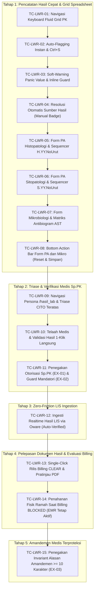

# 1. Overview & Objective

Dokumen ini merupakan **TEST-PACKAGE** resmi untuk memvalidasi secara menyeluruh hasil implementasi fitur **Hasil Pemeriksaan Laboratorium Terverifikasi (*Laboratory Results & Expertise Management Workspace*)** (`OC-LAB-HASIL-LAB`), mencakup antarmuka pengguna konsol web meja kerja pada `c012_myhospital_web`, penyelarasan Backend-For-Frontend (BFF) pada `b09-bilreg-api`, dan bridging middleware LIS pada `a046_oware_ordermiddlewareapi`.

Tujuan utama pengujian ini adalah memastikan bahwa seluruh alur kerja operasional laboratorium rumah sakit berjalan cepat, minim friksi administratif, dan mematuhi aturan kendali mutu medis:
1. **Pencatatan Hasil Cepat (*High-Speed Result Entry*)**:
   - Formulir spreadsheet grid Patologi Klinik ([`LabResultEntryPkTabular.vue`](file:///D:/Project.Aktif/_hospital_web/c012_myhospital_web/src/modules/Laboratory/components/result/LabResultEntryPkTabular.vue)) mendukung navigasi tombol keyboard fluid (`Enter`/`Tab`), kalkulasi instan status flag (*Normal/Low/High/Critical*), dan shortcut simpan `Ctrl+S`.
   - Penegakan *Inline Mandatory Panic Value Guard* (SCR-LAB-RES-08): soft-warning visual merah berkedip pada analit kritis yang mewajibkan pengisian catatan readback telepon (`CriticalNote`) secara inline sebelum simpan diizinkan, tanpa modal popup pemblokir layar.
   - Formulir adaptif Patologi Anatomi ([`LabResultEntryPaForm.vue`](file:///D:/Project.Aktif/_hospital_web/c012_myhospital_web/src/modules/Laboratory/components/result/LabResultEntryPaForm.vue)): nomor register fisik PA dibangkitkan otomatis oleh sequencer (`H.{YY}.{NoUrut}` untuk Histopatologi vs `S.{YY}.{NoUrut}` untuk Sitopatologi), sajian input adaptif (Makroskopis vs Adekuasi Sediaan + Rekomendasi), serta Bottom Action Bar (Reset & Simpan).
   - Formulir Mikrobiologi ([`LabResultEntryMicroForm.vue`](file:///D:/Project.Aktif/_hospital_web/c012_myhospital_web/src/modules/Laboratory/components/result/LabResultEntryMicroForm.vue)): sediaan langsung pewarnaan gram, identifikasi biakan & hitung koloni, matriks antibiogram dinamis (AST), serta Bottom Action Bar (Reset & Simpan).
   - Otomatisasi sumber hasil (`ResultSource.Manual = 1` vs `ResultSource.ExternalLis = 3`) secara statis berupa badge informatif tanpa listbox dropdown pilihan manual.
2. **Triase & Verifikasi Medis Dokter Spesialis Patologi Klinik (Sp.PK)**:
   - Rute terfokus persona `/app/laboratorium/hasil_lab` ([`HasilLab.vue`](file:///D:/Project.Aktif/_hospital_web/c012_myhospital_web/src/modules/Laboratory/views/HasilLab.vue)) langsung mengaktifkan antrean verifikasi dengan triase prioritas CITO di baris teratas.
   - Layar telaah medis & validasi hasil Sp.PK ([`LabVerificationPanel.vue`](file:///D:/Project.Aktif/_hospital_web/c012_myhospital_web/src/modules/Laboratory/components/verification/LabVerificationPanel.vue)) menyajikan ringkasan temuan kritis di baris atas, editor catatan ekspertise patolog (`ExpertiseNote`) dengan chip template cepat, dan tombol validasi 1-klik langsung (*Direct 1-Click Verification*) tanpa modal konfirmasi berulang.
   - Penegakan otorisasi peran Dokter Sp.PK (`doktersppk` / `lab.result.verify`) (**EX-01**) dan kelengkapan komponen mandatori (**EX-02**).
3. **Integrasi Realtime LIS via Oware (*Zero-Friction Ingestion*)**:
   - Ingesti data hasil dari LIS pihak ketiga melalui Oware (`POST /api/LabContext/LabResultFeature/ingest-lis`) mencocokkan tes 1:1, menetapkan validator LIS otomatis, menandai `ResultSource = ExternalLis`, dan mengalirkan hasil langsung ke antrean Siap Rilis tanpa membebani Sp.PK untuk verifikasi ulang hasil rutin instrumen.
4. **Pelepasan Dokumen Hasil (*Single-Click Release*) & Gerbang Tagihan**:
   - Aksi tunggal *"Cetak & Rilis Hasil"* pada antrean Siap Rilis mengevaluasi kelayakan tagihan `TRK-BILLING` secara sinkron.
   - Jika `CLEAR`, dokumen langsung berstatus `Released` dan modal pratinjau lembar PDF resmi ([`LabResultPdfPreviewDialog.vue`](file:///D:/Project.Aktif/_hospital_web/c012_myhospital_web/src/modules/Laboratory/components/dialogs/LabResultPdfPreviewDialog.vue)) terbuka otomatis untuk dicetak.
   - Jika `BLOCKED`, sistem menyajikan pemberitahuan informatif ramah bahwa tagihan kasir belum lunas (penyerahan fisik tertahan), tanpa exception crash, dan **akses klinis dokter DPJP di EMR internal tetap aktif**.
5. **Siklus Hidup Amandemen Medis Terproteksi (*Strict Medical Amendment*)**:
   - Hasil berstatus `Verified` terkunci permanen (*immutable*).
   - Dialog amandemen ([`LabAmendResultDialog.vue`](file:///D:/Project.Aktif/_hospital_web/c012_myhospital_web/src/modules/Laboratory/components/dialogs/LabAmendResultDialog.vue)) menegakkan pengisian alasan amandemen resmi minimal 10 karakter (**EX-03**) dan membatasi otorisasi hanya untuk peran Sp.PK atau Supervisor Lab.
   - Sistem membentuk dokumen snapshot Versi N+1 dengan status `Recorded` untuk perekaman koreksi baru.

Paket pengujian ini disusun agar **dapat dieksekusi secara mandiri oleh manusia (*Tester, QA, Dokter Sp.PK, Analis Lab, atau Trainer*)** menggunakan antarmuka grafis peramban web (*browser*), dengan instruksi yang terukur, dapat diamati secara visual (*observable behavior*), dan bebas tebak-tebakan.

---

# 2. Scope & Testing Principles

## 2.1 Lingkup Pengujian (In-Scope)
- **Frontend Konsol Laboratorium (`c012_myhospital_web`)**:
  - Navigasi rute tab menu `Hasil Lab` (`/app/laboratorium/hasil_lab`) dan `Tindakan Lab` (`/app/laboratorium/tindakan_lab`).
  - Pengoperasian antrean kerja multi-tab: `Input Hasil` (status `Collected`), `Verifikasi Medis` (status `Recorded`), `Siap Rilis` (status `Verified`), dan `Integrasi LIS / Oware`.
  - Formulir Spreadsheet Grid Patologi Klinik: navigasi keyboard fluid (`Enter`/`Tab`), auto-flagging instan warna, soft-warning nilai kritis, inline mandatory `CriticalNote`, shortcut `Ctrl+S`, dan tombol Reset Form / Simpan Nilai Hasil.
  - Formulir Patologi Anatomi: header nomor register fisik adaptif (`H.YY.NoUrut` vs `S.YY.NoUrut`), input Makroskopis (Histologi) vs Adekuasi + Rekomendasi (Sitologi), chip template diagnosis cepat, dan tombol Reset / Simpan.
  - Formulir Mikrobiologi: sediaan mikroskopis langsung, biakan & koloni kuman, tabel antibiogram AST, dan tombol Reset / Simpan.
  - Penyajian statis badge sumber hasil (`Manual` vs `LIS Eksternal`).
  - Layar telaah medis & validasi Sp.PK: ringkasan abnormalitas, chip ekspertise, tombol validasi 1-klik, dan penolakan jika akun non-Sp.PK.
  - Tombol rilis *"Cetak & Rilis Hasil"* pada gerbang billing `CLEAR` vs penanganan penundaan fisik saat billing `BLOCKED`.
  - Dialog modal pratinjau PDF lembar hasil resmi dan fungsi cetak browser.
  - Dialog amandemen: validasi alasan koreksi < 10 karakter vs $\ge$ 10 karakter, pembatasan otorisasi peran, dan pembentukan versi N+1.
- **Backend API & Data Persistence (`b09-bilreg-api`)**:
  - Endpoint `POST record`, `PATCH verify`, `POST ingest-lis`, `POST amend`, `GET {orderId}`, `GET {orderId}/pdf`, dan `GET worklist/verification`.
  - Transisi siklus hidup status: `Collected` $\rightarrow$ `Recorded` $\rightarrow$ `Verified` $\rightarrow$ `Released` $\rightarrow$ `Amended`.
  - Persistensi kolom `ExpertiseNote`, `CriticalNote`, dan `AmendmentReason` pada tabel `BILRG_LabResultDocument`.
  - Pembangkitan nomor urut register fisik PA oleh sequencer.
  - Penegakan evaluasi sinkron `TRK-BILLING` menghasilkan kontrak respon `LabOrderReleaseResponse`.
- **Integration Ingestion (`a046_oware_ordermiddlewareapi`)**:
  - Pengiriman hasil instrumen LIS via endpoint `POST ingest-lis` dengan mapping deterministik dan status langsung `Verified`.

## 2.2 Di Luar Lingkup (Out-of-Scope)
- Pengkabelan fisik RS-232 / driver serial instrumen laboratorium analyzer (dikelola LIS eksternal pihak ketiga).
- Transaksi pembayaran kasir, pencetakan struk pembayaran kasir, dan penutupan shift kasir (`TRK-KASIR`).
- Pengisian lembar pengkajian EMR rawat jalan / rawat inap oleh dokter poliklinik (`EMRContext`).

## 2.3 Prinsip Pengujian (Testing Principles)
- **Berorientasi Perilaku Teramati (*Observable Behavior*)**: Penguji memvalidasi perubahan visual warna flag, notifikasi toast feedback, perubahan status badge antrean, nomor versi, dan pop-up pratinjau PDF.
- **Tester-Agnostic**: Ditulis menggunakan terminologi alur kerja klinis dan operasional yang dipahami oleh analis laboratorium, perawat, kasir, dan dokter tanpa perlu membaca kode sumber program.
- **Human Executability**: Setiap skenario memiliki tujuan, data uji prasyarat, langkah aksi terperinci per klik/tombol, dan ekspektasi hasil yang jelas tanpa ambiguitas.

---

# 3. Environment & Prerequisites

## 3.1 Kebutuhan Lingkungan Sistem
- **Frontend Client**: Aplikasi web `c012_myhospital_web` berjalan aktif pada peramban web (port default `http://localhost:5173` atau server staging/development).
- **Backend API**: Layanan `b09-bilreg-api` aktif pada port `http://localhost:5189` (tersambung ke database SQL Server `HOSPITAL_PKL` / `BILREG` dan RabbitMQ).
- **Peramban Web (*Browser*)**: Google Chrome / Microsoft Edge versi terbaru dengan jendela *Developer Tools (F12 Console)* terbuka untuk memverifikasi ketiadaan unhandled runtime exception crash.
- **Alat Pendukung API (Opsional untuk simulasi bridging LIS)**: Postman, cURL, atau Swagger UI pada `http://localhost:5189/swagger`.

## 3.2 Kebutuhan Akun Pengguna & Hak Akses (User Roles)

| ID Akun | Nama Pengguna | Peran Operasional (*Role / Claim*) | Kewenangan dalam Uji Coba |
|---|---|---|---|
| `USR-ANALIS-01` | Analis Dewi Kurnia, A.Md.AK | Analis Kesehatan (`analis_lab`) | Entri hasil PK, PA, Mikro, input catatan nilai kritis, dan reset form. Dilarang melakukan verifikasi Sp.PK. |
| `USR-SPPK-01` | dr. Bambang Sudarmo, Sp.PK | Dokter Spesialis Patologi Klinik (`doktersppk` / `lab.result.verify`) | Telaah klinis hasil, input ekspertise, verifikasi medis 1-klik, otorisasi amandemen hasil. |
| `USR-LOKET-01` | Siti Nurhaliza | Petugas Loket & Administrasi Lab (`petugas_lab` / `loket_lab`) | Eksekusi tombol *"Cetak & Rilis Hasil"*, penyerahan dokumen fisik ke pasien/keluarga. |
| `USR-SUPERVISOR-01` | Ns. Hartono, S.Tr.Kes | Supervisor Laboratorium (`supervisor`) | Otorisasi pengajuan dan konfirmasi amandemen hasil laboratorium terverifikasi. |

## 3.3 Matriks Data Uji (Test Data Catalog)

| ID Data Uji | Tipe Pemeriksaan & Pasien | Karakteristik Klinis & Finansial | Status Awal Order |
|---|---|---|---|
| `DATA-PK-RUTIN` | Pasien Rawat Jalan (Poli Penyakit Dalam) | Paket Darah Lengkap (Hemoglobin, Leukosit, Trombosit, Hematokrit). Seluruh hasil dalam batas normal. | `Collected` (Tercatat / Input Hasil) |
| `DATA-PK-PANIC` | Pasien Rawat Inap (Bangsal Bedah Flamboyan) | Pemeriksaan Darah Lengkap dengan nilai kritis ekstrim: Hemoglobin 5.2 g/dL (Nilai Kritis Rendah < 7.0 g/dL). | `Collected` (Tercatat / Input Hasil) |
| `DATA-PK-OPTION` | Pasien Pra-Operasi Rawat Jalan | Pemeriksaan Golongan Darah & Rhesus (Komponen bertipe opsi / select choices: A, B, AB, O dan Positif/Negatif). | `Collected` (Tercatat / Input Hasil) |
| `DATA-PA-HISTO` | Pasien Bedah Onkologi Rawat Inap | Biopsi Jaringan Mamae Dextra (`DISC-PAH`, Histopatologi Jaringan). Form wajib memuat deskripsi Makroskopis. | `Collected` (Tercatat / Input Hasil) |
| `DATA-PA-CYTO` | Pasien Rawat Jalan Poli Paru | Aspirasi Jarum Halus Cairan Pleura (`DISC-PAS`, Sitopatologi). Form wajib memuat Adekuasi Sediaan dan Rekomendasi Klinis. | `Collected` (Tercatat / Input Hasil) |
| `DATA-MIC-AST` | Pasien Infeksi Saluran Kemih Rawat Jalan | Kultur Mikroorganisme Urin & Uji Kepekaan Antibiotik Antibiogram AST (`DISC-MIC`). | `Collected` (Tercatat / Input Hasil) |
| `DATA-VERIF-CITO` | Pasien IGD Cito Darurat (`IsCito = true`) | Pemeriksaan Elektrolit & GDS Cito berstatus `Recorded`. Terdaftar di antrean Verifikasi Medis Sp.PK. | `Recorded` (Antrean Verifikasi Sp.PK) |
| `DATA-RELEASE-CLEAR` | Pasien Rawat Jalan Umum | Order berstatus `Verified`. Administrasi tagihan di Tata Rekening berstatus lunas / dibuka resmi (`CLEAR`). | `Verified` (Antrean Siap Rilis) |
| `DATA-RELEASE-BLOCKED` | Pasien Rawat Jalan Umum (Belum Bayar) | Order berstatus `Verified`. Administrasi tagihan kasir belum lunas di Tata Rekening (`BLOCKED`). | `Verified` (Antrean Siap Rilis) |
| `DATA-AMEND-EXP` | Pasien Rawat Inap Terverifikasi | Dokumen hasil laboratorium telah berstatus `Verified` (Versi 1) yang memerlukan revisi nilai analit. | `Verified` (Dokumen Hasil Sah) |
| `DATA-LIS-BRIDGE` | Pasien Rawat Jalan Alat Otomatis | Order lab terkirim ke LIS pihak ketiga melalui Oware (`owareStatus = 1`). Belum memiliki hasil di HIS. | `Collected` (Terkirim ke LIS) |

---

# 4. Test Execution Sequence

Alur eksekusi pengujian disusun secara berjenjang mengikuti siklus hidup riil spesimen di instalasi laboratorium:



---

# 5. Test Cases

## TC-LWR-01: Navigasi Keyboard Fluid pada Spreadsheet Grid Entri Patologi Klinik
- **Objective**: Memverifikasi bahwa antarmuka pengisian hasil Patologi Klinik ([`LabResultEntryPkTabular.vue`](file:///D:/Project.Aktif/_hospital_web/c012_myhospital_web/src/modules/Laboratory/components/result/LabResultEntryPkTabular.vue)) berfungsi selayaknya lembar kerja *spreadsheet* berkecepatan tinggi: penekanan tombol `Enter`, `Tab`, dan tombol panah keyboard secara mulus memindahkan fokus baris input tanpa jeda dan tanpa melempar runtime exception saat mencapai baris terakhir.
- **Kategori**: UI / Ergonomics & Keyboard Workflow
- **Pemetaan Kriteria Penerimaan**: `AC-ARCH-09`, `SCR-LAB-RES-03`
- **Preconditions**:
  - Login sebagai Analis Lab (`USR-ANALIS-01`).
  - Buka menu **Tindakan Lab** (`/app/laboratorium/tindakan_lab`).
  - Pilih tab antrean **Input Hasil** (status `Collected`).
  - Pilih pasien data uji `DATA-PK-RUTIN` yang memiliki 4 baris analit pemeriksaan.
- **Langkah Pengujian**:
  1. Klik kotak input nilai hasil pada baris pertama (#1 Hemoglobin).
  2. Ketik angka `14.2`, kemudian tekan tombol keyboard **`Enter`**.
  3. Amati perpindahan kursor fokus.
  4. Ketik angka `7500` pada baris kedua (#2 Leukosit), lalu tekan tombol **`Tab`**.
  5. Amati perpindahan kursor fokus ke baris ketiga (#3 Trombosit).
  6. Tekan tombol **`Shift + Tab`** pada keyboard. Amati perpindahan kursor mundur ke baris kedua.
  7. Tekan tombol panah bawah **`↓`** dua kali hingga kursor berada di baris terakhir (#4 Hematokrit).
  8. Ketik angka `42.5`, kemudian tekan tombol **`Enter`**.
  9. Amati respon fokus kursor saat berada di baris terakhir.
- **Expected Result**:
  - Penekanan `Enter` pada baris #1 otomatis memindahkan fokus kursor ke input baris #2 dan menyeleksi teks sebelumnya.
  - Penekanan `Tab` memindahkan fokus maju ke baris berikutnya; `Shift + Tab` memindahkan fokus mundur ke baris sebelumnya.
  - Penekanan panah bawah `↓` dan panah atas `↑` menavigasi baris input secara vertikal.
  - Saat menekan `Enter` pada baris terakhir (#4), fokus kursor berpindah secara aman ke tombol simpan hasil ([`Simpan Nilai Hasil (Ctrl+S)`](file:///D:/Project.Aktif/_hospital_web/c012_myhospital_web/src/modules/Laboratory/components/result/LabResultEntryPkTabular.vue#L697-L708)) tanpa memicu error `TypeError: saveButtonRef.value.focus is not a function` pada konsol browser.

---

## TC-LWR-02: Auto-Flagging Instan Client-Side & Shortcut Simpan Global `Ctrl+S`
- **Objective**: Memverifikasi bahwa kalkulasi penanda abnormalitas (*Normal, Low, High*) dihitung secara instan di sisi client saat mengetik nilai angka berdasarkan nilai rujukan pasien, serta kombinasi tombol `Ctrl+S` / `Cmd+S` berhasil menyimpan hasil dan memajukan status ke `Recorded`.
- **Kategori**: Happy Path & Business Rules
- **Pemetaan Kriteria Penerimaan**: `AC-ARCH-04`, `AC-ARCH-09`, `SCR-LAB-RES-03`
- **Preconditions**:
  - Login sebagai Analis Lab (`USR-ANALIS-01`).
  - Buka data uji `DATA-PK-RUTIN` (Pasien Pria, Nilai Rujukan Hb: 13.5 - 17.5 g/dL, Leukosit: 4000 - 10000 /uL).
- **Langkah Pengujian**:
  1. Pada baris Hemoglobin, ketik angka `11.0` (di bawah batas normal 13.5). Amati lencana (*badge*) kolom Penanda (Flag).
  2. Ganti angka menjadi `18.5` (di atas batas normal 17.5). Amati lencana Penanda.
  3. Ganti angka menjadi `14.5` (dalam rentang normal). Amati lencana Penanda.
  4. Isi seluruh baris pemeriksaan lain dengan nilai dalam batas normal.
  5. Tanpa mengklik mouse, tekan kombinasi tombol keyboard **`Ctrl + S`** (atau `Cmd + S` pada macOS).
  6. Amati notifikasi pop-up toast dan perubahan status pada kanvas header order.
- **Expected Result**:
  - Saat nilai `11.0`: Lencana otomatis berubah warna biru dengan teks **`LOW`** (Rendah).
  - Saat nilai `18.5`: Lencana otomatis berubah warna oranye/kuning dengan teks **`HIGH`** (Tinggi).
  - Saat nilai `14.5`: Lencana otomatis berubah warna hijau dengan teks **`NORMAL`**.
  - Seluruh perhitungan flag terjadi secara instan (*real-time reactive*) tanpa refresh halaman atau jeda kueri server.
  - Penekanan `Ctrl+S` menampilkan toast notifikasi hijau: *"Hasil lab order ORD-xxx berhasil disimpan!"*.
  - Status order pada antrean dan dokumen hasil otomatis memajukan diri menjadi **`Recorded` (Tercatat)**, dan kartu order berpindah ke sub-antrean **Verifikasi Medis**.

---

## TC-LWR-03: Soft-Warning Nilai Kritis (*Panic Value*) & Penegakan Inline Mandatory Guard pada `CriticalNote`
- **Objective**: Memverifikasi penegakan keselamatan pasien (SCR-LAB-RES-08): analit bernilai kritis memicu penanda visual merah berkedip (*pulsing badge*), banner soft-warning peringatan dini, serta memblokir tombol simpan hingga catatan pelaporan telepon (`CriticalNote`) diisi langsung secara inline tanpa memunculkan popup dialog modal yang membekukan layar.
- **Kategori**: Validation Rules & Safety Invariant
- **Pemetaan Kriteria Penerimaan**: `AC-ARCH-04`, `SCR-LAB-RES-08`
- **Preconditions**:
  - Login sebagai Analis Lab (`USR-ANALIS-01`).
  - Buka pasien data uji `DATA-PK-PANIC` (Rentang Kritis Rendah Hb: < 7.0 g/dL).
- **Langkah Pengujian**:
  1. Pada baris analit Hemoglobin, ketik angka nilai kritis `5.2`.
  2. Amati perubahan visual pada baris analit dan area bawah tabel.
  3. Amati kondisi tombol **Simpan Nilai Hasil (Ctrl+S)**.
  4. Cobalah menekan tombol `Simpan Nilai Hasil` atau tekan shortcut `Ctrl+S`.
  5. Klik tombol bantuan template pelaporan cepat **`+ Template Pelaporan Cepat (Telepon DPJP / Perawat)`**.
  6. Amati isi kotak isian `Catatan Pelaporan Nilai Kritis (Critical Note)`.
  7. Periksa kembali kondisi tombol `Simpan Nilai Hasil (Ctrl+S)`.
  8. Klik tombol `Simpan Nilai Hasil (Ctrl+S)`.
- **Expected Result**:
  - Baris Hemoglobin otomatis menampilkan lencana merah berkedip berlabel **`CRITICAL`**.
  - Muncul banner peringatan dini (*Soft-Warning Banner*) berlatar merah muda di bawah tabel yang merangkum temuan kritis: *"Peringatan Nilai Kritis: Hemoglobin (Hb.) bernilai 5.2 g/dL (Batas Kritis < 7.0 g/dL)"*.
  - Tidak ada jendela pop-up modal yang memblokir layar kerja pengguna (*non-blocking inline notification*).
  - Tombol `Simpan Nilai Hasil (Ctrl+S)` dalam keadaan non-aktif (*disabled*) selama field `CriticalNote` masih kosong.
  - Menekan `+ Template Pelaporan Cepat` secara otomatis mengisi teks terstandarisasi lengkap dengan jam saat ini: *"Lapor Ns. Bangsal/DPJP ext 302 pkl HH:mm WIB. Readback valid."*.
  - Tombol `Simpan Nilai Hasil (Ctrl+S)` seketika aktif kembali (*enabled*).
  - Penyimpanan berhasil, dan catatan nilai kritis tersimpan persisten ke basis data.

---

## TC-LWR-04: Resolusi Otomatis Sumber Hasil (*Manual* vs *LIS Eksternal*) Tanpa Dropdown
- **Objective**: Memverifikasi bahwa elemen pilihan dropdown/listbox *"Sumber entri hasil"* telah dihapus dari formulir entri hasil, dan sistem secara otomatis menampilkan lencana sumber yang tepat: berlabel **`Manual`** saat dientry petugas di web MyHospital, atau berlabel **`LIS Eksternal`** saat hasil berasal dari ingesti LIS Oware.
- **Kategori**: UI Simplification & Business Invariant
- **Pemetaan Kriteria Penerimaan**: `AC-ARCH-01`, `SCR-LAB-RES-03`
- **Preconditions**:
  - Buka formulir entri hasil PK, PA, dan Mikro untuk order manual baru (`DATA-PK-RUTIN`, `DATA-PA-HISTO`, `DATA-MIC-AST`).
  - Buka order hasil yang berasal dari integrasi LIS Oware (`DATA-LIS-BRIDGE`).
- **Langkah Pengujian**:
  1. Periksa bagian header formulir entri hasil pada `DATA-PK-RUTIN`.
  2. Periksa apakah terdapat elemen dropdown / kotak pilihan (*select box*) untuk memilih *"Pilih sumber"*, *"Manual"*, *"Instrumen"*, atau *"LIS eksternal"*.
  3. Amati tampilan badge di samping label *"Sumber:"*.
  4. Buka formulir entri hasil pada `DATA-PA-HISTO` dan `DATA-MIC-AST`.
  5. Amati tampilan badge sumber pada kedua formulir tersebut.
  6. Buka dokumen hasil yang telah di-ingest dari LIS (`DATA-LIS-BRIDGE`). Amati tampilan badge sumbernya.
- **Expected Result**:
  - Tidak ada lagi dropdown atau listbox pilihan sumber hasil pada formulir PK, PA, maupun Mikro (elemen `<Select>` ditiadakan).
  - Pada order manual (`DATA-PK-RUTIN`, `DATA-PA-HISTO`, `DATA-MIC-AST`), label *"Sumber:"* otomatis menyajikan lencana berlatar ungu/slate bertuliskan **`Manual`**.
  - Pada order yang di-ingest dari LIS Oware (`DATA-LIS-BRIDGE`), label *"Sumber:"* otomatis menyajikan lencana berlatar oranye bertuliskan **`LIS Eksternal`**.
  - Nilai kode sumber tersimpan secara akurat pada payload `resultSource: 1` (*Manual*) atau `resultSource: 3` (*ExternalLis*).

---

## TC-LWR-05: Formulir Adaptif Patologi Anatomi: Histopatologi Jaringan, Nomor Sediaan & Sequencer `H.YY.NoUrut`
- **Objective**: Memverifikasi bahwa saat membuka order Patologi Anatomi sub-spesialisasi Histopatologi (`DISC-PAH`), formulir adaptif ([`LabResultEntryPaForm.vue`](file:///D:/Project.Aktif/_hospital_web/c012_myhospital_web/src/modules/Laboratory/components/result/LabResultEntryPaForm.vue)) menyajikan nomor register fisik dengan format `H.{YY}.{NoUrut}`, menyajikan input parameter nomor sediaan arsip fisik (`PA_SLIDE_NO`) dalam grid 2-kolom bersama lokasi jaringan (`PA_SPECIMEN_SITE`), menampilkan input deskripsi Makroskopis, menyembunyikan field Sitologi, serta mendukung pengisian diagnosis cepat via chip template.
- **Kategori**: Functional & Discipline Adaptability
- **Pemetaan Kriteria Penerimaan**: `AC-ARCH-11`, `SCR-LAB-RES-02`
- **Preconditions**:
  - Login sebagai Analis Lab (`USR-ANALIS-01`).
  - Pilih pasien data uji `DATA-PA-HISTO` (Pemeriksaan Biopsi Jaringan Mamae, Disiplin `DISC-PAH`).
- **Langkah Pengujian**:
  1. Buka formulir entri hasil Patologi Anatomi.
  2. Amati lencana disiplin dan nomor register fisik PA pada bagian header form.
  3. Periksa keberadaan grid 2-kolom metadata spesimen: field input **Nomor Sediaan / Slide** (opsional) di kolom kiri dan **Asal / Lokasi Jaringan** (wajib) di kolom kanan.
  4. Isikan nomor blok kaset sediaan pada field Nomor Sediaan: `A1, A2, B1`.
  5. Periksa keberadaan field input **Pemeriksaan Sediaan Makroskopis (Gross Description)**.
  6. Periksa apakah field *Kecukupan Sediaan (Specimen Adequacy)* dan *Rekomendasi Klinis* muncul pada form ini.
  7. Isi field Asal Jaringan (*Specimen Site*), Makroskopis, dan Mikroskopis.
  8. Pada bagian *Template Diagnosis Cepat*, klik chip **`+ Infiltrating Ductal Carcinoma`**.
  9. Amati perubahan pada kotak isian *Diagnosis Patologi Anatomi (Kesimpulan)* dan *Kode SNOMED / Morfologi ICD-O*.
  10. Klik tombol **Simpan Nilai Hasil (Ctrl+S)** pada Bottom Action Bar.
- **Expected Result**:
  - Header formulir menampilkan lencana kuning bertuliskan **`HISTOPATOLOGI (DISC-PAH)`**.
  - Nomor register fisik PA otomatis terisi dan berformat **`H.{YY}.{NomorUrut}`** (misal: `H.26.0089`).
  - Field input **Nomor Sediaan / Slide** tampil dalam susunan grid 2-kolom berdampingan dengan Asal Jaringan dan menerima input free-text jamak (`A1, A2, B1`).
  - Field input **Pemeriksaan Sediaan Makroskopis** tampil dan wajib diisi.
  - Field *Kecukupan Sediaan* dan *Rekomendasi Klinis* tidak ditampilkan pada mode Histopatologi.
  - Mengklik chip template langsung mengisi kesimpulan diagnosis: *"Infiltrating duct carcinoma (IDC) mammae, grade II-III..."* dan kode morfologi: *"M-8500/3"*.
  - Notifikasi toast sukses muncul dan hasil tersimpan dengan status `Recorded` (mencakup komponen `PA_SLIDE_NO`).

---

## TC-LWR-06: Formulir Adaptif Patologi Anatomi: Sitopatologi Cairan, Nomor Slide & Sequencer `S.YY.NoUrut`
- **Objective**: Memverifikasi bahwa saat membuka order Patologi Anatomi sub-spesialisasi Sitopatologi (`DISC-PAS`), formulir secara cerdas beradaptasi menampilkan format nomor register fisik `S.{YY}.{NoUrut}`, menampilkan input Nomor Sediaan / Slide (`PA_SLIDE_NO`), input Kecukupan Sediaan (*Specimen Adequacy*) dan Rekomendasi Klinis, serta menyembunyikan field Makroskopis.
- **Kategori**: Functional & Discipline Adaptability
- **Pemetaan Kriteria Penerimaan**: `AC-ARCH-11`, `SCR-LAB-RES-02`
- **Preconditions**:
  - Login sebagai Analis Lab (`USR-ANALIS-01`).
  - Pilih pasien data uji `DATA-PA-CYTO` (Pemeriksaan Sitologi Aspirasi FNAB, Disiplin `DISC-PAS`).
- **Langkah Pengujian**:
  1. Buka formulir entri hasil Patologi Anatomi.
  2. Amati lencana disiplin dan nomor register fisik PA pada header form.
  3. Periksa field input **Nomor Sediaan / Slide** pada grid 2-kolom dan isikan: `Slide 1-3`.
  4. Periksa keberadaan field input **Kecukupan Sediaan / Adekuasi Sampel (Specimen Adequacy)** dan **Catatan / Rekomendasi Klinis**.
  5. Periksa apakah field *Pemeriksaan Sediaan Makroskopis* ditampilkan.
  6. Klik tombol radio adekuasi **`Adekuat`**.
  7. Isi deskripsi Mikroskopis dan Kesimpulan Diagnosis Sitologi.
  8. Klik tombol **Simpan Nilai Hasil (Ctrl+S)** pada Bottom Action Bar.
- **Expected Result**:
  - Header formulir menampilkan lencana ungu bertuliskan **`SITOPATOLOGI (DISC-PAS)`**.
  - Nomor register fisik PA otomatis terisi dan berformat **`S.{YY}.{NomorUrut}`** (misal: `S.26.0012`).
  - Field input **Nomor Sediaan / Slide** terisi `Slide 1-3`.
  - Field input **Kecukupan Sediaan** dan **Rekomendasi Klinis** tampil aktif.
  - Field *Pemeriksaan Sediaan Makroskopis* tidak ditampilkan pada mode Sitopatologi.
  - Tombol radio `Adekuat` otomatis mengisi narasi: *"Sediaan adekuat untuk evaluasi diagnostik (jumlah sel epitel representatif mencukupi)."*.
  - Hasil tersimpan sukses dengan status `Recorded` (mencakup komponen `PA_SLIDE_NO`).

---

## TC-LWR-07: Formulir Mikrobiologi: Sediaan Langsung, Biakan Kuman & Antibiogram AST
- **Objective**: Memverifikasi formulir Mikrobiologi ([`LabResultEntryMicroForm.vue`](file:///D:/Project.Aktif/_hospital_web/c012_myhospital_web/src/modules/Laboratory/components/result/LabResultEntryMicroForm.vue)) mampu mencatat pemeriksaan mikroskopis langsung, identifikasi koloni kuman, serta penambahan baris dinamis uji kepekaan antibiotik (*Antibiogram AST*) lengkap dengan kategori kepekaan S / I / R.
- **Kategori**: Functional & Complex Data Entry
- **Pemetaan Kriteria Penerimaan**: `AC-ARCH-03`, `SCR-LAB-RES-02`
- **Preconditions**:
  - Login sebagai Analis Lab (`USR-ANALIS-01`).
  - Pilih pasien data uji `DATA-MIC-AST` (Pemeriksaan Kultur Mikroorganisme Urin).
- **Langkah Pengujian**:
  1. Buka formulir entri hasil Mikrobiologi.
  2. Pada seksi **1. Pemeriksaan Mikroskopis Langsung**, ketik hasil pewarnaan Gram: *"Ditemukan basil Gram negatif berpasangan, leukosit 10-15 / LPB"*.
  3. Pada seksi **2. Biakan & Identifikasi**, pilih Pertumbuhan Kuman: **`Ada Pertumbuhan`**, Hitung Koloni: `> 10^5 CFU/mL`, dan Organisme: `Escherichia coli`.
  4. Pada seksi **3. Matriks Uji Kepekaan Antibiotik (Antibiogram / AST)**, klik tombol **`+ Tambah Antibiotik`**.
  5. Pilih antibiotik `Ciprofloxacin`, ketik diameter zona hambat `24 mm`, dan pilih kategori kepekaan: **`S (Sensitif)`**.
  6. Klik tombol **`+ Tambah Antibiotik`** baris kedua.
  7. Pilih antibiotik `Ampicillin`, ketik zona hambat `10 mm`, dan pilih kategori: **`R (Resisten)`**.
  8. Klik tombol **Simpan Nilai Hasil (Ctrl+S)**.
- **Expected Result**:
  - Formulir Mikrobiologi menyajikan 3 seksi pemeriksaan terstruktur secara rapi.
  - Penambahan baris antibiotik dinamis berfungsi lancar, menampilkan lencana warna kategori kepekaan (Hijau untuk `S`, Merah untuk `R`, Kuning untuk `I`).
  - Tombol hapus baris (*trash icon*) dapat menghapus baris antibiotik yang keliru.
  - Seluruh data sediaan langsung, koloni, dan matriks antibiogram tersimpan persisten ke dokumen hasil laboratorium.

---

## TC-LWR-08: Bottom Action Bar Form PA dan Mikro: Reset Form & Simpan Nilai Hasil
- **Objective**: Memverifikasi bahwa formulir entri Patologi Anatomi dan Mikrobiologi memiliki Bottom Action Bar yang lengkap dengan banner informasi status `Recorded`, tombol **Reset Form**, tombol **Simpan Nilai Hasil (Ctrl+S)**, dan pendengar keyboard shortcut `Ctrl+S`.
- **Kategori**: Functional & UI Consistency
- **Pemetaan Kriteria Penerimaan**: `AC-ARCH-09`, `AC-ARCH-11`
- **Preconditions**:
  - Login sebagai Analis Lab (`USR-ANALIS-01`).
  - Buka order PA (`DATA-PA-HISTO`) atau order Mikro (`DATA-MIC-AST`).
- **Langkah Pengujian**:
  1. Ketik teks sembarang pada field makroskopis / mikroskopis formulir.
  2. Periksa bagian paling bawah formulir: pastikan Bottom Action Bar tampil.
  3. Klik tombol **Reset Form**.
  4. Amati apakah seluruh isian form kembali ke nilai bawaan awal.
  5. Isi kembali data formulir dengan data yang valid.
  6. Tekan tombol keyboard **`Ctrl + S`**.
  7. Amati apakah proses penyimpanan terpicu dan tombol berubah status menjadi *"Menyimpan..."*.
  8. Buka order dalam mode hanya-baca (*read-only*). Periksa apakah Bottom Action Bar disembunyikan.
- **Expected Result**:
  - Bottom Action Bar tampil jelas di bagian bawah form PA dan Mikro dengan tombol `Reset Form` dan `Simpan Nilai Hasil (Ctrl+S)`.
  - Mengklik `Reset Form` mengembalikan nilai inputan ke kondisi default tanpa perlu me-reload halaman.
  - Menekan tombol keyboard `Ctrl+S` memicu penyimpanan secara instan dengan indikator loading dan toast sukses.
  - Pada mode *read-only*, Bottom Action Bar disembunyikan secara otomatis.

---

## TC-LWR-09: Navigasi Persona `/hasil_lab` & Triase Antrean CITO di Baris Teratas
- **Objective**: Memverifikasi navigasi khusus persona Dokter Spesialis Patologi Klinik ([`HasilLab.vue`](file:///D:/Project.Aktif/_hospital_web/c012_myhospital_web/src/modules/Laboratory/views/HasilLab.vue)): mengklik menu *"Hasil Lab"* langsung membuka antrean kerja Verifikasi Medis Sp.PK, menyajikan banner fokus telaah klinis, serta secara otomatis mengurutkan pemeriksaan berstatus CITO (`Urgency = Cito`) pada baris paling atas mendahului pemeriksaan rutin.
- **Kategori**: Navigation & Queue Triage Invariant
- **Pemetaan Kriteria Penerimaan**: `AC-ARCH-07`, `AC-ARCH-08`, `SCR-LAB-RES-01B`
- **Preconditions**:
  - Login sebagai Dokter Spesialis Patologi Klinik (`USR-SPPK-01`).
  - Terdapat order rutin berstatus `Recorded` dan order CITO berstatus `Recorded` (`DATA-VERIF-CITO`).
- **Langkah Pengujian**:
  1. Klik menu navigasi samping **Hasil Lab** (`/app/laboratorium/hasil_lab`).
  2. Periksa sub-antrean yang aktif secara default di panel sisi kiri.
  3. Periksa urutan kartu pasien pada daftar kerja antrean verifikasi.
  4. Amati kartu pasien data uji `DATA-VERIF-CITO`.
- **Expected Result**:
  - Rute `/app/laboratorium/hasil_lab` otomatis memuat meja kerja dengan preset sub-antrean **`Verifikasi Medis`** aktif (tanpa harus mengklik manual dari tab order baru atau sampling).
  - Tampil banner informasi fokus: *"Workspace Verifikasi Medis Dokter Spesialis Patologi Klinik"*.
  - Order CITO (`DATA-VERIF-CITO`) berada di posisi paling atas daftar antrean, ditandai dengan lencana merah mencolok **`CITO`**.
  - Pengurutan kueri backend mematuhi aturan invariant: `ORDER BY o.Urgency DESC, d.RecordedDate DESC`.

---

## TC-LWR-10: Telaah Medis Klinis Sp.PK & Validasi Hasil 1-Klik Langsung (*Direct 1-Click Verification*)
- **Objective**: Memverifikasi layar telaah medis Sp.PK ([`LabVerificationPanel.vue`](file:///D:/Project.Aktif/_hospital_web/c012_myhospital_web/src/modules/Laboratory/components/verification/LabVerificationPanel.vue)) menyajikan ringkasan temuan kritis di baris atas, chip template ekspertise klinis cepat, dan tombol validasi & sahkan hasil medis 1-klik langsung tanpa popup modal konfirmasi berulang demi efisiensi verifikasi volume tinggi.
- **Kategori**: Happy Path & High-Throughput Ergonomics
- **Pemetaan Kriteria Penerimaan**: `AC-ARCH-02`, `AC-ARCH-10`, `SCR-LAB-RES-04`
- **Preconditions**:
  - Login sebagai Dokter Spesialis Patologi Klinik (`USR-SPPK-01`).
  - Buka pasien data uji yang berada di antrean Verifikasi Medis (`DATA-VERIF-CITO` atau `DATA-PK-RUTIN` yang telah `Recorded`).
- **Langkah Pengujian**:
  1. Pilih kartu pasien pada daftar antrean verifikasi.
  2. Amati tampilan layar telaah medis pada kanvas tengah: periksa ringkasan hasil uji dan nilai rujukan.
  3. Pada panel *Catatan Ekspertise Patologi Klinik*, klik salah satu chip template cepat: **`+ Dalam Batas Normal`** atau **`+ Evaluasi Klinis Berkala`**.
  4. Amati apakah teks template otomatis mengisi kotak catatan ekspertise.
  5. Klik tombol utama **`✓ Validasi & Sahkan Hasil (1-Klik)`**.
  6. Periksa apakah sistem langsung memproses verifikasi tanpa memunculkan popup konfirmasi kedua.
  7. Amati notifikasi toast feedback dan pembaruan status dokumen.
- **Expected Result**:
  - Layar telaah medis menyajikan nilai hasil, rentang rujukan, dan flag secara komprehensif.
  - Mengklik chip template cepat langsung mengisi kotak `ExpertiseNote`.
  - Mengklik tombol verifikasi langsung mengeksekusi mutasi `verifyMutation` tanpa popup konfirmasi modal berulang (*zero redundant clicks*).
  - Muncul toast notifikasi sukses: *"Hasil lab berhasil diverifikasi oleh dr. Bambang Sudarmo, Sp.PK"*.
  - Status dokumen hasil dan status order otomatis berubah menjadi **`Verified` (Terverifikasi)**, dan kartu berpindah ke sub-antrean **Siap Rilis**.

---

## TC-LWR-11: Penegakan Otorisasi Medis Sp.PK (`EX-01`) & Guard Komponen Mandatori (`EX-02`)
- **Objective**: Memverifikasi penegakan aturan hukum & medis: (1) Verifikasi ditolak jika akun pengguna bukan Dokter Spesialis Patologi Klinik (`EX-01`), dan (2) Verifikasi ditolak oleh backend jika terdapat analit pemeriksaan bertanda mandatori yang nilainya masih kosong (`EX-02`).
- **Kategori**: Security & Business Invariant Guard
- **Pemetaan Kriteria Penerimaan**: `AC-ARCH-02`, Invariants `EX-01`, `EX-02`
- **Preconditions**:
  - Skenario A: Login sebagai Analis Lab (`USR-ANALIS-01`) tanpa klaim `doktersppk`.
  - Skenario B: Login sebagai Dokter Sp.PK (`USR-SPPK-01`), terdapat order di mana analit mandatori (misal Hb) sengaja dikosongkan nilainya.
- **Langkah Pengujian**:
  - **Uji Otorisasi (Skenario A)**:
    1. Buka antrean Verifikasi Medis dengan akun Analis Lab.
    2. Periksa keberadaan tombol `✓ Verifikasi Hasil Medis`.
    3. Jika tombol tampak, coba eksekusi verifikasi via UI atau kirim request `PATCH /api/LabContext/LabResultFeature/verify`.
    4. Amati respon sistem.
  - **Uji Komponen Mandatori (Skenario B)**:
    1. Buka order yang memiliki komponen uji mandatori kosong dengan akun Sp.PK.
    2. Klik tombol `✓ Verifikasi Hasil Medis`.
    3. Amati respon validasi sistem.
- **Expected Result**:
  - **Skenario A**: Tombol verifikasi disembunyikan/dinonaktifkan untuk akun non-Sp.PK, atau API backend menolak dengan HTTP 403 Forbidden / pesan: *"Pengguna tidak memiliki wewenang verifikasi medis (wajib peran Dokter Sp.PK)"*.
  - **Skenario B**: Sistem menolak verifikasi dengan notifikasi galat yang jelas: *"Gagal verifikasi: Komponen mandatori [Nama Komponen] wajib memiliki nilai hasil sebelum disahkan (EX-02)"*. Status dokumen tetap `Recorded`.

---

## TC-LWR-12: Ingesti Realtime Hasil LIS via Oware (*Zero-Friction Ingestion*)
- **Objective**: Memverifikasi bahwa data hasil analitik dari analyzer / LIS eksternal yang dikirim melalui endpoint bridging Oware (`POST /api/LabContext/LabResultFeature/ingest-lis`) dipetakan secara deterministik 1:1 ke perancah order, otomatis berstatus `Verified` dengan validator LIS, dan langsung dialirkan ke antrean Siap Rilis tanpa memerlukan intervensi verifikasi manual Sp.PK.
- **Kategori**: Integration & Automated Lifecycle
- **Pemetaan Kriteria Penerimaan**: `AC-ARCH-01`, `AC-ARCH-06`, `SCR-LAB-RES-09`
- **Preconditions**:
  - Order `DATA-LIS-BRIDGE` telah terdaftar dan berstatus `Collected` (spesimen telah diambil dan barcode LIS terkirim).
  - Layanan API backend aktif.
- **Payload Request (Simulasi Bridging Oware)**:
  - Endpoint: `POST /api/LabContext/LabResultFeature/ingest-lis`
  - Body (JSON):
    ```json
    {
      "orderId": "{DATA-LIS-BRIDGE-ID}",
      "validatorName": "Sysmex XN-1000 AutoValidator",
      "verifiedDate": "2026-11-10T14:30:00Z",
      "items": [
        {
          "testCode": "HB",
          "componentCode": "HB",
          "numericValue": 13.8,
          "textValue": null,
          "unit": "g/dL",
          "referenceRangeText": "12.0 - 16.0",
          "flagStatus": 1
        }
      ]
    }
    ```
- **Langkah Pengujian**:
  1. Kirim payload ingesti di atas ke endpoint `/ingest-lis` melalui cURL/Postman.
  2. Buka antrean kerja laboratorium pada aplikasi web `c012_myhospital_web`.
  3. Buka sub-antrean **Siap Rilis** (status `Verified`).
  4. Cari nomor order pasien `DATA-LIS-BRIDGE`.
  5. Buka detail dokumen hasil pasien tersebut.
- **Expected Result**:
  - Endpoint mengembalikan HTTP 200 OK dengan status success.
  - Dokumen hasil otomatis tercipta dan langsung berstatus **`Verified` (Terverifikasi)** tanpa singgah di antrean verifikasi manual Sp.PK (*zero-friction*).
  - Kartu order langsung tampil pada antrean **Siap Rilis** dengan badge biru: **`[🤖 LIS Bridge • Tervalidasi Otomatis]`**.
  - Detail dokumen mencantumkan validator asal LIS: *"Sysmex XN-1000 AutoValidator"* dan `ResultSource = ExternalLis`.

---

## TC-LWR-13: Single-Click Rilis Hasil Saat Billing `CLEAR` & Pratinjau Cetak PDF Resmi
- **Objective**: Memverifikasi alur pelepasan hasil 1-klik (SCR-LAB-RES-07): saat petugas loket mengklik tombol *"Cetak & Rilis Hasil"*, sistem mengevaluasi kelayakan finansial `TRK-BILLING` di latar belakang; jika `CLEAR`, dokumen hasil dan order langsung berstatus `Released`, dan dialog pratinjau PDF resmi ([`LabResultPdfPreviewDialog.vue`](file:///D:/Project.Aktif/_hospital_web/c012_myhospital_web/src/modules/Laboratory/components/dialogs/LabResultPdfPreviewDialog.vue)) otomatis terbuka untuk dicetak.
- **Kategori**: Happy Path & Release Automation
- **Pemetaan Kriteria Penerimaan**: `AC-ARCH-05`, `AC-ARCH-12`, `SCR-LAB-RES-07`, `SCR-LAB-RES-10`
- **Preconditions**:
  - Login sebagai Petugas Loket Lab (`USR-LOKET-01`).
  - Pilih order data uji `DATA-RELEASE-CLEAR` pada sub-antrean **Siap Rilis** (rekening pasien di Tata Rekening berstatus `Opened` atau telah lunas).
- **Langkah Pengujian**:
  1. Pilih kartu order pasien `DATA-RELEASE-CLEAR` pada sub-antrean Siap Rilis.
  2. Amati panel ringkasan rilis di sisi kanan / kanvas kerja.
  3. Klik tombol utama **`🖨️ Cetak & Rilis Hasil`**.
  4. Amati respon sistem, perubahan status dokumen, dan dialog yang muncul di layar.
  5. Pada dialog modal pratinjau PDF, periksa lembar dokumen hasil:
     - Header rumah sakit, data demografi pasien, DPJP perujuk.
     - Tabel hasil analit, satuan, rentang rujukan, dan flag abnormalitas.
     - Catatan ekspertise Sp.PK atau identitas validator LIS.
     - Tanda tangan digital / nama terang Dokter Sp.PK.
  6. Klik tombol **`Cetak Dokumen`** pada modal pratinjau.
- **Expected Result**:
  - Pengecekan gerbang billing mengembalikan `BillingStatus: "CLEAR"`.
  - Status order dan status dokumen hasil laboratorium seketika berubah menjadi **`Released` (Dirilis)**.
  - Dialog modal pratinjau PDF ([`LabResultPdfPreviewDialog.vue`](file:///D:/Project.Aktif/_hospital_web/c012_myhospital_web/src/modules/Laboratory/components/dialogs/LabResultPdfPreviewDialog.vue)) otomatis terbuka menyajikan lembar hasil resmi berformat A4 secara utuh.
  - Seluruh elemen klinis (tabel hasil, flag, ekspertise patolog, nama Sp.PK) tertera rapi pada lembar cetak.
  - Mengklik `Cetak Dokumen` membuka dialog print bawaan peramban (*browser print dialog*).

---

## TC-LWR-14: Penahanan Fisik Ramah Saat Billing `BLOCKED` (Tanpa Crash & EMR Tetap Aktif)
- **Objective**: Memverifikasi penanganan gerbang billing saat tagihan kasir belum diselesaikan (`BLOCKED`): sistem secara ramah menampilkan notifikasi penahanan penyerahan cetakan fisik kepada pasien tanpa melempar exception crash, dan akses rekam medis klinis internal dokter DPJP di EMR tetap aktif.
- **Kategori**: Error Handling & Graceful Degradation
- **Pemetaan Kriteria Penerimaan**: `AC-ARCH-05`, `SCR-LAB-RES-07`
- **Preconditions**:
  - Login sebagai Petugas Loket Lab (`USR-LOKET-01`).
  - Pilih order data uji `DATA-RELEASE-BLOCKED` pada sub-antrean Siap Rilis (rekening tagihan kasir pasien masih memiliki tanggungan yang belum lunas).
- **Langkah Pengujian**:
  1. Pilih kartu order pasien `DATA-RELEASE-BLOCKED`.
  2. Klik tombol **`🖨️ Cetak & Rilis Hasil`**.
  3. Amati respon visual aplikasi dan konsol peramban (*F12 Console*).
  4. Buka akses rekam medis pasien melalui modul EMR / rawat jalan internal sebagai dokter DPJP.
- **Expected Result**:
  - Sistem **TIDAK crash** dan tidak menampilkan layar putih (*blank screen*) atau unhandled promise rejection error.
  - Muncul notifikasi alert oranye yang informatif dan ramah: *"Penyerahan cetakan fisik hasil ditunda: Tagihan pemeriksaan laboratorium di loket kasir belum diselesaikan (Status Billing: BLOCKED). Mohon arahkan pasien/keluarga ke kasir terlebih dahulu."*.
  - Status order tetap `Verified` (penyerahan lembar cetak fisik ditahan).
  - Namun, dokter DPJP pada modul EMR tetap dapat melihat nilai hasil laboratorium pasien secara internal guna kesinambungan perawatan medis (*continuity of care*).

---

## TC-LWR-15: Penegakan Invariant Alasan Amandemen $\ge$ 10 Karakter (`EX-03`) & Pembentukan Versi N+1
- **Objective**: Memverifikasi aturan integritas audit medis: (1) Hasil yang telah `Verified` terkunci dari pengeditan langsung; (2) Amandemen melalui dialog modal ([`LabAmendResultDialog.vue`](file:///D:/Project.Aktif/_hospital_web/c012_myhospital_web/src/modules/Laboratory/components/dialogs/LabAmendResultDialog.vue)) menolak alasan yang kurang dari 10 karakter (**EX-03**); (3) Amandemen dengan alasan valid ($\ge$ 10 karakter) memensiunkan versi lama dan membentuk dokumen snapshot Versi N+1 berstatus `Recorded`.
- **Kategori**: Immutability & Audit Trail Invariant
- **Pemetaan Kriteria Penerimaan**: `AC-ARCH-03`, `AC-ARCH-13`, Invariant `EX-03`, `SCR-LAB-RES-06`
- **Preconditions**:
  - Login sebagai Dokter Spesialis Patologi Klinik (`USR-SPPK-01`) atau Supervisor (`USR-SUPERVISOR-01`).
  - Pilih order data uji `DATA-AMEND-EXP` yang telah berstatus `Verified` (Versi 1).
- **Langkah Pengujian**:
  1. Buka detail dokumen hasil pasien `DATA-AMEND-EXP`.
  2. Periksa apakah kotak input nilai hasil pada tabel dapat diedit secara langsung.
  3. Klik tombol **`Amend Hasil (Koreksi)`** pada kanvas kerja.
  4. Amati dialog modal amandemen yang muncul.
  5. Pada kolom *Alasan Amandemen Resmi*, ketik teks pendek: `"Salah"` (5 karakter).
  6. Amati indikator validasi karakter dan kondisi tombol konfirmasi amandemen.
  7. Ubah teks alasan amandemen menjadi: `"Koreksi nilai Hemoglobin sesuai pengulangan sampel duplo"` (57 karakter).
  8. Klik tombol konfirmasi **`Buat Versi Amandemen Baru`**.
  9. Amati perubahan status order, banner nomor versi, dan antrean kerja.
- **Expected Result**:
  - Seluruh kolom input pada dokumen hasil terverifikasi dalam kondisi terkunci (*read-only*), mencegah manipulasi data secara diam-diam.
  - Saat alasan amandemen < 10 karakter, kotak input bergaris merah dengan pesan validasi: *"Alasan amandemen wajib diisi minimal 10 karakter (EX-03)"*, dan tombol konfirmasi dalam keadaan non-aktif (*disabled*).
  - Backend API juga secara ketat melempar `ArgumentException` jika menerima alasan < 10 karakter.
  - Saat alasan diisi $\ge$ 10 karakter, tombol konfirmasi aktif.
  - Setelah dikonfirmasi, sistem memensiunkan Versi 1 dan membentuk dokumen **Versi 2** berstatus **`Recorded`**.
  - Muncul banner amber di bagian atas dokumen: *"DOKUMEN HASIL DIAMANDEMEN (Versi 2 aktif) • Alasan: Koreksi nilai Hemoglobin sesuai pengulangan sampel duplo"*, dan order kembali dapat diedit pada antrean input/verifikasi.

---

# 6. Traceability Matrix

Matriks ketertelusuran memetakan korelasi antara Kasus Uji (*Test Case*), Kriteria Penerimaan Arsitektur (*Acceptance Criteria*), Irisan Rencana Implementasi (*Implementation Plan Slice*), serta Komponen Antarmuka Pengguna (*Screen ID*):

| ID Kasus Uji | Kriteria Penerimaan Arsitektur | Irisan Implementasi Teruji | Komponen Layar / Modul Terkait |
|---|---|---|---|
| **TC-LWR-01** | `AC-ARCH-09` | `P3-S07`, `P6-S15` | `SCR-LAB-RES-03` (`LabResultEntryPkTabular.vue`) |
| **TC-LWR-02** | `AC-ARCH-04`, `AC-ARCH-09` | `P3-S07`, `P6-S15` | `SCR-LAB-RES-03` (`LabResultEntryPkTabular.vue`) |
| **TC-LWR-03** | `AC-ARCH-04` | `P1-S03`, `P3-S07` | `SCR-LAB-RES-03`, `SCR-LAB-RES-08` |
| **TC-LWR-04** | `AC-ARCH-01`, `AC-ARCH-09` | `P2-S05`, `P3-S07` | `SCR-LAB-RES-03`, `LabResultSourceBadge.vue` |
| **TC-LWR-05** | `AC-ARCH-11` | `P1-S01`, `P3-S08` | `SCR-LAB-RES-02`, `LabResultEntryPaForm.vue` |
| **TC-LWR-06** | `AC-ARCH-11` | `P1-S01`, `P3-S08` | `SCR-LAB-RES-02`, `LabResultEntryPaForm.vue` |
| **TC-LWR-07** | `AC-ARCH-03` | `P3-S09`, `P6-S15` | `SCR-LAB-RES-02`, `LabResultEntryMicroForm.vue` |
| **TC-LWR-08** | `AC-ARCH-09`, `AC-ARCH-11` | `P3-S08`, `P3-S09` | `LabResultEntryPaForm.vue`, `LabResultEntryMicroForm.vue` |
| **TC-LWR-09** | `AC-ARCH-07`, `AC-ARCH-08` | `P1-S04`, `P3-S06` | `SCR-LAB-RES-01B` (`HasilLab.vue`, `tabs.ts`) |
| **TC-LWR-10** | `AC-ARCH-02`, `AC-ARCH-10` | `P4-S10`, `P4-S11` | `SCR-LAB-RES-04` (`LabVerificationPanel.vue`) |
| **TC-LWR-11** | `AC-ARCH-02` (Invariants EX-01, EX-02) | `P1-S02`, `P4-S11` | `SCR-LAB-RES-04`, `LabResultController.cs` |
| **TC-LWR-12** | `AC-ARCH-01`, `AC-ARCH-06` | `P1-S02`, `P4-S10` | `SCR-LAB-RES-09`, `BilregLabResultClient.cs` |
| **TC-LWR-13** | `AC-ARCH-05`, `AC-ARCH-12` | `P5-S12`, `P5-S13` | `SCR-LAB-RES-07`, `LabResultPdfPreviewDialog.vue` |
| **TC-LWR-14** | `AC-ARCH-05` | `P2-S05`, `P5-S12` | `SCR-LAB-RES-07` (`LabReleaseQueuePanel.vue`) |
| **TC-LWR-15** | `AC-ARCH-03`, `AC-ARCH-13` (Invariant EX-03) | `P1-S01`, `P5-S14` | `SCR-LAB-RES-06` (`LabAmendResultDialog.vue`) |

---

# 7. Defect Reporting & Hand-Off Protocol

Setiap temuan ketidaksesuaian (*defect*) yang teramati selama eksekusi uji coba wajib dicatat dengan format standar di bawah ini untuk diserahkan ke tahap **Issue Intake (`ica-issuer`)**:

```markdown
### Laporan Cacat Pengujian (Defect Record)
- **Kode Kasus Uji**: TC-LWR-xx
- **Judul Masalah**: [Deskripsi ringkas perilaku menyimpang yang diamati]
- **Tingkat Keparahan (Severity)**: Critical / High / Medium / Low
- **Langkah Menghasilkan Kembali (Steps to Reproduce)**:
  1. [Langkah 1]
  2. [Langkah 2]
- **Hasil yang Diharapkan (Expected Result)**: [Sesuai kriteria penerimaan dokumen TEST-PACKAGE]
- **Hasil Aktual yang Terjadi (Actual Result)**: [Perilaku nyata sistem atau pesan galat]
- **Bukti / Evidence**: Tangkapan layar (*screenshot*), payload JSON request/response, atau rekaman log konsol browser.
- **Dampak Klinis / Operasional**: [Penjelasan dampak terhadap keselamatan pasien atau operasional lab]
```
