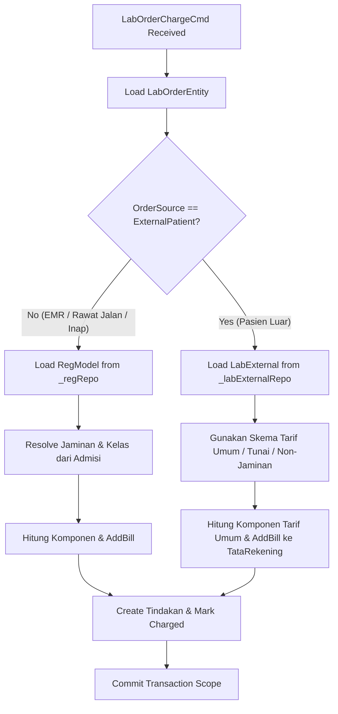
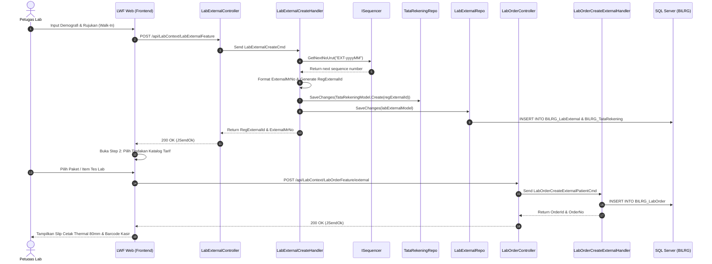

# 1. Overview

## Realized Feature

Arsitektur ini merealisasikan spesifikasi fitur **[OC-LAB-REG-EXTERNAL-FEATURE.md](file:///D:/Project.Aktif/_hospital_web/b09-bilreg-api/docs/contexts/lab/OC-LAB-REG-EXTERNAL-FEATURE.md)** yang diturunkan dari outcome bisnis **[OC-LAB-REG-EXTERNAL.md](file:///D:/Project.Aktif/_hospital_web/b21-myhosweb-system/outcomes/OC-LAB-REG-EXTERNAL.md)** dan menindaklanjuti issue **[OC-LAB-REG-EXTERNAL-ISSUE.md](file:///D:/Project.Aktif/_hospital_web/b09-bilreg-api/docs/contexts/lab/OC-LAB-REG-EXTERNAL-ISSUE.md)** (`ISSUE-LAB-REG-EXTERNAL-001`).

Arsitektur ini menetapkan realisasi teknis menyeluruh pada dua subsistem utama:
1. **Backend BILREG API (`b09-bilreg-api`)**:
   - Membentuk fitur bounded baru `LabExternalFeature` di dalam `Bilreg.Domain.LabContext`, `Bilreg.Application.LabContext`, `Bilreg.Infrastructure.LabContext`, dan `Bilreg.Api`.
   - Menyediakan persistensi tabel database baru `BILRG_LabExternal` untuk mencatat fakta pendaftaran mandiri pasien luar secara persisten dan independen.
   - Mengimplementasikan generator nomor rekam medis operasional sekali pakai (`ExternalMrNo`) dengan format `EXT-{yyyyMM}-{00000}` berbasis `ISequencer`.
   - Mengorkestrasikan pembentukan akun penagihan langsung (*cash-first billing account*) pada agregat `TataRekeningModel` di domain Tata Rekening (`PaymentContext`).
   - Melakukan refaktorisasi pada handler pembebanan biaya (`LabOrderChargeCmd` di `LabOrderFeature`) agar mendukung resolusi penagihan pasien eksternal tanpa bergantung pada data admisi reguler (`_regRepo`).
   - Menerapkan penegakan guard non-destructive cancellation untuk mencegah pembatalan jika tagihan kasir telah dibayar (`EX-01`) atau spesimen telah diambil (`EX-02`).
2. **Frontend LWF Web (`c012_myhospital_web`)**:
   - Memperbarui alur pendaftaran walk-in pada modul Laboratorium (`c012_myhospital_web/src/modules/Laboratory`) dengan dialog pendaftaran mandiri terpadu (`WalkInRegistrationDialog.vue`).
   - Menghubungkan pemilihan pemeriksaan dengan katalog tarif riil (`TRK-TARIF`) menggantikan data dummy/stub lama.
   - Menyediakan komponen cetak slip thermal 80mm / lembar A5 (`ExternalRegistrationReceiptModal.vue`) yang dilengkapi barcode Code-128 untuk kasir.
   - Menyediakan drawer omni-search riwayat pasien luar (`ExternalPatientSearchDrawer.vue`) untuk mempermudah pencarian dan repeat order.

## Referenced Artifacts

- Originating ISSUE: [OC-LAB-REG-EXTERNAL-ISSUE.md](file:///D:/Project.Aktif/_hospital_web/b09-bilreg-api/docs/contexts/lab/OC-LAB-REG-EXTERNAL-ISSUE.md)
- Domain Context: [07-LABORATORY-DOMAIN.md](file:///D:/Project.Aktif/_hospital_web/b21-myhosweb-system/domain/07-LABORATORY-DOMAIN.md) & [lab-domain.md](file:///D:/Project.Aktif/_hospital_web/b09-bilreg-api/docs/contexts/lab/lab-domain.md)
- Target Outcome: [OC-LAB-REG-EXTERNAL.md](file:///D:/Project.Aktif/_hospital_web/b21-myhosweb-system/outcomes/OC-LAB-REG-EXTERNAL.md)
- Feature Specification: [OC-LAB-REG-EXTERNAL-FEATURE.md](file:///D:/Project.Aktif/_hospital_web/b09-bilreg-api/docs/contexts/lab/OC-LAB-REG-EXTERNAL-FEATURE.md)
- Analysis Input: [OC-LAB-REG-EXTERNAL-FEASIBILITY-ASSESSMENT.md](file:///D:/Project.Aktif/_hospital_web/b09-bilreg-api/docs/contexts/lab/OC-LAB-REG-EXTERNAL-FEASIBILITY-ASSESSMENT.md) (Status: `READY-FOR-PLANNING`)
- UI & Screen Inventory: [OC-LAB-REG-EXTERNAL-SCREEN-INVENTORY.md](file:///D:/Project.Aktif/_hospital_web/b09-bilreg-api/docs/contexts/lab/OC-LAB-REG-EXTERNAL-SCREEN-INVENTORY.md) & [OC-LAB-REG-EXTERNAL-UI-MOCKUP.md](file:///D:/Project.Aktif/_hospital_web/b09-bilreg-api/docs/contexts/lab/OC-LAB-REG-EXTERNAL-UI-MOCKUP.md)

---

# 2. Architectural Basis

## Business Context

Layanan laboratorium rawat jalan membutuhkan loket mandiri pendaftaran cepat (*fast-track walk-in*) bagi pasien yang datang atas inisiatif sendiri (Atas Permintaan Sendiri / APS) maupun pasien yang membawa surat rujukan dari fasilitas kesehatan luar. Pasien luar tidak perlu mendaftar ke loket pendaftaran rumah sakit umum (Admisi / Rekam Medis), karena data identitas mereka hanya diperlukan untuk episode pemeriksaan laboratorium yang bersangkutan.

Secara bisnis dan hukum rekam medis:
1. Pendaftaran luar laboratorium dilarang menyisipkan data pasien ke dalam Master Rekam Medis Permanen Rumah Sakit (`PAS-DATSOS`) guna mencegah pencemaran data pasien (*master data pollution*).
2. Pendaftaran luar dilarang membentuk kunjungan reguler di Domain Admisi (`ADM-REG`).
3. Pasien luar diwajibkan menyelesaikan pembayaran secara mandiri (*Cash-First Principle*) di kasir penunjang sebelum pengambilan spesimen dilakukan atau sebelum hasil diserahkan.

## Analysis Input

Arsitektur ini mengonsumsi keputusan-keputusan resmi penutupan celah (*Gap Closure*) dan pertanyaan terbuka (*Open Questions*) yang telah disahkan pada [OC-LAB-REG-EXTERNAL-FEASIBILITY-ASSESSMENT.md](file:///D:/Project.Aktif/_hospital_web/b09-bilreg-api/docs/contexts/lab/OC-LAB-REG-EXTERNAL-FEASIBILITY-ASSESSMENT.md):

- **GAP-001 (Agregat & Tabel Terpisah)**: Membangun bounded feature baru `LabExternalFeature` di backend Bilreg dengan tabel `BILRG_LabExternal`.
- **GAP-002 (Resolusi Charging Pasien Luar)**: Menyesuaikan `LabOrderChargeCmd` agar mendukung dua jalur resolusi: order rawat jalan/inap melalui `_regRepo`, dan order eksternal melalui `_labExternalRepo` serta akun billing mandiri `TataRekeningModel`.
- **GAP-003 & OQ-001 (Format ExternalMrNo)**: Menerbitkan nomor rekam medis operasional sekali pakai dengan format terstandarisasi `EXT-{yyyyMM}-{00000}` yang dikelola oleh sequencer khusus laboratorium.
- **GAP-004 (Atribut Demografi & Rujukan)**: Merekam demografi lengkap (Nama, NIK opsional, Tanggal Lahir/Usia, Gender wajib, No Telepon/WA, Alamat) dan informasi rujukan (Kategori Kedatangan APS vs Rujukan Luar, Dokter Perujuk, Instansi Pengirim, Catatan Klinis).
- **GAP-005 (Siklus Hidup & Non-Destructive Cancellation)**: Siklus hidup registrasi `Active` $\rightarrow$ `Completed` atau `Cancelled`, dengan validasi pencegahan pembatalan jika tagihan kasir telah lunas (`EX-01`) atau spesimen telah diambil (`EX-02`).
- **GAP-006 & OQ-003 (Alur Terpadu UI)**: Form walk-in UI disajikan sebagai alur 2 langkah terpadu (*Step 1: Registrasi Pasien Luar* $\rightarrow$ *Step 2: Pemesanan Pemeriksaan & Cetak Bukti*).
- **OQ-002 (Pembentukan Akun Billing Langsung)**: Membentuk `TataRekeningModel` secara atomik pada saat pendaftaran eksternal disimpan dengan `RegId = RegExternalId`.

```text
[07-LABORATORY-DOMAIN] + [OC-LAB-REG-EXTERNAL-FEATURE]
                         +
    [OC-LAB-REG-EXTERNAL-FEASIBILITY-ASSESSMENT]
                         ↓
    [OC-LAB-REG-EXTERNAL-ARCHITECTURE]
```

---

# 3. Scope

## Included

1. **Backend Domain Layer (`Bilreg.Domain.LabContext.LabExternalFeature`)**:
   - Definisi entitas/agregat `LabExternalModel` dan antarmuka identitas `ILabExternalKey`.
   - Value Objects: `LabExternalDemographicsType`, `LabExternalReferralInfoType`, `LabExternalCancelInfoType`.
   - Enumerasi: `LabReferralTypeEnum` (`Aps = 1`, `FaskesLuar = 2`), `LabExternalStatusEnum` (`Active = 1`, `Completed = 2`, `Cancelled = 3`).
   - Domain invariants & business rules: validasi atribut wajib, penegakan guard pembatalan `Cancel(...)`.
2. **Backend Application Layer (`Bilreg.Application.LabContext.LabExternalFeature`)**:
   - Commands & Handlers: `LabExternalCreateCmd` (registrasi baru + pembuatan `TataRekening`), `LabExternalCancelCmd` (verifikasi status kasir/spesimen + soft-cancel).
   - Queries & Handlers: `LabExternalGetQuery` (detail pendaftaran), `LabExternalListQuery` (omni-search riwayat pasien luar berdasarkan nama, telepon, NIK, atau `ExternalMrNo`).
   - Repository Interface: `ILabExternalRepo`.
   - Perluasan Generator Nomor: `LabExternalCreateHelper` memanfaatkan `ISequencer` untuk format `EXT-{yyyyMM}-{00000}` dan `NunaId` untuk `LEX{10}`.
3. **Backend Refactoring (`Bilreg.Application.LabContext.LabOrderFeature`)**:
   - Penyesuaian `LabOrderCreateExternalPatientHandler` agar mengonsumsi `RegExternalId` dan `ExternalMrNo` dari registrasi eksternal yang sah.
   - Penyesuaian `LabOrderChargeHandler` untuk mengenali `OrderSource == ExternalPatient`, memotong dependensi ke `_regRepo` (Admisi), dan menggunakan skema tarif umum untuk penagihan pada `TataRekeningModel` pasien luar.
4. **Backend Infrastructure Layer (`Bilreg.Infrastructure.LabContext.LabExternalFeature`)**:
   - Implementasi `LabExternalRepo`, `LabExternalDal`, dan DTO mapping `LabExternalDto` berbasis Dapper.
   - Pendaftaran dependensi repositori dan DAL di `InfrastructureService.cs`.
5. **Backend Database DDL (`Bilreg.SqlDb/LabContext/LabExternalFeature`)**:
   - Skrip pembuatan tabel `BILRG_LabExternal.sql` lengkap dengan default constraints, primary key clustered, dan non-clustered indexes.
   - Pendaftaran skrip DDL ke dalam project database `Bilreg.SqlDb.sqlproj`.
6. **Backend Web API Layer (`Bilreg.Api/Controllers/LabContext/LabExternalFeature`)**:
   - Controller `LabExternalController.cs` dengan endpoint:
     - `POST /api/LabContext/LabExternalFeature` (Create registration)
     - `POST /api/LabContext/LabExternalFeature/cancel` (Cancel registration)
     - `GET /api/LabContext/LabExternalFeature/{regExternalId}` (Get by ID)
     - `GET /api/LabContext/LabExternalFeature/search` (Search & history)
7. **Frontend Web UI (`c012_myhospital_web/src/modules/Laboratory`)**:
   - Schema Zod & TypeScript types: `lab-external.schema.ts` dan `lab-external.types.ts`.
   - Composable service: `useLabExternalService.ts` berbasis `@tanstack/vue-query`.
   - Dialog registrasi walk-in: `WalkInRegistrationDialog.vue` (menggantikan `WalkInExamDialog.vue` lama).
   - Dialog slip thermal: `ExternalRegistrationReceiptModal.vue`.
   - Dialog pembatalan: `CancelExternalRegistrationDialog.vue`.
   - Drawer riwayat: `ExternalPatientSearchDrawer.vue`.
   - Integrasi tombol shortcut pada `LabWorkflowView.vue` (`[+ Pasien Luar (F2)]`).

## Excluded

1. Penulisan atau manipulasi tabel master data pasien rumah sakit (`PAS_Pasien` / `PAS-DATSOS`).
2. Pembuatan nomor rekam medis rumah sakit permanen (`MedrecNo` / `PatientId` reguler).
3. Pembuatan episode pendaftaran pada tabel admisi reguler (`BILRG_Reg` / `ADM-REG`).
4. Integrasi bridging klaim BPJS Kesehatan (VClaim / Apotek Online / PCare) karena seluruh pasien eksternal lab adalah pelayanan umum/mandiri.
5. Perubahan logika instrumen analitik lab LIS / ASTM / HL7 (LIS tetap membaca barcode order/spesimen standar laboratorium).
6. Modifikasi modul kasir rumah sakit secara menyeluruh (modul kasir penunjang yang sudah ada cukup membaca `BillingAccountId` / `RegExternalId` dari `TataRekening`).

---

# 4. Technical Decisions

## TD-01: Struktur Agregat Domain `LabExternalModel`

Agregat `LabExternalModel` berada di namespace `Bilreg.Domain.LabContext.LabExternalFeature` dan mengimplementasikan antarmuka `ILabExternalKey`. Model ini dirancang dengan encapsulation murni di mana seluruh mutasi status wajib melalui metode domain berproteksi invariant.

```csharp
namespace Bilreg.Domain.LabContext.LabExternalFeature;

public interface ILabExternalKey
{
    string RegExternalId { get; }
}

public class LabExternalModel : ILabExternalKey
{
    public const string IdPrefix = "LEX";
    public static readonly DateTime EmptyDate = new(3000, 1, 1);

    public string RegExternalId { get; private set; }
    public string ExternalMrNo { get; private set; }
    public LabExternalDemographicsType Demographics { get; private set; }
    public LabExternalReferralInfoType ReferralInfo { get; private set; }
    public string BillingAccountId { get; private set; }
    public LabExternalStatusEnum Status { get; private set; }
    public LabExternalCancelInfoType CancelInfo { get; private set; }
    public AuditTrailType AuditTrail { get; private set; }

    // Factory Method untuk Registrasi Baru
    public static LabExternalModel Create(
        string regExternalId,
        string externalMrNo,
        LabExternalDemographicsType demographics,
        LabExternalReferralInfoType referralInfo,
        string billingAccountId,
        AuditInfoType audit);

    // Factory Method untuk Rehidrasi DAL
    public static LabExternalModel Load(
        string regExternalId,
        string externalMrNo,
        LabExternalDemographicsType demographics,
        LabExternalReferralInfoType referralInfo,
        string billingAccountId,
        LabExternalStatusEnum status,
        LabExternalCancelInfoType cancelInfo,
        AuditTrailType auditTrail);

    // Domain Invariant: Pembatalan Registrasi
    public void Cancel(
        string reason,
        string userId,
        DateTime cancelledAt,
        bool hasPaidCashier,
        bool hasCollectedSpecimen)
    {
        if (Status == LabExternalStatusEnum.Cancelled)
            throw new InvalidOperationException("Registrasi eksternal sudah dalam status dibatalkan.");

        if (Status == LabExternalStatusEnum.Completed)
            throw new InvalidOperationException("Registrasi eksternal yang sudah selesai tidak dapat dibatalkan.");

        // EX-01 Guard: Penolakan jika sudah ada pembayaran di kasir
        if (hasPaidCashier)
            throw new InvalidOperationException("EX-01: Pembatalan ditolak. Tagihan telah dibayar di kasir. Lakukan void kasir terlebih dahulu.");

        // EX-02 Guard: Penolakan jika spesimen telah diambil
        if (hasCollectedSpecimen)
            throw new InvalidOperationException("EX-02: Pembatalan ditolak. Spesimen laboratorium telah diambil untuk order ini.");

        if (string.IsNullOrWhiteSpace(reason))
            throw new ArgumentException("Alasan pembatalan wajib diisi.", nameof(reason));

        Status = LabExternalStatusEnum.Cancelled;
        CancelInfo = new LabExternalCancelInfoType(reason, userId, cancelledAt);
        AuditTrail = AuditTrail.Update(userId, cancelledAt);
    }

    // Domain Invariant: Penyelesaian Registrasi
    public void MarkCompleted(string userId, DateTime completedAt)
    {
        if (Status != LabExternalStatusEnum.Active)
            throw new InvalidOperationException($"Hanya registrasi berstatus Active yang dapat diselesaikan. Status saat ini: {Status}.");

        Status = LabExternalStatusEnum.Completed;
        AuditTrail = AuditTrail.Update(userId, completedAt);
    }
}
```

### Value Objects Pendukung

```csharp
public record LabExternalDemographicsType(
    string PatientName,
    string Nik,
    DateTime BirthDate,
    string Gender,
    string Phone,
    string Address);

public record LabExternalReferralInfoType(
    LabReferralTypeEnum ReferralType,
    string ReferralDoctor,
    string ReferralOrigin,
    string ClinicalNotes);

public record LabExternalCancelInfoType(
    string CancelReason,
    string CancelledUserId,
    DateTime CancelledDate)
{
    public static LabExternalCancelInfoType Default => new(string.Empty, string.Empty, new DateTime(3000, 1, 1));
}

public enum LabReferralTypeEnum
{
    Aps = 1,          // Atas Permintaan Sendiri
    FaskesLuar = 2    // Rujukan Dokter / Klinik Luar
}

public enum LabExternalStatusEnum
{
    Active = 1,
    Completed = 2,
    Cancelled = 3
}
```

---

## TD-02: Skema Generator Nomor Identitas (`RegExternalId` & `ExternalMrNo`)

1. **Identifier Internal Registrasi (`RegExternalId`)**:
   - Menggunakan utilitas `NunaId.New("LEX")` yang menghasilkan string 13 karakter unik terindeks (contoh: `LEX26A14B8C1D`).
   - Sesuai dengan batasan tipe data `VARCHAR(15)` pada kolom kunci registrasi di seluruh ekosistem Bilreg.
2. **Nomor Rekam Medis Operasional Sekali Pakai (`ExternalMrNo`)**:
   - Memanfaatkan port sequencer `ISequencer` dengan format kunci bulanan: `EXT-{yyyyMM}`.
   - Menghasilkan format tampilan manusia: `EXT-{yyyyMM}-{00000}` (contoh: `EXT-202610-00001`).
   - Panjang string 16 karakter, pas disimpan pada kolom `VARCHAR(20)`.
   - Karakteristik nomor: **sekali pakai (*one-time use only*)**, terisolasi di laboratorium, dan divalidasi oleh sistem admisi agar tidak dapat digunakan untuk registrasi rawat jalan/inap.

```csharp
public static class LabExternalNumberHelper
{
    public static string GenerateExternalMrNo(ISequencer sequencer, DateTime timestamp)
    {
        var periodKey = $"EXT-{timestamp:yyyyMM}";
        var nextNo = sequencer.GetNextNoUrut(periodKey);
        return $"{periodKey}-{nextNo:D5}";
    }
}
```

---

## TD-03: Integrasi Tata Rekening & Prinsip *Cash-First* (Penutupan OQ-002)

Setiap pendaftaran pasien luar laboratorium secara otomatis memiliki akun penagihan langsung (*direct billing account*) pada modul Tata Rekening (`PaymentContext.TataRekeningFeature`).
- Dalam Bilreg, agregat `TataRekeningModel` menggunakan `RegId` sebagai primary key (`PK_BILRG_TataRekening`).
- Pada saat eksekusi `LabExternalCreateHandler`, sistem secara atomik membuat entitas `TataRekeningModel` baru dengan `RegId = regExternalId`:
  ```csharp
  var billingAccount = TataRekeningModel.Create(regExternalId);
  _tataRekeningRepo.SaveChanges(billingAccount);
  ```
- Seluruh mutasi `LabExternal` dan pembuatan `TataRekeningModel` dibungkus dalam satu blok transaksi database `TransHelper.NewScope()`.
- Hal ini menjamin bahwa setiap pendaftaran eksternal yang terbit **pasti memiliki akun penagihan kasir yang siap menerima charge item tarif** dan siap dibayar di kasir dengan mencantumkan `RegExternalId` atau `ExternalMrNo`.

---

## TD-04: Resolusi Dua Jalur Penagihan pada `LabOrderChargeCmd` (Penutupan GAP-002)

Use case `LabOrderChargeHandler` existing sebelumnya selalu memanggil `LoadReg(order.Patient.RegId)` ke `_regRepo` (Admisi Rawat Jalan/Inap). Jika order berasal dari pasien luar, pemanggilan ini melempar `KeyNotFoundException`.

Arsitektur ini merevisi alur resolusi pada `LabOrderChargeHandler`:



Realisasi teknis:
1. Jika `order.OrderSource == LabOrderSourceEnum.ExternalPatient`:
   - Validasi keberadaan registrasi eksternal melalui `_labExternalRepo.LoadEntity(LabExternalModel.Key(order.Patient.RegId))`.
   - Gunakan konstanta/aturan tarif umum (*Umum / Non-Jaminan / Kelas Poliklinik Rawat Jalan*).
   - Bentuk transaksi penagihan (`TrsBillType`) yang terhubung langsung ke `TataRekeningModel` milik `RegExternalId`.
2. Jika `order.OrderSource != LabOrderSourceEnum.ExternalPatient`:
   - Tetap menjalankan alur lama yang membaca `_regRepo`.

---

## TD-05: Penegakan Aturan Pembatalan Non-Destructive (EX-01 & EX-02)

Use case `LabExternalCancelCmd` dirancang dengan proteksi ganda sebelum status diubah:
1. **Pemeriksaan Pembayaran Kasir (`EX-01`)**:
   - Handler membaca agregat `TataRekeningModel` untuk `RegExternalId`.
   - Memeriksa apakah `tataRekening.ListPayment.Any()` atau terdapat transaksi penerimaan kasir aktif. Jika ada pembayaran yang belum di-void, flag `hasPaidCashier = true`.
2. **Pemeriksaan Pengambilan Spesimen (`EX-02`)**:
   - Handler membaca seluruh order laboratorium yang terikat pada `RegExternalId` via `_labOrderRepo`.
   - Memeriksa apakah salah satu order memiliki `CollectionInfo.CollectedDate != EmptyDate` atau status $\ge$ `SpecimenCollected`. Jika ada, flag `hasCollectedSpecimen = true`.
3. **Eksekusi Pembatalan Domain**:
   - Memanggil `labExternal.Cancel(request.Reason, request.UserId, now, hasPaidCashier, hasCollectedSpecimen)`.
   - Jika terdapat pelanggaran, domain melempar `InvalidOperationException` dengan pesan spesifik (`EX-01` atau `EX-02`).
   - Jika lolos validasi, handler menyimpan pembaruan `LabExternalModel` (status menjadi `Cancelled`) dan membatalkan order laboratorium terkait yang belum diambil spesimennya secara berurutan.

---

## TD-06: Arsitektur Frontend & Fast-Track Workflow

Alur kerja pada frontend (`c012_myhospital_web`) dioptimalkan untuk kecepatan staf loket laboratorium (< 90 detik):
- Menggunakan Vue 3 Composition API dengan TypeScript dan skema validasi Zod (`lab-external.schema.ts`).
- Server state dikelola oleh TanStack Vue Query via composable `useLabExternalService`:
  - `useCreateLabExternalMutation`: Memicu `POST /api/LabContext/LabExternalFeature`.
  - `useCancelLabExternalMutation`: Memicu `POST /api/LabContext/LabExternalFeature/cancel`.
  - `useLabExternalDetailQuery`: Mengambil detail pendaftaran eksternal.
  - `useLabExternalSearchQuery`: Mendukung pencarian instan debounce di drawer riwayat.
- **Orkestrasi 2-Langkah**:
  1. *Langkah 1*: Staf menginput data demografi dan rujukan pada dialog `WalkInRegistrationDialog.vue` $\rightarrow$ memicu `createLabExternal` $\rightarrow$ mendapatkan `RegExternalId` dan `ExternalMrNo`.
  2. *Langkah 2*: Tanpa menutup konteks, dialog langsung menyajikan pemilihan paket/item tes lab dari `TRK-TARIF` $\rightarrow$ memicu `createExternalLabOrder` dengan menyertakan `RegExternalId` sebagai `RegId` dan `ExternalMrNo` sebagai `PatientId`.
  3. *Langkah 3*: Muncul modal cetak slip thermal 80mm / A5 dengan barcode Code-128 dan rincian estimasi biaya kasir.

---

# 5. Component Responsibilities

| Component | Layer / Namespace | Responsibility |
| :--- | :--- | :--- |
| **`LabExternalModel`** | Domain (`Bilreg.Domain.LabContext.LabExternalFeature`) | Agregat root untuk data registrasi eksternal; memvalidasi demografi minimal, mengelola status pendaftaran, dan menegakkan guard pembatalan `Cancel(...)`. |
| **`ILabExternalKey`** | Domain (`Bilreg.Domain.LabContext.LabExternalFeature`) | Kontrak identitas unik registrasi eksternal (`RegExternalId`). |
| **`LabExternalCreateCmd`** | Application (`Bilreg.Application.LabContext.LabExternalFeature`) | Command untuk mendaftarkan pasien eksternal baru, menghasilkan `ExternalMrNo`, dan menginisialisasi `TataRekeningModel`. |
| **`LabExternalCancelCmd`** | Application (`Bilreg.Application.LabContext.LabExternalFeature`) | Command untuk membatalkan registrasi eksternal dengan verifikasi pra-kondisi kasir dan status spesimen. |
| **`LabExternalGetQuery` & `LabExternalListQuery`** | Application (`Bilreg.Application.LabContext.LabExternalFeature`) | Query handler untuk pembacaan detail registrasi dan pencarian riwayat pasien luar. |
| **`ILabExternalRepo`** | Application (`Bilreg.Application.LabContext.LabExternalFeature`) | Interface kontrak abstraksi persistensi untuk agregat `LabExternalModel`. |
| **`LabOrderChargeHandler` (Updated)** | Application (`Bilreg.Application.LabContext.LabOrderFeature`) | Handler pembebanan biaya yang telah dimodifikasi agar mendukung rute penagihan mandiri untuk order pasien eksternal. |
| **`LabExternalRepo`** | Infrastructure (`Bilreg.Infrastructure.LabContext.LabExternalFeature`) | Implementasi repositori berbasis Dapper yang melakukan orkestrasi DAL, DTO mapping, dan pembaruan database. |
| **`LabExternalDal`** | Infrastructure (`Bilreg.Infrastructure.LabContext.LabExternalFeature`) | Data Access Layer pengeksekusi query SQL CRUD langsung ke tabel `BILRG_LabExternal`. |
| **`BILRG_LabExternal.sql`** | Database (`Bilreg.SqlDb/LabContext/LabExternalFeature`) | Skrip DDL tabel fisik database `BILRG_LabExternal` beserta indeks penunjang performa. |
| **`LabExternalController`** | Web API (`Bilreg.Api/Controllers/LabContext/LabExternalFeature`) | Controller REST HTTP pengekspos endpoint `POST`, `GET`, dan `cancel` dengan wrapper respon `JSendOk`. |
| **`useLabExternalService`** | Frontend Query (`c012_myhospital_web/.../queries`) | TanStack Vue Query composable untuk interaksi API registrasi eksternal. |
| **`WalkInRegistrationDialog.vue`** | Frontend Component (`c012_myhospital_web/.../components`) | Dialog pendaftaran walk-in 2 langkah (Demografi & Rujukan $\rightarrow$ Pemeriksaan). |
| **`ExternalRegistrationReceiptModal.vue`** | Frontend Component (`c012_myhospital_web/.../components`) | Dialog preview & print slip pendaftaran thermal 80mm / A5 dengan barcode kasir. |
| **`ExternalPatientSearchDrawer.vue`** | Frontend Component (`c012_myhospital_web/.../components`) | Slide-over drawer pencarian data riwayat pasien luar dan fitur re-order 1 klik. |

---

# 6. Integration Design

| Source | Target | Purpose | Protocol / Mechanism |
| :--- | :--- | :--- | :--- |
| **Frontend UI** | **`LabExternalController`** | Mendaftarkan pasien eksternal baru | `POST /api/LabContext/LabExternalFeature` (JSON) |
| **Frontend UI** | **`LabExternalController`** | Membatalkan pendaftaran pasien luar | `POST /api/LabContext/LabExternalFeature/cancel` (JSON) |
| **Frontend UI** | **`LabExternalController`** | Mencari riwayat pendaftaran pasien luar | `GET /api/LabContext/LabExternalFeature/search?searchTerm=...` |
| **`LabExternalCreateHandler`** | **`ISequencer`** | Mendapatkan nomor urut bulanan untuk `ExternalMrNo` | C# In-Process Interface (`GetNextNoUrut`) |
| **`LabExternalCreateHandler`** | **`ITataRekeningRepo`** | Membuat akun billing kasir penunjang baru | C# In-Process Interface (`SaveChanges`) |
| **`LabExternalCreateHandler`** | **`ILabExternalRepo`** | Menyimpan agregat `LabExternalModel` ke database | C# In-Process Interface (`SaveChanges`) |
| **Frontend UI** | **`LabOrderController`** | Membuat order pemeriksaan laboratorium untuk pasien luar | `POST /api/LabContext/LabOrderFeature/external` (JSON) |
| **`LabExternalCancelHandler`** | **`ITataRekeningRepo`** | Memeriksa status pelunasan pembayaran kasir (`EX-01`) | C# In-Process Interface (`LoadEntity`) |
| **`LabExternalCancelHandler`** | **`ILabOrderRepo`** | Memeriksa status pengambilan spesimen lab (`EX-02`) | C# In-Process Interface (`LoadEntity`) |
| **`LabOrderChargeHandler`** | **`ILabExternalRepo`** | Membaca demografi pasien luar saat proses penagihan | C# In-Process Interface (`LoadEntity`) |
| **`LabOrderChargeHandler`** | **`IAddBillAppService`** | Memasukkan item tarif lab ke akun billing pasien luar | C# In-Process Interface (`FromLabOrderItem`) |

## Diagram Alir Integrasi Registrasi & Order Lab



---

# 7. Data Ownership

| Data Entity | Primary Owner | Storage Table | Boundaries & Access Rules |
| :--- | :--- | :--- | :--- |
| **Registrasi Pasien Eksternal** | `LabExternalFeature` (`LAB-EXTERNAL`) | `BILRG_LabExternal` | Pemilik eksklusif seluruh data pendaftaran mandiri pasien luar, demografi terbatas, informasi dokter/faskes perujuk, dan status registrasi eksternal. Modul lain dilarang menulis langsung ke tabel ini. |
| **Order Pemeriksaan Lab** | `LabOrderFeature` (`LAB-ORDER`) | `BILRG_LabOrder`, `BILRG_LabOrderItem` | Menyimpan transaksi permintaan tes diagnostik laboratorium. Menyimpan snapshot `RegId = RegExternalId` dan `PatientId = ExternalMrNo`. |
| **Akun Billing Kasir** | `TataRekeningFeature` (`TRK-BILLING`) | `BILRG_TataRekening`, `BILRG_TrsBill` | Memiliki otoritas finansial atas pembebanan tarif tindakan dan pelunasan kasir. Terikat melalui kunci `RegId = RegExternalId`. |
| **Master Data Pasien** | Domain Pasien (`PAS-DATSOS`) | `PAS_Pasien`, `PAS_Demografi` | **TIDAK TERSENTUH**. Pendaftaran eksternal dilarang membuat atau memperbarui baris pada tabel-tabel ini. |
| **Kunjungan Admisi RS** | Domain Admisi (`ADM-REG`) | `BILRG_Reg` | **TIDAK TERSENTUH**. Pendaftaran eksternal dilarang membuat baris kunjungan admisi pada tabel ini. |

---

# 8. Database Design

## New Tables

### `BILRG_LabExternal`

Tabel ini menyimpan fakta bisnis persisten atas pendaftaran langsung pasien luar instalasi laboratorium.

```sql
CREATE TABLE BILRG_LabExternal (
    RegExternalId       VARCHAR(15)     NOT NULL CONSTRAINT DF_BILRG_LabExternal_RegExternalId DEFAULT(''),
    ExternalMrNo        VARCHAR(20)     NOT NULL CONSTRAINT DF_BILRG_LabExternal_ExternalMrNo DEFAULT(''),
    PatientName         VARCHAR(100)    NOT NULL CONSTRAINT DF_BILRG_LabExternal_PatientName DEFAULT(''),
    Nik                 VARCHAR(20)     NOT NULL CONSTRAINT DF_BILRG_LabExternal_Nik DEFAULT(''),
    BirthDate           DATETIME        NOT NULL CONSTRAINT DF_BILRG_LabExternal_BirthDate DEFAULT('3000-01-01'),
    Gender              VARCHAR(1)      NOT NULL CONSTRAINT DF_BILRG_LabExternal_Gender DEFAULT(''),
    Phone               VARCHAR(30)     NOT NULL CONSTRAINT DF_BILRG_LabExternal_Phone DEFAULT(''),
    Address             VARCHAR(250)    NOT NULL CONSTRAINT DF_BILRG_LabExternal_Address DEFAULT(''),
    
    ReferralType        INT             NOT NULL CONSTRAINT DF_BILRG_LabExternal_ReferralType DEFAULT(1),
    ReferralDoctor      VARCHAR(100)    NOT NULL CONSTRAINT DF_BILRG_LabExternal_ReferralDoctor DEFAULT(''),
    ReferralOrigin      VARCHAR(100)    NOT NULL CONSTRAINT DF_BILRG_LabExternal_ReferralOrigin DEFAULT(''),
    ClinicalNotes       VARCHAR(250)    NOT NULL CONSTRAINT DF_BILRG_LabExternal_ClinicalNotes DEFAULT(''),
    
    BillingAccountId    VARCHAR(15)     NOT NULL CONSTRAINT DF_BILRG_LabExternal_BillingAccountId DEFAULT(''),
    Status              INT             NOT NULL CONSTRAINT DF_BILRG_LabExternal_Status DEFAULT(1),
    
    CancelReason        VARCHAR(250)    NOT NULL CONSTRAINT DF_BILRG_LabExternal_CancelReason DEFAULT(''),
    CancelledUserId     VARCHAR(50)     NOT NULL CONSTRAINT DF_BILRG_LabExternal_CancelledUserId DEFAULT(''),
    CancelledDate       DATETIME        NOT NULL CONSTRAINT DF_BILRG_LabExternal_CancelledDate DEFAULT('3000-01-01'),
    
    CrtUser             VARCHAR(50)     NOT NULL CONSTRAINT DF_BILRG_LabExternal_CrtUser DEFAULT(''),
    CrtDate             DATETIME        NOT NULL CONSTRAINT DF_BILRG_LabExternal_CrtDate DEFAULT('3000-01-01'),
    UpdUser             VARCHAR(50)     NOT NULL CONSTRAINT DF_BILRG_LabExternal_UpdUser DEFAULT(''),
    UpdDate             DATETIME        NOT NULL CONSTRAINT DF_BILRG_LabExternal_UpdDate DEFAULT('3000-01-01'),
    VodUser             VARCHAR(50)     NOT NULL CONSTRAINT DF_BILRG_LabExternal_VodUser DEFAULT(''),
    VodDate             DATETIME        NOT NULL CONSTRAINT DF_BILRG_LabExternal_VodDate DEFAULT('3000-01-01'),

    CONSTRAINT PK_BILRG_LabExternal PRIMARY KEY CLUSTERED (RegExternalId)
);
GO

-- Indeks Keunikan Nomor Rekam Medis Operasional Sekali Pakai
CREATE UNIQUE NONCLUSTERED INDEX IX_BILRG_LabExternal_ExternalMrNo 
ON BILRG_LabExternal(ExternalMrNo);
GO

-- Indeks Pencarian Omni-Search (Nama & Nomor Telepon)
CREATE NONCLUSTERED INDEX IX_BILRG_LabExternal_Search 
ON BILRG_LabExternal(PatientName, Phone, Status);
GO

-- Indeks Filter Status & Tanggal Pendaftaran
CREATE NONCLUSTERED INDEX IX_BILRG_LabExternal_StatusDate 
ON BILRG_LabExternal(Status, CrtDate);
GO
```

## Modified Tables

Tidak ada modifikasi skema DDL fisik pada tabel yang sudah ada. Tabel `BILRG_LabOrder` dan `BILRG_TataRekening` sudah memiliki kolom `RegId VARCHAR(10)` / `VARCHAR(15)` dan `PatientId VARCHAR(15)` yang kompatibel untuk menampung `RegExternalId` dan `ExternalMrNo`.

## Relationships

1. **`BILRG_LabExternal` $\rightarrow$ `BILRG_TataRekening`**: Relasi logis $1 : 1$ berbasis nilai `RegExternalId` $\rightarrow$ `RegId`.
2. **`BILRG_LabExternal` $\rightarrow$ `BILRG_LabOrder`**: Relasi logis $1 : N$ berbasis nilai `RegExternalId` $\rightarrow$ `RegId`.

## Migration Considerations

1. **Idempotensi**: Skrip DDL `BILRG_LabExternal.sql` disimpan di direktori `b09-bilreg-api/src/bilreg/Bilreg.SqlDb/LabContext/LabExternalFeature/` dan didaftarkan pada `Bilreg.SqlDb.sqlproj`. Skrip menggunakan klausa pengecekan keberadaan objek sebelum `CREATE TABLE` bila dijalankan pada database lingkungan migrasi.
2. **Backwards Compatibility**: Data historis order eksternal yang dibuat dengan versi stub lama tetap dapat dibaca karena kolom pada `BILRG_LabOrder` tidak diubah.

---

# 9. Cross-Cutting Concerns

## 1. Concurrency & Data Consistency
- Penomoran `ExternalMrNo` memanfaatkan `ISequencer` yang mengandalkan locking atomik berbasis database sequence / nomor urut guna mencegah nomor ganda pada kondisi panggilan bersamaan (*concurrent registrations*).
- Pembuatan pendaftaran `LabExternal` dan akun `TataRekening` dieksekusi dalam satu transaksi atomik (`TransHelper.NewScope()`). Jika pembuatan akun billing gagal, seluruh pendaftaran eksternal di-rollback.

## 2. Audit Trail & Non-Destructive Operations
- Seluruh mutasi data dicatat dengan standar audit Bilreg (`CrtUser`, `CrtDate`, `UpdUser`, `UpdDate`, `VodUser`, `VodDate`).
- Pembatalan registrasi eksternal dilakukan secara *soft-cancel* dengan mengisi `Status = Cancelled`, `CancelReason`, `CancelledUserId`, dan `CancelledDate`. Data registrasi tidak pernah dihapus secara fisik (`HARD DELETE`).

## 3. Observability & Exception Handling
- Seluruh exception domain (`EX-01`, `EX-02`, validasi data minimal `EX-03`) dilempar sebagai exception terstruktur dan ditangkap oleh middleware API untuk mengembalikan HTTP 400 Bad Request dengan format standar `JSendFail`.

---

# 10. Implementation Constraints

1. **DDD & Clean Architecture Boundaries**:
   - `Bilreg.Domain` tidak boleh mereferensikan Entity Framework, ASP.NET Core, atau pustaka infrastruktur.
   - Seluruh dependensi eksternal diakses melalui Interface (Ports and Adapters).
2. **Data Access Technology**:
   - Repositori dan DAL wajib menggunakan **Dapper** dengan parameterized SQL query. Dilarang menggunakan Entity Framework Core untuk fitur ini.
3. **API Response Contract**:
   - Seluruh endpoint Web API wajib mengembalikan wrapper **`JSendOk`** untuk status sukses dan **`JSendFail`** / **`JSendError`** untuk status gagal sesuai standar API Bilreg.
4. **Isolasi Mutlak Master Pasien**:
   - Implementer dilarang keras menambahkan pemanggilan ke repositori pasien (`IPasienRepo` / `PAS-DATSOS`) atau admisi (`IRegRepo` / `ADM-REG`) di dalam use case registrasi eksternal.
5. **Frontend Standards**:
   - Antarmuka web wajib menggunakan Vue 3 dengan `<script setup lang="ts">`, `@tanstack/vue-query` untuk data-fetching, skema validasi Zod, Tailwind CSS, dan icon Lucide.

---

# 11. Acceptance Conditions

Implementasi fitur ini dinyatakan selesai dan memenuhi syarat arsitektural (*Architecturally Complete*) apabila seluruh kondisi berikut terverifikasi:

- [ ] **AC-ARCH-01**: Tabel `BILRG_LabExternal` berhasil terbentuk di database dengan indeks performa yang sesuai dan terdaftar pada `Bilreg.SqlDb.sqlproj`.
- [ ] **AC-ARCH-02**: Endpoint `POST /api/LabContext/LabExternalFeature` berhasil menyimpan pendaftaran pasien luar dan mengembalikan `RegExternalId` serta `ExternalMrNo` dengan format `EXT-{yyyyMM}-{00000}`.
- [ ] **AC-ARCH-03**: Akun penagihan pada `BILRG_TataRekening` terkonfirmasi terbentuk secara otomatis dengan `RegId = RegExternalId` segera setelah registrasi eksternal dibuat.
- [ ] **AC-ARCH-04**: Use case `LabOrderCreateExternalPatientCmd` berhasil menerbitkan order laboratorium dengan mengaitkan `RegExternalId` dan `ExternalMrNo`.
- [ ] **AC-ARCH-05**: Use case `LabOrderChargeCmd` berhasil memproses pembebanan tarif order pasien luar ke akun `TataRekening` tanpa melempar `KeyNotFoundException`.
- [ ] **AC-ARCH-06**: Percobaan pembatalan melalui `POST /api/LabContext/LabExternalFeature/cancel` ditolak dengan error `EX-01` apabila tagihan kasir telah dibayar.
- [ ] **AC-ARCH-07**: Percobaan pembatalan ditolak dengan error `EX-02` apabila spesimen pemeriksaan telah diambil.
- [ ] **AC-ARCH-08**: Pembatalan yang memenuhi syarat berhasil mengubah status registrasi menjadi `Cancelled` dan mencatat alasan serta user pembatal secara non-destructive.
- [ ] **AC-ARCH-09**: Terkonfirmasi bahwa tidak ada penambahan baris data baru pada tabel master pasien rumah sakit (`PAS_Pasien`).
- [ ] **AC-ARCH-10**: Antarmuka web laboratorium di `c012_myhospital_web` berhasil menyediakan form walk-in 2 langkah terpadu, katalog tarif riil, pencarian riwayat pasien luar, dan cetak slip thermal 80mm.
