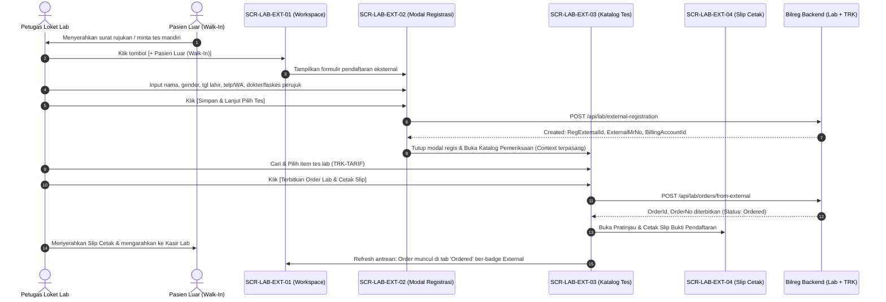

# Screen Inventory & UI Architecture — Registrasi Pasien Eksternal Laboratorium

**Status:** Canonical UI Architecture Blueprint  
**Outcome Reference:** [`OC-LAB-REG-EXTERNAL.md`](file:///D:/Project.Aktif/_hospital_web/b21-myhosweb-system/outcomes/OC-LAB-REG-EXTERNAL.md) (`OC-08-01: RegExternal`)  
**Feasibility Reference:** [`OC-LAB-REG-EXTERNAL-FEASIBILITY-ASSESSMENT.md`](file:///D:/Project.Aktif/_hospital_web/b09-bilreg-api/docs/contexts/lab/OC-LAB-REG-EXTERNAL-FEASIBILITY-ASSESSMENT.md) (Status: `READY-FOR-PLANNING`)  
**Domain Reference:** [`07-LABORATORY-DOMAIN.md`](file:///D:/Project.Aktif/_hospital_web/b21-myhosweb-system/domain/07-LABORATORY-DOMAIN.md) (`LAB-EXTERNAL`)  
**Wave & Screen Catalog:** `WAVE-05` / `SC-08 Laboratorium` / `SC-08-01 Workspace Order Laboratorium`  
**Frontend Client Scope:** `c012_myhospital_web/src/modules/Laboratory`  
**Backend API Scope:** `b09-bilreg-api` (`Bilreg.Application.LabContext`)  

---

## 1. Executive Summary & UI Philosophy

Berdasarkan keputusan resmi pada *Feasibility Assessment* ([`OC-LAB-REG-EXTERNAL-FEASIBILITY-ASSESSMENT.md`](file:///D:/Project.Aktif/_hospital_web/b09-bilreg-api/docs/contexts/lab/OC-LAB-REG-EXTERNAL-FEASIBILITY-ASSESSMENT.md)) dan spesifikasi kanonikal bisnis ([`OC-LAB-REG-EXTERNAL.md`](file:///D:/Project.Aktif/_hospital_web/b21-myhosweb-system/outcomes/OC-LAB-REG-EXTERNAL.md)), alur pendaftaran pasien luar laboratorium dioperasikan dengan prinsip-prinsip arsitektural berikut:

1. **Single Operational Workspace First**: Seluruh siklus operasional pasien eksternal tetap terintegrasi di dalam antarmuka utama laboratorium (`SC-08 Laboratorium`), sehingga petugas tidak perlu berpindah aplikasi atau membuka konsol pendaftaran admisi reguler rumah sakit.
2. **Seamless Two-Phase Fast-Track Journey (OQ-003 Decision)**:
   - **Fase 1: Pendaftaran Pasien Eksternal (*Direct External Registration*)**: Mencatat fakta bisnis demografi terbatas pasien luar, mengidentifikasi kategori rujukan (APS vs Rujukan Luar), menerbitkan nomor rekam medis operasional sekali pakai (`ExternalMrNo` berformat `EXT-yyMM-XXXXX`), dan membentuk akun tagihan kasir penunjang (`BillingAccountId`) di domain Tata Rekening (`TRK-BILLING`).
   - **Fase 2: Pemesanan Pemeriksaan & Katalog Tarif Riil (*Real Examination Ordering*)**: Langsung mengarahkan petugas ke pemilihan tes laboratorium dari katalog tarif aktif (`TRK-TARIF`), menggantikan data dummy/stub `T-WALKIN`.
3. **Master Isolation & Non-Contamination**: Antarmuka secara tegas tidak menyentuh master data pasien (`PAS-DATSOS`) dan tidak membuat episode kunjungan di admisi rumah sakit (`ADM-REG`). Nomor rekam medis eksternal diberi visual badge pembeda (*"Pasien Eksternal (Sekali Pakai)"*).
4. **Cash-First Operational Transparency**: Karena pasien eksternal wajib melunasi biaya sebelum pengambilan sampel analitik (*Cash-First Principle*), antarmuka menyediakan penerbitan cetak tanda bukti registrasi beserta rincian slip kasir (*billing payment ticket*).
5. **Non-Destructive Cancellation Guard**: Menyediakan modal pembatalan resmi yang dilengkapi dengan validasi bisnis ketat (pencegahan pembatalan jika sudah lunas kasir atau spesimen telah diambil) serta perekaman alasan pembatalan untuk jejak audit.

---

## 2. Screen Inventory Matrix

| Screen / Dialog ID | Screen / Component Name | Purpose | Primary Actor | Trigger / Route | Status |
|---|---|---|---|---|---|
| **SCR-LAB-EXT-01** | **Laboratorium Tindakan Workspace (Host Surface)** | Konsol operasional terpadu laboratorium; menjadi *host surface* yang menampilkan antrean order pasien eksternal, indikator status, tombol pemicu pendaftaran walk-in, dan panel detail tindakan. | Staf Administrasi Lab, Petugas Flebotomi, Analis Kesehatan | `/app/laboratorium/tindakan_lab` (`LabWorkflowView.vue`) | **Modified** |
| **SCR-LAB-EXT-02** | **Dialog Registrasi Pasien Eksternal (Walk-In)** | Formulir input terstandarisasi untuk merekam identitas sosial minimal pasien luar, NIK, kontak aktif, dan informasi dokter/faskes perujuk luar. Menerbitkan `RegExternalId`, `ExternalMrNo`, dan `BillingAccountId`. | Petugas Loket Pendaftaran Lab | Tombol `"Pasien Luar (Walk-In)"` pada toolbar worklist SCR-LAB-EXT-01 | **Modified** (Replaces `WalkInExamDialog.vue`) |
| **SCR-LAB-EXT-03** | **Katalog & Pemilihan Pemeriksaan Lab Pasien Luar** | Modal pemilihan item pemeriksaan laboratorium riil dari katalog tarif aktif (`TRK-TARIF`) dengan kelas penunjang/umum. Menampilkan kalkulasi total estimasi biaya dan membentuk `LAB-ORDER`. | Petugas Loket Lab, Analis Lab | Transisi otomatis pasca simpan sukses SCR-LAB-EXT-02 | **New** |
| **SCR-LAB-EXT-04** | **Bukti Registrasi Eksternal & Slip Kasir (Print Slip)** | Lembar fisik/PDF bukti pendaftaran dan slip pembayaran kasir laboratorium bagi pasien eksternal. Berisi `ExternalMrNo`, barcode transaksi, rincian biaya, dan nomor akun penagihan kasir. | Pasien Eksternal, Kasir Lab, Petugas Lab | Tombol `"Cetak Bukti Registrasi"` pada SCR-LAB-EXT-01 atau pasca konfirmasi SCR-LAB-EXT-03 | **New** |
| **SCR-LAB-EXT-05** | **Dialog Pembatalan Registrasi Eksternal** | Modal pembatalan transaksi registrasi eksternal sebelum tindakan atau pembayaran diproses. Memvalidasi ketiadaan pembayaran kasir dan ketiadaan spesimen serta mencatat alasan audit pembatalan. | Staf Administrasi Lab, Kepala Lab | Aksi `"Batalkan Registrasi Eksternal"` pada panel detail SCR-LAB-EXT-01 | **New** |
| **SCR-LAB-EXT-06** | **Drawer Pencarian & Riwayat Registrasi Pasien Luar** | Drawer pencarian historis untuk melacak catatan pendaftaran eksternal berdasarkan `ExternalMrNo`, nama, nomor kontak/WhatsApp, atau tanggal registrasi. | Petugas Loket Lab, Supervisor Lab | Tombol `"Cari Registrasi Luar"` pada header toolbar worklist SCR-LAB-EXT-01 | **New** |

---

## 3. Detailed Screen Specifications

### 3.1 SCR-LAB-EXT-01: Laboratorium Tindakan Workspace (Host Surface)

#### A. Purpose & User Goal
Menjadi ruang kerja operasional tunggal bagi instalasi laboratorium. Pada konteks registrasi eksternal, layar ini berfungsi sebagai pintu masuk (*entry point*) pendaftaran pasien walk-in, menampilkan daftar antrean order berlabel *External Patient*, serta menyajikan informasi detail pasien luar lengkap dengan nomor identitas operasional sekali pakai (`ExternalMrNo`).

#### B. Primary Actors
- Staf Administrasi Loket Laboratorium
- Petugas Pengambilan Sampel (Flebotomis)
- Analis Kesehatan Laboratorium

#### C. Route & Mount Point
- **Route:** `/app/laboratorium/tindakan_lab`
- **Component File:** `c012_myhospital_web/src/modules/Laboratory/views/LabWorkflowView.vue`
- **Sub-components:**
  - `c012_myhospital_web/src/modules/Laboratory/components/workspace/LabOrderWorklistPanel.vue`
  - `c012_myhospital_web/src/modules/Laboratory/components/workspace/LabOrderDetailPanel.vue`
  - `c012_myhospital_web/src/modules/Laboratory/components/PatientInfoPanel.vue`

#### D. Layout Architecture & Regions
```text
┌────────────────────────────────────────────────────────────────────────────────────────┐
│ TOP BAR: Modul Laboratorium  |  Tanggal: [ 2026-10-13 ]  |  Loket: [ Lab Utama ]       │
├────────────────────────────────────────┬───────────────────────────────────────────────┤
│ WORKLIST PANEL (Kiri, ~380px)          │ DETAIL & ACTION PANEL (Kanan, Flex-1)         │
│ ┌────────────────────────────────────┐ │ ┌───────────────────────────────────────────┐ │
│ │ [ + Pasien Luar (Walk-In) ]        │ │ │ SNAPSHOT PASIEN EKSTERNAL                  │ │
│ │ [ Cari No. EXT / Nama / Kontak... ]│ │ │ Nama: TN. BUDI SANTOSO (L / 45 Thn)        │ │
│ ├────────────────────────────────────┤ │ │ No. RM: EXT-2610-00128 [ Sekali Pakai ]   │ │
│ │ Tab Antrean:                       │ │ │ Asal: Rujukan Luar (dr. Haryono, Sp.PD)    │ │
│ │ [Semua] [Ordered] [Charged]...     │ │ │ No. Billing: BIL-LAB-2610-0042             │ │
│ ├────────────────────────────────────┤ │ ├───────────────────────────────────────────┤ │
│ │ Daftar Kartu Order:                │ │ │ STATUS ALUR KERJA: [ Ordered ]             │ │
│ │ ┌────────────────────────────────┐ │ │ ├───────────────────────────────────────────┤ │
│ │ │ EXT-2610-00128                 │ │ │ RINCIAN ITEM PEMERIKSAAN LAB:                │ │
│ │ │ Tn. Budi Santoso (45 Th)       │ │ │ 1. Darah Lengkap (CBC) - Rp 95.000          │ │
│ │ │ Rujukan: Klinik Sehat          │ │ │ 2. Glukosa Darah Puasa - Rp 35.000          │ │
│ │ │ Status: Ordered [Belum Bayar]  │ │ │ Total Tagihan: Rp 130.000                    │ │
│ │ └────────────────────────────────┘ │ │ ├───────────────────────────────────────────┤ │
│ │                                    │ │ │ KARTU PERSIAPAN SPESIMEN & PETUNJUK TABUNG │ │
│ │                                    │ │ ├───────────────────────────────────────────┤ │
│ │                                    │ │ │ ACTION BAR:                                │ │
│ │                                    │ │ │ [Cetak Bukti Reg] [Charge] [Batal Reg]     │ │
│ └────────────────────────────────────┘ │ └───────────────────────────────────────────┘ │
└────────────────────────────────────────┴───────────────────────────────────────────────┘
```

#### E. Information Displayed
- Badge penanda registrasi eksternal: Label kuning/oranye bertuliskan `"Pasien Eksternal"` dan chip `"One-Time Identity"`.
- Nomor transaksi identitas sementara: `ExternalMrNo` (misal: `EXT-2610-00128`).
- Informasi asal kedatangan: Ditampilkan apakah `Atas Permintaan Sendiri (APS)` atau `Rujukan Luar: [Nama Dokter] / [Faskes Asal]`.
- Status pembayaran kasir: Indikator kesiapan penagihan (`Menunggu Pembayaran Kasir` vs `Lunas di Kasir`).

#### F. Actions & Event Handlers
- `@open-walk-in`: Membuka modal `SCR-LAB-EXT-02`.
- `@print-reg-slip`: Membuka dialog pratinjau dan cetak `SCR-LAB-EXT-04`.
- `@cancel-external-reg`: Membuka modal pembatalan `SCR-LAB-EXT-05`.

---

### 3.2 SCR-LAB-EXT-02: Dialog Registrasi Pasien Eksternal (Walk-In)

#### A. Purpose & User Goal
Formulir modal untuk mencatat fakta bisnis pendaftaran langsung pasien luar laboratorium tanpa birokrasi admisi rumah sakit reguler. Menghasilkan identifier unik registrasi (`RegExternalId`), nomor identitas operasional sekali pakai (`ExternalMrNo`), dan membentuk akun penagihan kasir (`BillingAccountId`).

#### B. Primary Actors
- Petugas Loket Pendaftaran Instalasi Laboratorium

#### C. Implementation Target
- **Component File:** `c012_myhospital_web/src/modules/Laboratory/components/dialogs/LabExternalRegistrationDialog.vue` (Menggantikan `WalkInExamDialog.vue`)
- **Schema Validation:** `c012_myhospital_web/src/modules/Laboratory/types/lab-external.schema.ts`

#### D. Form Structure & Input Controls

| Seksi Formulir | Nama Field UI | Model Key | Tipe Kontrol | Aturan Validasi | Keterangan Bisnis |
|---|---|---|---|---|---|
| **1. Identitas Sosial Pasien** | Nama Lengkap | `patientName` | Input Text | Wajib, min 3 karakter | Sesuai KTP/identitas fisik pasien luar. |
| | NIK / No. KTP | `nik` | Input Text (16 digit) | Opsional (16 angka jika diisi) | Untuk keperluan pelaporan kesehatan satu sehat/dinkes. |
| | Tanggal Lahir | `birthDate` | Datepicker | Wajib jika usia tidak diisi | Digunakan untuk penetapan rentang nilai normal analitik lab. |
| | Estimasi Usia (Thn) | `age` | Input Number | Wajib jika tgl lahir kosong | Kalkulasi otomatis sinkron dengan tanggal lahir. |
| | Jenis Kelamin | `gender` | Combobox / Radio | Wajib (`L` / `P`) | **Prasyarat mutlak** kalkulasi nilai rujukan instrumen analiser. |
| | No. HP / WhatsApp | `phone` | Input Tel (E.164/Lokal) | Wajib, format nomor valid | Untuk konfirmasi dan pengiriman tautan PDF hasil digital. |
| | Alamat Domisili | `address` | Textarea | Wajib, min 5 karakter | Alamat tinggal singkat pasien. |
| **2. Asal Rujukan Luar** | Kategori Kedatangan | `referralType` | Segmented Button / Radio | Wajib (`APS` \| `ExternalReferral`) | Default: `APS` (Atas Permintaan Sendiri). |
| | Dokter Perujuk Luar | `referringDoctor` | Input Text / Autocomplete | Wajib jika `referralType == ExternalReferral` | Nama dokter pengirim pada lembar rujukan luar. |
| | Faskes / Instansi Asal | `referringInstitution` | Input Text | Opsional | Nama klinik, puskesmas, atau RS pengirim rujukan. |
| | Diagnosa / Indikasi Klinis | `clinicalIndication` | Input Text | Opsional | Keterangan diagnosa awal atau alasan pemeriksaan luar. |
| **3. Administrasi & Loket** | Loket Laboratorium | `loketId` | Select Dropdown | Wajib | Loket lab aktif tempat petugas bertugas (`ORG-LAYANAN`). |
| | Skema Pembayaran | `paymentScheme` | Select Dropdown | Wajib (Default: `Umum / Tunai`) | Pilihan: Umum Tunai, QRIS, EDC/Debit, Asuransi Rekanan Lab. |

#### E. Wireframe Modal Layout
```text
┌─────────────────────────────────────────────────────────────────────────────┐
│ REGISTRASI PASIEN EKSTERNAL LABORATORIUM (WALK-IN)                      [X] │
├─────────────────────────────────────────────────────────────────────────────┤
│ 1. DATA IDENTITAS PASIEN LUAR (ONE-TIME IDENTITY)                           │
│ Nama Lengkap Pasien *            : [ Tn. Budi Santoso                     ] │
│ NIK / No. KTP (Opsional)         : [ 3201234567890001                     ] │
│ Tanggal Lahir * : [ 1981-05-12 ]     Usia : [ 45 ] Thn    Gender * : (•) L  │
│ No. Telepon / WhatsApp Aktif *   : [ 081234567890                         ] │
│ Alamat Domisili Singkat *        : [ Jl. Melati No. 12, RT 02/05, Cimahi  ] │
│                                                                             │
│ 2. KATEGORI KEDATANGAN & ASAL RUJUKAN LUAR                                  │
│ Kategori Kedatangan *            : [ ( ) Atas Permintaan Sendiri (APS)    ] │
│                                    [ (•) Rujukan Fasilitas Luar           ] │
│ Nama Dokter Perujuk Luar *       : [ dr. Haryono, Sp.PD                   ] │
│ Instansi / Faskes Pengirim       : [ Klinik Pratama Sehat Sejahtera       ] │
│ Diagnosa Rujukan / Indikasi      : [ Suspek Diabetes Melitus Tipe 2       ] │
│                                                                             │
│ 3. LOKET & SKEMA PEMBAYARAN KASIR                                           │
│ Loket Lab : [ Loket Lab 01 - Admisi Penunjang ]  Skema : [ Umum / Tunai   ] │
│                                                                             │
│ [!] Catatan: Registrasi ini tidak membuat data master rekam medis permanen. │
│     Nomor identitas yang diterbitkan bersifat sekali pakai (One-Time Only). │
├─────────────────────────────────────────────────────────────────────────────┤
│ [ Batal ]                                   [ Simpan & Lanjut Pilih Tes > ] │
└─────────────────────────────────────────────────────────────────────────────┘
```

#### F. Workflow Actions & API Integration
1. Petugas menekan **"Simpan & Lanjut Pilih Tes"**.
2. Frontend memvalidasi skema Zod (`LabExternalRegistrationFormSchema`).
3. Frontend mengirimkan command:
   ```http
   POST /api/lab/external-registration
   ```
   Payload:
   ```json
   {
     "patientName": "Tn. Budi Santoso",
     "nik": "3201234567890001",
     "birthDate": "1981-05-12",
     "gender": "L",
     "phone": "081234567890",
     "address": "Jl. Melati No. 12, Cimahi",
     "referralType": "ExternalReferral",
     "referringDoctor": "dr. Haryono, Sp.PD",
     "referringInstitution": "Klinik Pratama Sehat Sejahtera",
     "clinicalIndication": "Suspek Diabetes Melitus Tipe 2",
     "loketId": "LOKET-LAB-01",
     "paymentScheme": "UMUM"
   }
   ```
4. Backend mengembalikan response sukses:
   ```json
   {
     "regExternalId": "REG-EXT-20261013-0001",
     "externalMrNo": "EXT-2610-00128",
     "billingAccountId": "BIL-LAB-20261013-0042",
     "status": "Active"
   }
   ```
5. Modal SCR-LAB-EXT-02 tertutup, dan frontend secara otomatis membuka modal pemilihan tes (**SCR-LAB-EXT-03**) dengan menyertakan context registrasi eksternal yang baru terbentuk.

---

### 3.3 SCR-LAB-EXT-03: Katalog & Pemilihan Pemeriksaan Lab Pasien Luar

#### A. Purpose & User Goal
Memungkinkan petugas memilih item pemeriksaan laboratorium yang diminta (sesuai lembar rujukan dokter atau permintaan pasien sendiri) dari master katalog tarif laboratorium resmi (`TRK-TARIF`), menghitung total biaya kasir secara real-time, dan menerbitkan entitas order laboratorium (`LAB-ORDER`).

#### B. Primary Actors
- Petugas Loket Laboratorium
- Analis Laboratorium

#### C. Implementation Target
- **Component File:** `c012_myhospital_web/src/modules/Laboratory/components/dialogs/LabExternalOrderExamDialog.vue`
- **Composable:** `c012_myhospital_web/src/modules/Laboratory/composables/useLabTarifPicker.ts`

#### D. Wireframe Layout
```text
┌─────────────────────────────────────────────────────────────────────────────┐
│ PILIH PEMERIKSAAN LABORATORIUM — Tn. Budi Santoso (EXT-2610-00128)      [X] │
├─────────────────────────────────────────────────────────────────────────────┤
│ Cari Pemeriksaan / Paket: [ Darah Leng|                             ] [Q]   │
│ Kategori: [ Semua Kategori v ]    Kelas Tarif: [ Kelas 3 / Umum ]           │
├──────────────────────────────────────┬──────────────────────────────────────┤
│ HASIL PENCARIAN KATALOG TARIF        │ DAFTAR PEMERIKSAAN YANG DIPILIH (2)  │
│ ┌──────────────────────────────────┐ │ ┌──────────────────────────────────┐ │
│ │ [+] Darah Lengkap (CBC 5 Diff)   │ │ │ 1. Darah Lengkap (CBC 5 Diff)    │ │
│ │     Tarif: Rp 95.000 (EDTA)      │ │ │    Spesimen: Darah EDTA          │ │
│ │ [+] Golongan Darah + Rhesus      │ │ │    Biaya   : Rp 95.000       [x] │ │
│ │     Tarif: Rp 45.000             │ │ │                                  │ │
│ │ [+] Waktu Pendarahan / Pembekuan │ │ │ 2. Glukosa Darah Puasa (GDP)     │ │
│ │     Tarif: Rp 50.000             │ │ │    Spesimen: Serum / NaF         │ │
│ │ [+] Profil Lipid Lengkap (Paket) │ │ │    Instruksi: Puasa 8-10 Jam     │ │
│ │     Tarif: Rp 220.000            │ │ │    Biaya   : Rp 35.000       [x] │ │
│ └──────────────────────────────────┘ │ └──────────────────────────────────┘ │
│                                      │                                      │
│                                      │ Estimasi Kebutuhan Tabung:           │
│                                      │ • 1x Tabung Ungu (EDTA)              │
│                                      │ • 1x Tabung Abu-abu (NaF)            │
│                                      │                                      │
│                                      │ TOTAL TAGIHAN KASIR : Rp 130.000     │
├──────────────────────────────────────┴──────────────────────────────────────┤
│ [ < Kembali ke Identitas ]               [ Terbitkan Order Lab & Cetak Slip ]│
└─────────────────────────────────────────────────────────────────────────────┘
```

#### E. Business Rules & Validations
- Minimal 1 item pemeriksaan wajib dipilih sebelum tombol "Terbitkan Order" aktif.
- Menampilkan indikator persiapan khusus pasien (misal: "Wajib Puasa") jika tes yang dipilih memiliki prasyarat analitik.
- Menghitung efisiensi tabung vacutainer berdasarkan pengelompokan spesimen tes.

#### F. API Integration
- Command:
  ```http
  POST /api/lab/orders/from-external
  ```
  Payload:
  ```json
  {
    "regExternalId": "REG-EXT-20261013-0001",
    "externalMrNo": "EXT-2610-00128",
    "billingAccountId": "BIL-LAB-20261013-0042",
    "items": [
      { "tarifId": "TR-LAB-001", "testId": "T-CBC", "tarifName": "Darah Lengkap" },
      { "tarifId": "TR-LAB-014", "testId": "T-GDP", "tarifName": "Glukosa Darah Puasa" }
    ]
  }
  ```
- Output: Order lab terbentuk berstatus `Ordered`, order muncul di worklist SCR-LAB-EXT-01, dan otomatis memicu pratinjau cetak bukti transaksi (SCR-LAB-EXT-04).

---

### 3.4 SCR-LAB-EXT-04: Bukti Registrasi Eksternal & Slip Kasir (Print Slip)

#### A. Purpose & User Goal
Dokumen cetak fisik (thermal receipt 80mm atau lembar A5) dan berkas digital untuk diberikan kepada pasien luar sebagai bukti registrasi yang sah, nomor antrean laboratorium, dan tiket pembayaran kasir.

#### B. Primary Actors
- Pasien Eksternal / Keluarga
- Petugas Loket Kasir Laboratorium (`TRK-KASIR`)
- Petugas Flebotomi Laboratorium

#### C. Implementation Target
- **Component File:** `c012_myhospital_web/src/modules/Laboratory/components/print/LabExternalRegistrationSlip.vue`

#### D. Content Structure
1. **Header Rumah Sakit**: Nama RS, Alamat, Logo, dan Unit Instalasi Laboratorium.
2. **Identitas Transaksi Eksternal**:
   - `No. Registrasi Eksternal`: `REG-EXT-20261013-0001`
   - `No. Rekam Medis (Sekali Pakai)`: `EXT-2610-00128` (Disertai Barcode Code-128)
   - `Tanggal & Jam Pendaftaran`: `13-10-2026 10:45 WIB`
   - `Nama Pasien`: Tn. Budi Santoso (L / 45 Th)
   - `Dokter Perujuk`: dr. Haryono, Sp.PD / Klinik Pratama Sehat
3. **Rincian Permintaan Uji & Biaya**:
   - Daftar item tes dan rincian harga.
   - Total Biaya yang harus dibayar di kasir.
   - `No. Akun Tagihan Kasir`: `BIL-LAB-20261013-0042`
4. **Instruksi Alur Pelayanan Pasien (*Next Steps Instructions*)**:
   - *"Langkah 1: Silakan lakukan pembayaran di Loket Kasir Laboratorium."*
   - *"Langkah 2: Tunjukkan bukti lunas ke Ruang Flebotomi / Pengambilan Darah (Bilik 2)."*
   - *"Langkah 3: Hasil digital akan dikirimkan via WhatsApp ke nomor 081234567890."*

---

### 3.5 SCR-LAB-EXT-05: Dialog Pembatalan Registrasi Eksternal

#### A. Purpose & User Goal
Modal interaksi untuk memproses permohonan pembatalan registrasi eksternal sebelum tindakan dilaksanakan, dengan menegakkan seluruh *Business Exception* kanonikal.

#### B. Implementation Target
- **Component File:** `c012_myhospital_web/src/modules/Laboratory/components/dialogs/LabExternalCancelDialog.vue`

#### C. Exception Rules Enforced
1. **Validasi Kasir (EX-01)**: Jika `BillingAccountId` telah berstatus `Paid` di `TRK-KASIR`:
   - Tombol pembatalan dinonaktifkan.
   - UI menampilkan banner *Error Alert*:
     > *"Registrasi ini tidak dapat dibatalkan karena pembayaran telah diselesaikan di Kasir. Silakan lakukan proses pengembalian dana / Void Kasir di loket kasir terlebih dahulu."*
2. **Validasi Spesimen (EX-02)**: Jika order lab terkait telah berstatus `Collected`:
   - Pembatalan diblokir total:
     > *"Registrasi tidak dapat dibatalkan karena spesimen biologis telah diambil oleh petugas flebotomi."*

#### D. Wireframe Layout
```text
┌─────────────────────────────────────────────────────────────────────────────┐
│ BATALKAN REGISTRASI EKSTERNAL — EXT-2610-00128                          [X] │
├─────────────────────────────────────────────────────────────────────────────┤
│ Apakah Anda yakin ingin membatalkan registrasi eksternal pasien ini?        │
│                                                                             │
│ Pasien : Tn. Budi Santoso (45 Thn)                                          │
│ Order  : LBO-2610-0042 (2 Pemeriksaan)                                      │
│                                                                             │
│ Pengecekan Syarat Pembatalan:                                               │
│ [v] Tagihan Kasir: Belum Dibayar (Aman)                                     │
│ [v] Sampel Spesimen: Belum Diambil (Aman)                                   │
│                                                                             │
│ Alasan Pembatalan * :                                                       │
│ [ (•) Pasien Batal Periksa / Pulang                                       ] │
│ [ ( ) Kesalahan Input Identitas / Data Demografi                          ] │
│ [ ( ) Kendala Biaya / Tarif                                               ] │
│ [ ( ) Lainnya (Tuliskan keterangan di bawah)                              ] │
│                                                                             │
│ Catatan Alasan Pembatalan *:                                                │
│ [ Pasien memilih periksa di klinik faskes asal karena antrean panjang     ] │
│                                                                             │
│ [!] Tindakan pembatalan bersifat permanen dan akan terekam dalam audit log. │
├─────────────────────────────────────────────────────────────────────────────┤
│ [ Kembali ]                                           [ Konfirmasi Batal ]  │
└─────────────────────────────────────────────────────────────────────────────┘
```

#### E. API Integration
- Command:
  ```http
  POST /api/lab/external-registration/{regExternalId}/cancel
  ```
  Payload:
  ```json
  {
    "cancelledReason": "Pasien Batal Periksa / Pulang: Pasien memilih periksa di klinik faskes asal",
    "userId": "PETUGAS-LAB-01"
  }
  ```

---

### 3.6 SCR-LAB-EXT-06: Drawer Pencarian & Riwayat Registrasi Pasien Luar

#### A. Purpose & User Goal
Panel drawer geser (*slide-over drawer*) untuk mencari, melacak, dan meninjau seluruh transaksi pendaftaran pasien eksternal historis maupun aktif, berguna saat pasien datang kembali menanyakan hasil atau kasir membutuhkan verifikasi rincian tagihan.

#### B. Implementation Target
- **Component File:** `c012_myhospital_web/src/modules/Laboratory/components/workspace/LabExternalSearchDrawer.vue`

#### C. Filter & Search Criteria
- Kata Kunci Bebas: Nomor `EXT-...`, `RegExternalId`, Nama Pasien, Nomor Telepon/WhatsApp, NIK.
- Rentang Tanggal: Hari ini, 7 hari terakhir, 30 hari terakhir, atau kustom tanggal.
- Status Filter: `Semua`, `Active`, `Completed`, `Cancelled`.

---

## 4. User Interaction & Operational State Transition Flow

Diagram alur interaksi terpadu antara pengguna dan komponen layar laboratorium:



---

## 5. Component Hierarchy & File Mapping (`c012_myhospital_web`)

Peta penempatan berkas kode sumber frontend yang terstruktur:

```text
c012_myhospital_web/src/modules/Laboratory/
├── views/
│   └── LabWorkflowView.vue                     <-- [SCR-LAB-EXT-01] Host workspace
├── components/
│   ├── workspace/
│   │   ├── LabOrderWorklistPanel.vue           <-- Worklist panel with [+ Walk-In] button & EXT badge
│   │   ├── LabOrderDetailPanel.vue             <-- Detail view with External Patient header snapshot
│   │   ├── LabExternalSearchDrawer.vue         <-- [SCR-LAB-EXT-06] Slide-over search drawer
│   │   └── PatientInfoPanel.vue                <-- Patient demographics card with "One-Time Identity" chip
│   ├── dialogs/
│   │   ├── LabExternalRegistrationDialog.vue   <-- [SCR-LAB-EXT-02] External registration dialog
│   │   ├── LabExternalOrderExamDialog.vue      <-- [SCR-LAB-EXT-03] Real tarif/test item picker
│   │   └── LabExternalCancelDialog.vue         <-- [SCR-LAB-EXT-05] Cancel dialog with EX-01/02 guards
│   └── print/
│       └── LabExternalRegistrationSlip.vue     <-- [SCR-LAB-EXT-04] Thermal/A5 printable receipt slip
├── composables/
│   ├── useLabWorkflow.ts                       <-- Extended to handle external reg dialog states
│   ├── useLabExternalRegistration.ts           <-- Lifecycle & mutation logic for RegExternal
│   └── useLabTarifPicker.ts                    <-- Catalog search & test selection logic
├── types/
│   ├── lab-external.schema.ts                  <-- Zod validation schemas for forms
│   └── lab-external.types.ts                   <-- TypeScript interfaces for RegExternal DTOs
└── queries/
    └── LabExternalService.ts                   <-- HTTP client methods for external lab endpoints
```

---

## 6. Business Exception Presentation Architecture

| Kode Exception | Kondisi Pemicu Bisnis | Visual Presentation & UI Handling |
|---|---|---|
| **EX-01** | Upaya pembatalan registrasi eksternal yang tagihan kasirnya telah dibayar lunas di `TRK-KASIR`. | Dialog `SCR-LAB-EXT-05` mendeteksi flag `isPaid == true`. Tombol konfirmasi diblokir permanen. Ditampilkan alert peringatan berwarna merah (*Destructive Alert*) dengan panduan resolusi kasir (*Void Kasir*). |
| **EX-02** | Upaya pembatalan registrasi eksternal yang sampel spesimennya telah diambil oleh flebotomis (`Collected`). | Dialog `SCR-LAB-EXT-05` mendeteksi status `LAB-COLLECT == Collected`. Pembatalan ditolak sistem dengan notifikasi: *"Spesimen biologis telah berada dalam proses laboratorium."* |
| **EX-03** | Pasien luar menolak memberikan nama lengkap, jenis kelamin, atau usia. | Form validasi `SCR-LAB-EXT-02` mengunci tombol simpan (*disabled state*) dan menampilkan inline error merah di bawah field bersangkutan dengan penjelasan: *"Jenis kelamin & usia mutlak diperlukan untuk rentang nilai rujukan analitik."* |
| **EX-04** | Nomor telepon/WhatsApp tidak sesuai format standar komunikasi. | Form `SCR-LAB-EXT-02` menampilkan warning format nomor ponsel (*"Gunakan format nomor ponsel aktif, misal 08123456789 atau +628123456789"*). |

---

## 7. Traceability Matrix to Upstream Specifications

| Upstream Requirement | Sumber Dokumen | Komponen UI / Screen Inventory Pemenuhan |
|---|---|---|
| Catatan Registrasi Eksternal Unik (`RegExternalId`) | [`OC-LAB-REG-EXTERNAL.md`](file:///D:/Project.Aktif/_hospital_web/b21-myhosweb-system/outcomes/OC-LAB-REG-EXTERNAL.md) (Sec 5.1 #1) | `SCR-LAB-EXT-02` Form submit & `SCR-LAB-EXT-01` detail panel |
| Nomor Rekam Medis Operasional Sekali Pakai (`ExternalMrNo`) | [`OC-LAB-REG-EXTERNAL.md`](file:///D:/Project.Aktif/_hospital_web/b21-myhosweb-system/outcomes/OC-LAB-REG-EXTERNAL.md) (Sec 5.1 #2) | `SCR-LAB-EXT-02` badge header & `SCR-LAB-EXT-04` barcode slip |
| Perekaman Data Identitas & Kontak Lengkap Pasien Luar | [`OC-LAB-REG-EXTERNAL.md`](file:///D:/Project.Aktif/_hospital_web/b21-myhosweb-system/outcomes/OC-LAB-REG-EXTERNAL.md) (Sec 5.1 #3) | `SCR-LAB-EXT-02` Seksi 1 Identitas Sosial |
| Kejelasan Asal Rujukan Luar (APS vs Rujukan Luar) | [`OC-LAB-REG-EXTERNAL.md`](file:///D:/Project.Aktif/_hospital_web/b21-myhosweb-system/outcomes/OC-LAB-REG-EXTERNAL.md) (Sec 5.1 #4) | `SCR-LAB-EXT-02` Seksi 2 Rujukan Luar |
| Pembentukan Akun Penagihan Kasir (`BillingAccountId`) | [`OC-LAB-REG-EXTERNAL.md`](file:///D:/Project.Aktif/_hospital_web/b21-myhosweb-system/outcomes/OC-LAB-REG-EXTERNAL.md) (Sec 5.1 #5) | `SCR-LAB-EXT-02` & `SCR-LAB-EXT-04` slip kasir |
| Isolasi Mutlak Master Pasien (`PAS-DATSOS` Non-Contamination) | [`07-LABORATORY-DOMAIN.md`](file:///D:/Project.Aktif/_hospital_web/b21-myhosweb-system/domain/07-LABORATORY-DOMAIN.md) | `SCR-LAB-EXT-02` peringatan isolasi & ketiadaan sinkronisasi admisi |
| Alur UI Mulus Dua Tahap (Registrasi -> Pilih Tes Riil) | `FEASIBILITY-ASSESSMENT` (OQ-003 Decision) | Transisi otomatis `SCR-LAB-EXT-02` ke `SCR-LAB-EXT-03` |
| Eliminasi Item Dummy Stub (`T-WALKIN`) | `FEASIBILITY-ASSESSMENT` (GAP-006 Decision) | `SCR-LAB-EXT-03` katalog tarif riil `TRK-TARIF` |
| Audit Trail Pembatalan Non-Destructive | [`OC-LAB-REG-EXTERNAL.md`](file:///D:/Project.Aktif/_hospital_web/b21-myhosweb-system/outcomes/OC-LAB-REG-EXTERNAL.md) (Sec 7 #4) | `SCR-LAB-EXT-05` Dialog Pembatalan |
